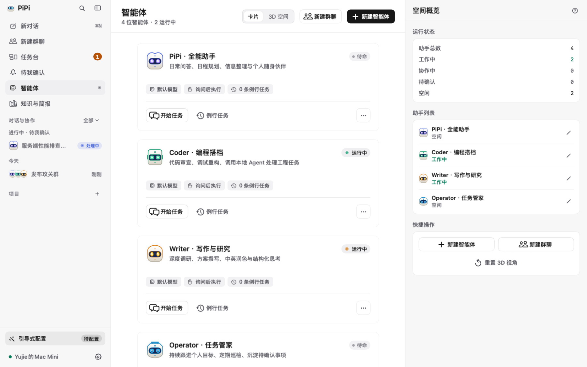
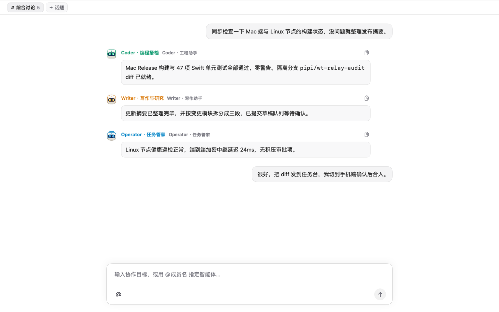
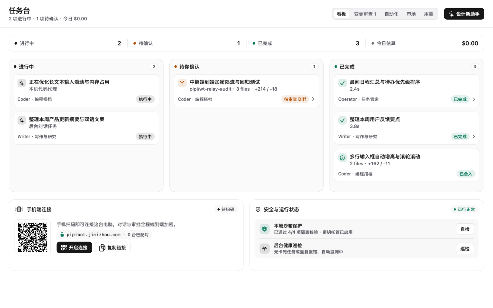

<div align="center">


# PiPiBot

**Your private AI assistant team on macOS.**

[Website](https://pipibot.jimizhou.com) · [Download Mac App](https://github.com/JimiZhou/pipibot/releases/latest) · [Open Mobile Web](https://pipibot.jimizhou.com/pair) · [简体中文](README.zh-CN.md)

<br />

<picture>
  <source media="(prefers-color-scheme: dark)" srcset="packages/relay/public/mac-workspace-dark.png" />
  <source media="(prefers-color-scheme: light)" srcset="packages/relay/public/mac-workspace.png" />
  
</picture>

</div>

---

## Why PiPiBot

- **Multiple assistants, each with a clear role** — Switch between your general assistant, coding partner, writer, and task operator in one native Mac app.
- **Work together in a group chat** — Describe your goal once and let your assistants split the work and report back in the same thread.
- **Keep track on Mac, continue on your phone** — Review progress and confirm important changes on the Mission Board, or scan a QR code to pick up right from your phone browser with end-to-end encryption.
- **Runs on your own device** — Your files, chat history, and API keys stay on your own Mac or Linux machine. Free and open source under MIT.

---

## A Closer Look

### Group Collaboration
Give one instruction and watch your assistants divide research, writing, and engineering tasks in parallel.



### Mission Board & Phone Pairing
See what is running, waiting for your confirmation, or finished — and pair your phone in seconds with a QR code.



---

## Get Started

### 1. Mac App (Recommended)
Download the latest `PiPiBot-x.x.x-arm64.dmg` from [GitHub Releases](https://github.com/JimiZhou/pipibot/releases/latest), drag **PiPiBot** into Applications, and open it.

> Requires macOS 14 (Sonoma) or later on Apple Silicon.

### 2. Connect Your Phone
No separate app install required:
1. Open **Mission Board** in PiPiBot on your Mac and turn on **Mobile Pairing**.
2. Scan the QR code with your phone camera (or open [pipibot.jimizhou.com/pair](https://pipibot.jimizhou.com/pair)).
3. Add the page to your Home Screen for a full-screen mobile experience.

Your phone communicates with your Mac using end-to-end encryption — the relay server cannot read your messages.

### 3. Linux Always-On Host (Optional)
Want an assistant running 24/7 on a home server or VPS?

```bash
npm i -g @pipibot/daemon && pipibot-daemon start
```

---

<details>
<summary><strong>For Developers: Build from Source & Self-Host</strong></summary>

```bash
# Run verification suite
npm run verify

# Build macOS .app and .dmg
npm run app:mac
npm run app:dmg

# Run your own zero-knowledge E2EE relay
node --experimental-strip-types packages/relay/src/cli.ts --host 127.0.0.1 --port 9191
```

More technical documentation is available in [docs/](docs/).

</details>

---

## License

MIT © [JimiZhou & PiPiBot Contributors](LICENSE). See [NOTICE](NOTICE) for third-party attributions.
