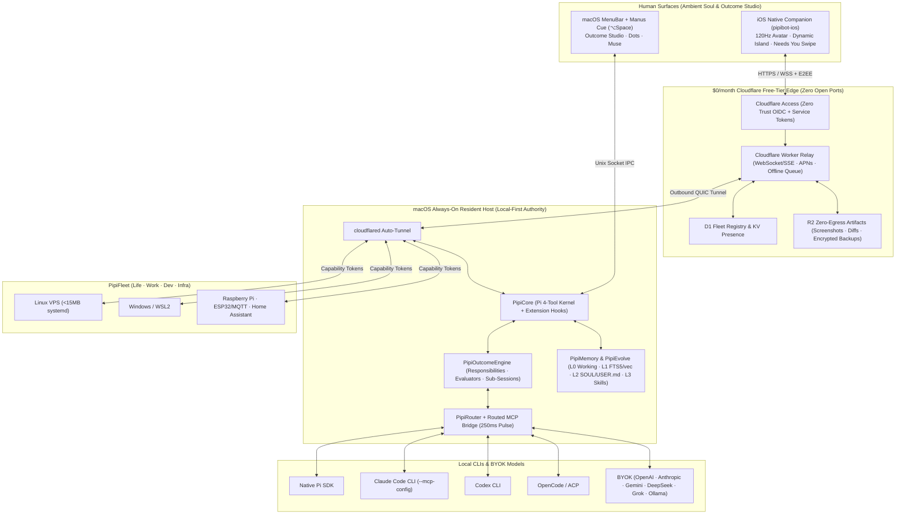

<div align="center">

# PipiBot

**From Tasks to Outcomes. From Chatbots to a Living Cross-Device AI Manager.**

[](docs/roadmap/02-PROGRESS-TRACKER.md)
[](LICENSE)
[](docs/architecture/03-CLOUDFLARE-AND-FLEET-INFRA.md)
[](design-system/index.html)
[](docs/architecture/02-SYSTEM-ARCHITECTURE-AND-HARNESS.md)

**English** · [简体中文](README.zh-CN.md)

</div>

---

## Vision: One Human + Living Bot Fleet

Modern AI coding tools still force you to act as a **micromanaging IC** — babysitting terminals, copy-pasting errors across tools, re-buying duplicate API subscriptions, and chatting with forgetful boxes that vanish the moment you close your laptop.

**PipiBot** flips the paradigm from **single-prompt tasks** to **continuous outcome ownership**:

- You act as the **AI Manager** — defining ongoing *Responsibilities* across **Daily Life, Work, Software Engineering, and Multi-Node Infrastructure**.
- Your **macOS Resident Host** runs 24/7 as the private single source of truth, dispatching work across your already-authenticated local CLIs (`claude-code`, `codex`, `opencode`), embedded **Pi Core**, or **BYOK** models.
- A **120Hz living procedural character** breathes on your Mac MenuBar, whispers contextual 1-click actions via **Manus Cue (`⌥Space`)**, tracks fleet health through **Dots**, collaborates spatially on **Muse**, and pings your **iPhone Dynamic Island** only when a high-signal **"Needs You"** decision needs a quick swipe.
- Every night, **PipiEvolve** consolidates what happened into a 4-tier cognitive memory graph and synthesizes reusable Pi skills — so **the longer you use PipiBot, the better it understands you**, all connected over a **$0/month Cloudflare Free-Tier** zero-trust tunnel.

---

## System Architecture



---

## Six Core Pillars

| Pillar | Architectural Synthesis | Where to Dive Deep |
| :--- | :--- | :--- |
| **1. Pi Core + Multi-Harness BYOK Router** | Embeds `@mariozechner/pi-coding-agent` (`read`, `write`, `edit`, `bash` + 25+ hooks) alongside a **Routed MCP Bridge** that reuses your existing local authenticated `claude`, `codex`, and `opencode` CLIs plus `pi-ai` BYOK endpoints — zero duplicate API bills. | [`02-SYSTEM-ARCHITECTURE-AND-HARNESS.md`](docs/architecture/02-SYSTEM-ARCHITECTURE-AND-HARNESS.md) · [`harness-router.ts`](packages/core/src/harness-router.ts) |
| **2. 120Hz Procedural Avatar + OpenPencil 5-Rule UX** | Zero-dependency GrokBot-style SVG/SwiftUI engine (**192-ray** polar morphing, **6-track** cubic-Bézier clips, **120Hz** Euler springs, **Rodrigues 3D** sphere eye tracking, **53 states / 9 expressions**), fused with **Manus Cue (`⌥Space`)**, **Dots**, **Muse**, **Stageshow** craft, and audited via `pipibot.pen` + 6 Named Blocks. | [`01-UIUX-DESIGN-SYSTEM.md`](docs/design-system/01-UIUX-DESIGN-SYSTEM.md) · [`design-system.md`](design-system/design-system.md) |
| **3. Devin-Style Outcome Ownership & "Needs You"** | Replaces one-shot chat prompts with **Responsibility Specs** (Goal + Constraints + Success Metrics), Cron/Webhook/FS triggers, autonomous Evaluators, parallel child sub-sessions, and a single **"Needs You"** swipe inbox backed by before/after evidence. | [`01-PRODUCT-VISION-AND-RESEARCH.md`](docs/architecture/01-PRODUCT-VISION-AND-RESEARCH.md) · [`protocol/src/index.ts`](packages/protocol/src/index.ts) |
| **4. 4-Tier Cognitive Memory & Nightly Self-Evolution** | **L0** sensory context -> **L1** local SQLite FTS5 + `sqlite-vec` episodes -> **L2** human-readable `SOUL.md` / `USER.md` / `MEMORY.md` with temporal superseding -> **L3** auto-synthesized `skills/*.md`. Audits changes daily via transparent **Evolution Diff** cards. | [`04-MEMORY-AND-SELF-EVOLUTION.md`](docs/architecture/04-MEMORY-AND-SELF-EVOLUTION.md) · [`memory-engine.ts`](packages/core/src/memory-engine.ts) |
| **5. Mac Always-On + iOS over $0 Cloudflare Free Tier** | macOS `launchd` resident executes locally; `cloudflared` outbound tunnel, **Workers**, **D1**, **KV**, **R2** (0 egress for screenshots/videos/encrypted backups), and **Cloudflare Access** connect your iPhone everywhere at **$0/month**. | [`03-CLOUDFLARE-AND-FLEET-INFRA.md`](docs/architecture/03-CLOUDFLARE-AND-FLEET-INFRA.md) · [`worker.ts`](packages/cloudflare-edge/src/worker.ts) |
| **6. Unified `PipiFleet` Across Life, Work, Dev & IoT** | Capability-scoped fleet orchestration spanning **macOS**, **iOS**, **Linux VPS** (`<15MB` RAM), **Windows/WSL2**, and **Embedded/IoT** (Raspberry Pi, ESP32/MQTT, Home Assistant) — unifying code shipping, server healing, and home life. | [`03-CLOUDFLARE-AND-FLEET-INFRA.md`](docs/architecture/03-CLOUDFLARE-AND-FLEET-INFRA.md) · [`01-DEVELOPMENT-PLAN.md`](docs/roadmap/01-DEVELOPMENT-PLAN.md) |

---

## Quickstart: All-in-One Native `PipiBot.app`, Dual-Mode iOS (`PipiBotIOS.app` + PWA) & Headless Daemon

> **Release Status (`v0.2.0-beta`)**: Ships the **All-in-One Native macOS App (`dist/PipiBot.app`)**, **Dual-Mode iOS Delivery** (Native iOS System App `dist/PipiBotIOS.app` with Action Button / Siri `AppIntents`, Lock-Screen Steer notifications, Dynamic Island snapshot, `pipibot://` deep-links & CoreHaptics + Zero-Install PWA `apps/ios-web`), headless `@pipibot/daemon`, OpenPencil `pipibot.pen` + 5-rule design audit, and Stageshow craft (`.agents/skills/stageshow`).

### 1. Build & Launch the All-in-One Native macOS App (`PipiBot.app`)

One native app bundle handles everything on macOS — MenuBar living avatar, `⌥Space` Manus Cue floating pill, 8-module Outcome Studio, live harness/hardware/frontmost-app probing, Keep-Awake, local persistence (`~/Library/Application Support/PipiBot/resident-state.json`), and automatic embedded HTTP/SSE bridge supervision for iOS:

```bash
git clone https://github.com/JimiZhou/pipibot.git
cd pipibot

# Build self-contained dist/PipiBot.app (Swift 6 Release + ad-hoc codesign)
npm run app:mac

# Launch PipiBot.app directly (no manual terminal daemon needed!)
open dist/PipiBot.app
```

See the full walkthrough in [`06-MAC-NATIVE-APP-GUIDE.md`](docs/architecture/06-MAC-NATIVE-APP-GUIDE.md).

### 2. Dual-Mode iOS: Native System App (`PipiBotIOS.app`) & Zero-Install PWA (`/ios`)

Choose either the **Native iOS System App** (`AppIntents`, Lock-Screen `UNTextInput` Steer, Dynamic Island snapshot, `pipibot://` deep-links) or the **Zero-Install iOS PWA** (`apps/ios-web`):

```bash
# Mode A: Build Native iOS System App bundle (dist/PipiBotIOS.app for iOS 17+ Simulator)
npm run app:ios

# Mode B: Or start standalone headless @pipibot/daemon for PWA / Linux VPS / CLI debugging
npm run start:daemon
```

Once running (either standalone or auto-supervised by `PipiBot.app`), open **`http://127.0.0.1:4242/ios`** in Safari on iPhone/Desktop (or via your Cloudflare Tunnel URL) and optionally tap **Add to Home Screen** for the zero-install PWA. See [`07-IOS-APP-AND-PWA-GUIDE.md`](docs/architecture/07-IOS-APP-AND-PWA-GUIDE.md) for Simulator launch & deep-link testing commands.

- **Design System & Avatar Workbench**: **`http://127.0.0.1:4242/design-system/`** (or static zero-build preview via `npm run preview:design` -> `http://127.0.0.1:8080/design-system/`).

### 3. Swift 6 Tests, OpenPencil 5-Rule Audit & Full Verification Suite

```bash
# Compile PipiBotKit, PipiBotIOSUI, PipiBotMacApp and run PipiBotKitTests (macOS 14+ / Swift 6.0)
npm run build:apple && npm run test:apple

# Audit OpenPencil pipibot.pen, design-system.md, apps/ios-web/styles.css & SwiftUI views
npm run audit:design

# Run full repo verification (avatar + iOS PWA syntax + design audit + workspace checks + daemon tests)
npm run verify
```

---

## Repository Structure

```text
pipibot/
├── README.md                                  # English flagship overview (you are here)
├── README.zh-CN.md                            # 简体中文旗舰文档
├── CONTRIBUTING.md                            # Contributor guide & engineering standards
├── LICENSE                                    # MIT License (Copyright 2026 JimiZhou & Contributors)
├── package.json                               # Root npm workspace manifest (v0.2.0-beta)
├── tsconfig.base.json                         # Shared strict TypeScript configuration
├── .gitignore                                 # Ignores node_modules, dist, .wrangler, *.sqlite, .env*
├── .agents/
│   └── skills/stageshow/                      # Stageshow visual craft skill (device-pair, dynamic-island)
├── scripts/
│   ├── audit-design-system.mjs                # Automated OpenPencil 5-rule & zero-raw-hex audit
│   ├── build-mac-app.sh                       # Builds & signs All-in-One dist/PipiBot.app bundle
│   └── build-ios-app.sh                       # Builds & packages Native dist/PipiBotIOS.app (iOS Simulator)
├── design-system/
│   ├── design-system.md                       # Persistent AI design memory (Rule + Reason + Date)
│   ├── pipibot.pen                            # OpenPencil JSON (3-tier tokens, 6 blocks, 12 screens)
│   ├── tokens.dtcg.json                       # W3C DTCG token export
│   ├── tokens.css                             # Obsidian Dark / Warm Vellum Light CSS tokens
│   ├── pipibot-avatar.js                      # Zero-dep 192-ray 120Hz procedural SVG engine
│   └── index.html                             # Interactive UX workbench & Mac/iOS simulator
├── apps/
│   ├── apple/                                 # Swift 6 Package (macOS 14+ & iOS 17+)
│   │   ├── Package.swift                      # PipiBotKit, PipiBotIOSUI, PipiBotIOSApp, PipiBotMacApp, PipiBotKitTests
│   │   ├── Sources/PipiBotKit/                # ProtocolModels, DesignTokens, CanonicalBlocks, Avatar, PipiNativeMacRuntime, Client
│   │   ├── Sources/PipiBotIOSUI/              # iOS Root, PipiIOSSystemIntegration (AppIntents/Notifications/DeepLink/Widget), SwipeDeck, Muse, Dots
│   │   ├── Sources/PipiBotIOSApp/             # Native iOS System App (@main PipiBotIOSApp -> dist/PipiBotIOS.app)
│   │   ├── Sources/PipiBotMacApp/             # All-in-One PipiBot.app (MenuBarExtra, ManusCueFloatingPanel, 8-Module Studio)
│   │   └── Tests/PipiBotKitTests/             # Swift 6 procedural avatar, protocol, Mac runtime & iOS integration tests
│   └── ios-web/                               # Zero-Install iOS Companion PWA (served at /ios by daemon)
│       ├── index.html
│       ├── styles.css                         # 100% bound to design-system/tokens.css (0 raw hex)
│       ├── app.js                             # Live /api/v1/* + 250ms SSE client with offline demo fallback
│       └── manifest.json                      # PWA manifest
├── docs/
│   ├── architecture/
│   │   ├── 01-PRODUCT-VISION-AND-RESEARCH.md  # Comparative research & unified vision
│   │   ├── 02-SYSTEM-ARCHITECTURE-AND-HARNESS.md # Pi core, multi-harness router & outcome engine
│   │   ├── 03-CLOUDFLARE-AND-FLEET-INFRA.md   # $0/mo Cloudflare stack & PipiFleet topology
│   │   ├── 04-MEMORY-AND-SELF-EVOLUTION.md    # 4-tier cognitive memory & nightly skill synthesis
│   │   ├── 05-MAC-AND-IOS-V1-IMPLEMENTATION.md # V1 Mac/iOS stack, Swift 6, PWA & OpenPencil spec
│   │   ├── 06-MAC-NATIVE-APP-GUIDE.md         # All-in-One PipiBot.app architecture, 8 modules & build guide
│   │   └── 07-IOS-APP-AND-PWA-GUIDE.md        # Dual-Mode iOS delivery: Native PipiBotIOS.app & Zero-Install PWA
│   ├── design-system/
│   │   └── 01-UIUX-DESIGN-SYSTEM.md           # Ambient Soul & Outcome Studio design specification
│   └── roadmap/
│       ├── 01-DEVELOPMENT-PLAN.md             # Phase 0-5 WBS, test suites, SLAs & risk matrix
│       └── 02-PROGRESS-TRACKER.md             # Live progress dashboard, ADR-001~009 & changelog
└── packages/
    ├── protocol/
    │   ├── package.json                       # @pipibot/protocol package manifest
    │   └── src/index.ts                       # Shared zero-dep types & relay contracts
    ├── core/
    │   ├── package.json                       # @pipibot/core package manifest
    │   ├── src/harness-router.ts              # PipiHarnessRouter & RoutedMcpBridge
    │   └── src/memory-engine.ts               # 4-tier PipiMemoryEngine & PipiEvolutionLoop
    ├── daemon/
    │   ├── package.json                       # @pipibot/daemon V1 resident host manifest
    │   ├── src/outcome-engine.ts              # PipiOutcomeEngine (2-stage evaluator + NeedsYou)
    │   ├── src/cue-fleet-sensor.ts            # PipiCueSensor & PipiFleetManager telemetry
    │   ├── src/server.ts                      # REST /api/v1/* + 250ms SSE + static /design-system & /ios
    │   ├── src/cli.ts                         # Daemon CLI entrypoint
    │   └── test/daemon.test.ts                # Full REST/SSE/static integration test suite
    └── cloudflare-edge/
        ├── wrangler.toml                      # Cloudflare Workers / D1 / R2 / KV bindings
        ├── schema.sql                         # D1 fleet registry & offline queue schema
        └── src/worker.ts                      # Zero-trust WebSocket/SSE relay & APNs bridge
```

---

## Documentation Index

| Document | Focus & Contents | Language |
| :--- | :--- | :--- |
| [01-PRODUCT-VISION-AND-RESEARCH.md](docs/architecture/01-PRODUCT-VISION-AND-RESEARCH.md) | Deep teardown of Devin Bots, GrokBot 0.18, GrokBot Animation Anatomy, Pi Harness & Manus Cue/Dots/Muse; unified "One Human + Bot Fleet" journeys | 中文 + EN Terms |
| [02-SYSTEM-ARCHITECTURE-AND-HARNESS.md](docs/architecture/02-SYSTEM-ARCHITECTURE-AND-HARNESS.md) | `PipiCore` (Pi SDK), `PipiRouter` (`pi`, `claude-code`, `codex`, `opencode`, `byok`), Routed MCP Bridge, Client-Side Tool Relay & `PipiOutcomeEngine` | 中文 + EN Terms |
| [03-CLOUDFLARE-AND-FLEET-INFRA.md](docs/architecture/03-CLOUDFLARE-AND-FLEET-INFRA.md) | Mac Resident + iOS Companion, $0/mo Cloudflare Free-Tier stack (`cloudflared`, Workers, D1, R2, KV, Access), quota budget & `PipiFleet` nodes | 中文 + EN Terms |
| [04-MEMORY-AND-SELF-EVOLUTION.md](docs/architecture/04-MEMORY-AND-SELF-EVOLUTION.md) | 4-Tier Memory (`L0–L3`), SQLite FTS5 + `sqlite-vec`, salience scoring, temporal superseding, Nightly Dreaming & `SOUL.md`/`USER.md`/Pi Skill synthesis | 中文 + EN Terms |
| [05-MAC-AND-IOS-V1-IMPLEMENTATION.md](docs/architecture/05-MAC-AND-IOS-V1-IMPLEMENTATION.md) | V1 implementation spec: OpenPencil 5-Rule Governance, Stageshow craft, `@pipibot/daemon` REST/SSE, Swift 6 `apps/apple` & Live PWA `apps/ios-web` | 中文 + EN Terms |
| [06-MAC-NATIVE-APP-GUIDE.md](docs/architecture/06-MAC-NATIVE-APP-GUIDE.md) | All-in-One `PipiBot.app` guide: `PipiNativeMacRuntime`, `PipiEmbeddedBridgeSupervisor`, 3 desktop surfaces, 8 modules & `npm run app:mac` packaging | 中文 + EN Terms |
| [07-IOS-APP-AND-PWA-GUIDE.md](docs/architecture/07-IOS-APP-AND-PWA-GUIDE.md) | Dual-Mode iOS guide: Native `PipiBotIOS.app` (`AppIntents`, Lock-Screen Steer, Dynamic Island, `pipibot://`) + Zero-Install PWA & `npm run app:ios` | 中文 + EN Terms |
| [01-UIUX-DESIGN-SYSTEM.md](docs/design-system/01-UIUX-DESIGN-SYSTEM.md) | "Ambient Soul & Outcome Studio" tokens, `PipiAvatar` 192-ray / Rodrigues 3D / 53-state spec, OpenPencil 5-Rule & Stageshow specs | 中文 + EN Terms |
| [design-system.md](design-system/design-system.md) | Persistent AI design memory recording 3-tier token, geometry, 6 Canonical Named Blocks & Stageshow rules (Rule + Reason + Date) | English |
| [01-DEVELOPMENT-PLAN.md](docs/roadmap/01-DEVELOPMENT-PLAN.md) | Phase 0–5 engineering WBS, verification test suites, non-functional targets (`<15MB` node RAM, `120fps <1% CPU`, `$0/mo`), risk mitigation matrix | 中文 + EN Terms |
| [02-PROGRESS-TRACKER.md](docs/roadmap/02-PROGRESS-TRACKER.md) | Live milestone completion tracker, **ADR-001 through ADR-009**, and `v0.1.0-alpha` / `v0.2.0-beta` changelog | 中文 + EN Terms |
| [CONTRIBUTING.md](CONTRIBUTING.md) | Monorepo workflows, harness/avatar/fleet contribution rules & PR checklist | English |

---

## Engineering Roadmap Snapshot

- **Phase 0 (`v0.1.0-alpha`) — 100% Verified**: Architecture blueprints, UI/UX design system, interactive 120Hz SVG workbench, protocol/core/edge scaffolds, roadmap & ADRs.
- **Phase 1 (Weeks 1–2) — ~75% (`v0.2.0-beta`)**: `@pipibot/daemon` HTTP REST + 250ms SSE + `PipiOutcomeEngine` + `PipiCueSensor` + `launchd` plist shipped; native SQLite FTS5/`sqlite-vec` persistence & live CLI subprocess plumbing next.
- **Phase 2 (Week 3) — ~20%**: Cloudflare Worker/D1/R2 edge templates ready; `cloudflared` sleep/wake tunnel wiring & live APNs next.
- **Phase 3 (Weeks 4–5) — ~80% (`v0.2.0-beta`)**: OpenPencil `.pen` + 5-rule design audit + Stageshow, Swift 6 `apps/apple` (`PipiBotKit`, `PipiBotIOSUI`, `PipiBotMacApp`) & Live iOS PWA (`apps/ios-web`) shipped; Xcode hardware ActivityKit signing next.
- **Phase 4 (Week 6) — ~30%**: Two-stage Evaluator & Nightly Dreaming diff APIs live in daemon; disk skill synthesis & cron watchers next.
- **Phase 5 (Weeks 7–8)**: Multi-node `PipiFleet` expansion to Linux VPS (`<15MB`), Windows/WSL2, and Embedded/IoT (Raspberry Pi, ESP32/MQTT, Home Assistant).

See the full breakdown in [01-DEVELOPMENT-PLAN.md](docs/roadmap/01-DEVELOPMENT-PLAN.md) and live status in [02-PROGRESS-TRACKER.md](docs/roadmap/02-PROGRESS-TRACKER.md).

---

## Contributing & Acknowledgements

Contributions are warmly welcomed — please review [CONTRIBUTING.md](CONTRIBUTING.md) before opening a PR.

PipiBot stands on the shoulders of groundbreaking ideas and open-source craft:
- **Devin Bots** (*"From Tasks to Outcomes"*) for pioneering the AI Manager & Responsibility model.
- **Pi Coding Agent (`@mariozechner/pi-coding-agent` / `pi-ai`)** for proving how powerful a minimalist 4-tool extensible harness can be.
- **GrokBot Animation Anatomy** & **Grok Bot 0.18 Reconstructed** for procedural SVG character physics and Routed MCP multi-CLI bridging.
- **Manus Cue**, **Dots**, and **Muse** for inspiring ambient context whispers, fleet vitality micro-dots, and spatial voice-first human collaboration.

Released under the [MIT License](LICENSE) — Copyright © 2026 JimiZhou & PipiBot Contributors.
