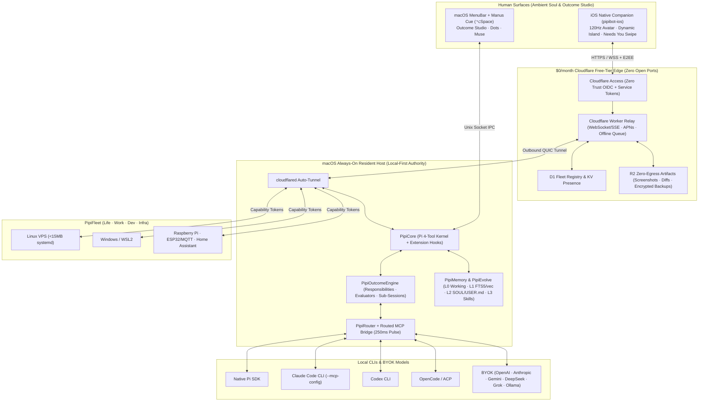

<div align="center">

# PipiBot

**From Tasks to Outcomes. From Chatbots to a Living Cross-Device AI Manager.**

[](docs/roadmap/02-PROGRESS-TRACKER.md)
[](LICENSE)
[](docs/architecture/03-CLOUDFLARE-AND-FLEET-INFRA.md)
[](design-system/index.html)
[](docs/architecture/02-SYSTEM-ARCHITECTURE-AND-HARNESS.md)

**English** · [简体中文](README.zh-CN.md)

</div>

---

## Vision: One Human + Living Bot Fleet

Modern AI coding tools still force you to act as a **micromanaging IC** — babysitting terminals, copy-pasting errors across tools, re-buying duplicate API subscriptions, and chatting with forgetful boxes that vanish the moment you close your laptop.

**PipiBot** flips the paradigm from **single-prompt tasks** to **continuous outcome ownership**:

- You act as the **AI Manager** — defining ongoing *Responsibilities* across **Daily Life, Work, Software Engineering, and Multi-Node Infrastructure**.
- Your **macOS Resident Host** runs 24/7 as the private single source of truth, dispatching work across your already-authenticated local CLIs (`claude-code`, `codex`, `opencode`), embedded **Pi Core**, or **BYOK** models.
- A **120Hz living procedural character** breathes on your Mac MenuBar, whispers contextual 1-click actions via **Manus Cue (`⌥Space`)**, tracks fleet health through **Dots**, collaborates spatially on **Muse**, and pings your **iPhone Dynamic Island** only when a high-signal **"Needs You"** decision needs a quick swipe.
- Every night, **PipiEvolve** consolidates what happened into a 4-tier cognitive memory graph and synthesizes reusable Pi skills — so **the longer you use PipiBot, the better it understands you**, all connected over a **$0/month Cloudflare Free-Tier** zero-trust tunnel.

---

## System Architecture



---

## Six Core Pillars

| Pillar | Architectural Synthesis | Where to Dive Deep |
| :--- | :--- | :--- |
| **1. Pi Core + Multi-Harness BYOK Router** | Embeds `@mariozechner/pi-coding-agent` (`read`, `write`, `edit`, `bash` + 25+ hooks) alongside a **Routed MCP Bridge** that reuses your existing local authenticated `claude`, `codex`, and `opencode` CLIs plus `pi-ai` BYOK endpoints — zero duplicate API bills. | [`02-SYSTEM-ARCHITECTURE-AND-HARNESS.md`](docs/architecture/02-SYSTEM-ARCHITECTURE-AND-HARNESS.md) · [`harness-router.ts`](packages/core/src/harness-router.ts) |
| **2. 120Hz Procedural Avatar + Multi-Paradigm UX** | Zero-dependency GrokBot-style SVG engine (**192-ray** polar morphing, **6-track** cubic-Bézier clips, **120Hz** Euler springs, **Rodrigues 3D** sphere eye tracking, `0.26s` blinks, **53 states / 9 expressions**), fused with **Manus Cue (`⌥Space`)**, **Dots** vitality matrix, and **Muse** spatial canvas. | [`01-UIUX-DESIGN-SYSTEM.md`](docs/design-system/01-UIUX-DESIGN-SYSTEM.md) · [`pipibot-avatar.js`](design-system/pipibot-avatar.js) |
| **3. Devin-Style Outcome Ownership & "Needs You"** | Replaces one-shot chat prompts with **Responsibility Specs** (Goal + Constraints + Success Metrics), Cron/Webhook/FS triggers, autonomous Evaluators, parallel child sub-sessions, and a single **"Needs You"** swipe inbox backed by before/after evidence. | [`01-PRODUCT-VISION-AND-RESEARCH.md`](docs/architecture/01-PRODUCT-VISION-AND-RESEARCH.md) · [`protocol/src/index.ts`](packages/protocol/src/index.ts) |
| **4. 4-Tier Cognitive Memory & Nightly Self-Evolution** | **L0** sensory context -> **L1** local SQLite FTS5 + `sqlite-vec` episodes -> **L2** human-readable `SOUL.md` / `USER.md` / `MEMORY.md` with temporal superseding -> **L3** auto-synthesized `skills/*.md`. Audits changes daily via transparent **Evolution Diff** cards. | [`04-MEMORY-AND-SELF-EVOLUTION.md`](docs/architecture/04-MEMORY-AND-SELF-EVOLUTION.md) · [`memory-engine.ts`](packages/core/src/memory-engine.ts) |
| **5. Mac Always-On + iOS over $0 Cloudflare Free Tier** | macOS `launchd` resident executes locally; `cloudflared` outbound tunnel, **Workers**, **D1**, **KV**, **R2** (0 egress for screenshots/videos/encrypted backups), and **Cloudflare Access** connect your iPhone everywhere at **$0/month**. | [`03-CLOUDFLARE-AND-FLEET-INFRA.md`](docs/architecture/03-CLOUDFLARE-AND-FLEET-INFRA.md) · [`worker.ts`](packages/cloudflare-edge/src/worker.ts) |
| **6. Unified `PipiFleet` Across Life, Work, Dev & IoT** | Capability-scoped fleet orchestration spanning **macOS**, **iOS**, **Linux VPS** (`<15MB` RAM), **Windows/WSL2**, and **Embedded/IoT** (Raspberry Pi, ESP32/MQTT, Home Assistant) — unifying code shipping, server healing, and home life. | [`03-CLOUDFLARE-AND-FLEET-INFRA.md`](docs/architecture/03-CLOUDFLARE-AND-FLEET-INFRA.md) · [`01-DEVELOPMENT-PLAN.md`](docs/roadmap/01-DEVELOPMENT-PLAN.md) |

---

## Quickstart: Interactive Design System & 120Hz Avatar Workbench

> **Release Status (`v0.1.0-alpha`)**: This initial open-source release delivers the complete architecture specifications, UI/UX design system, interactive browser workbench, `@pipibot/protocol` contracts, `@pipibot/core` router/memory scaffolds, and `@pipibot/cloudflare-edge` templates. Native macOS `launchd` daemon and `pipibot-ios` SwiftUI binaries follow in [Phases 1–5](docs/roadmap/01-DEVELOPMENT-PLAN.md).

You can run the **zero-build, zero-dependency** interactive Design System & Procedural Avatar Workbench in 10 seconds using Python's built-in HTTP server:

```bash
# 1. Clone the repository
git clone https://github.com/JimiZhou/pipibot.git
cd pipibot

# 2. Verify procedural avatar engine syntax (Node >= 22)
node --check design-system/pipibot-avatar.js

# 3. Start local static server
python3 -m http.server 8080 --bind 127.0.0.1
```

Open **`http://127.0.0.1:8080/design-system/`** in your browser to explore:
- **Live 120Hz `PipiAvatar` Stage**: Move your cursor for 3D Rodrigues eye tracking, click to trigger `0.26s` blinks, morph radial shapes, switch lifecycle states, and inspect live Euler spring telemetry.
- **Obsidian Dark / Warm Vellum Light Theme Switcher** & complete **53-State Matrix Explorer**.
- **macOS Resident & Manus Cue (`⌥Space`) Simulator**: Toggle active harnesses (`Pi`, `Claude Code`, `Codex`, `OpenCode`, `BYOK`) and trigger contextual Cue whispers.
- **iOS Companion & Devin "Needs You" Simulator**: Interactive Dynamic Island, swipeable PR/VPS/Memory approval cards, Muse spatial cards, and Dots fleet vitality indicators.

---

## Repository Structure

```text
pipibot/
├── README.md                                  # English flagship overview (you are here)
├── README.zh-CN.md                            # 简体中文旗舰文档
├── CONTRIBUTING.md                            # Contributor guide & engineering standards
├── LICENSE                                    # MIT License (Copyright 2026 JimiZhou & Contributors)
├── package.json                               # Root npm workspace manifest
├── tsconfig.base.json                         # Shared strict TypeScript configuration
├── .gitignore                                 # Ignores node_modules, dist, .wrangler, *.sqlite, .env*
├── design-system/
│   ├── index.html                             # Interactive UX workbench & Mac/iOS simulator
│   ├── pipibot-avatar.js                      # Zero-dep 192-ray 120Hz procedural SVG engine
│   └── tokens.css                             # Obsidian Dark / Warm Vellum Light semantic tokens
├── docs/
│   ├── architecture/
│   │   ├── 01-PRODUCT-VISION-AND-RESEARCH.md  # Comparative research & unified vision
│   │   ├── 02-SYSTEM-ARCHITECTURE-AND-HARNESS.md # Pi core, multi-harness router & outcome engine
│   │   ├── 03-CLOUDFLARE-AND-FLEET-INFRA.md   # $0/mo Cloudflare stack & PipiFleet topology
│   │   └── 04-MEMORY-AND-SELF-EVOLUTION.md    # 4-tier cognitive memory & nightly skill synthesis
│   ├── design-system/
│   │   └── 01-UIUX-DESIGN-SYSTEM.md           # Ambient Soul & Outcome Studio design specification
│   └── roadmap/
│       ├── 01-DEVELOPMENT-PLAN.md             # Phase 0-5 WBS, test suites, SLAs & risk matrix
│       └── 02-PROGRESS-TRACKER.md             # Live progress dashboard, ADR-001~008 & changelog
└── packages/
    ├── protocol/
    │   ├── package.json                       # @pipibot/protocol package manifest
    │   └── src/index.ts                       # Shared zero-dep types & relay contracts
    ├── core/
    │   ├── package.json                       # @pipibot/core package manifest
    │   ├── src/harness-router.ts              # PipiHarnessRouter & RoutedMcpBridge
    │   └── src/memory-engine.ts               # 4-tier PipiMemoryEngine & PipiEvolutionLoop
    └── cloudflare-edge/
        ├── wrangler.toml                      # Cloudflare Workers / D1 / R2 / KV bindings
        ├── schema.sql                         # D1 fleet registry & offline queue schema
        └── src/worker.ts                      # Zero-trust WebSocket/SSE relay & APNs bridge
```

---

## Documentation Index

| Document | Focus & Contents | Language |
| :--- | :--- | :--- |
| [01-PRODUCT-VISION-AND-RESEARCH.md](docs/architecture/01-PRODUCT-VISION-AND-RESEARCH.md) | Deep teardown of Devin Bots, GrokBot 0.18, GrokBot Animation Anatomy, Pi Harness & Manus Cue/Dots/Muse; unified "One Human + Bot Fleet" journeys | 中文 + EN Terms |
| [02-SYSTEM-ARCHITECTURE-AND-HARNESS.md](docs/architecture/02-SYSTEM-ARCHITECTURE-AND-HARNESS.md) | `PipiCore` (Pi SDK), `PipiRouter` (`pi`, `claude-code`, `codex`, `opencode`, `byok`), Routed MCP Bridge, Client-Side Tool Relay & `PipiOutcomeEngine` | 中文 + EN Terms |
| [03-CLOUDFLARE-AND-FLEET-INFRA.md](docs/architecture/03-CLOUDFLARE-AND-FLEET-INFRA.md) | Mac Resident + iOS Companion, $0/mo Cloudflare Free-Tier stack (`cloudflared`, Workers, D1, R2, KV, Access), quota budget & `PipiFleet` nodes | 中文 + EN Terms |
| [04-MEMORY-AND-SELF-EVOLUTION.md](docs/architecture/04-MEMORY-AND-SELF-EVOLUTION.md) | 4-Tier Memory (`L0–L3`), SQLite FTS5 + `sqlite-vec`, salience scoring, temporal superseding, Nightly Dreaming & `SOUL.md`/`USER.md`/Pi Skill synthesis | 中文 + EN Terms |
| [01-UIUX-DESIGN-SYSTEM.md](docs/design-system/01-UIUX-DESIGN-SYSTEM.md) | "Ambient Soul & Outcome Studio" tokens, `PipiAvatar` 192-ray / Rodrigues 3D / 53-state spec, macOS Cue & iOS Dynamic Island / Needs You specs | 中文 + EN Terms |
| [01-DEVELOPMENT-PLAN.md](docs/roadmap/01-DEVELOPMENT-PLAN.md) | Phase 0–5 engineering WBS, verification test suites, non-functional targets (`<15MB` node RAM, `120fps <1% CPU`, `$0/mo`), risk mitigation matrix | 中文 + EN Terms |
| [02-PROGRESS-TRACKER.md](docs/roadmap/02-PROGRESS-TRACKER.md) | Live milestone completion tracker, **ADR-001 through ADR-008**, and `v0.1.0-alpha` changelog | 中文 + EN Terms |
| [CONTRIBUTING.md](CONTRIBUTING.md) | Monorepo workflows, harness/avatar/fleet contribution rules & PR checklist | English |

---

## Engineering Roadmap Snapshot

- **Phase 0 (`v0.1.0-alpha`) — Completed**: Architecture blueprints, UI/UX design system, interactive 120Hz SVG workbench, protocol/core/edge scaffolds, roadmap & ADRs.
- **Phase 1 (Weeks 1–2)**: macOS `launchd` Resident Daemon, embedded Pi SDK, local `claude-code`/`codex`/`opencode` + Routed MCP Bridge, SQLite FTS5 + `sqlite-vec` store.
- **Phase 2 (Week 3)**: `$0/mo` Cloudflare Free-Tier auto-tunnel (`cloudflared`), Worker relay + offline inbox, D1, R2 zero-egress artifacts, Access Zero Trust.
- **Phase 3 (Weeks 4–5)**: macOS MenuBar & Manus Cue (`⌥Space`) + `pipibot-ios` SwiftUI app (120Hz Metal/Canvas Avatar, Dynamic Island, Needs You swipe deck, Muse canvas).
- **Phase 4 (Week 6)**: Devin-style Outcome Responsibility loops, Autonomous Evaluators & Nightly Self-Evolution / Skill Synthesis engine.
- **Phase 5 (Weeks 7–8)**: Multi-node `PipiFleet` expansion to Linux VPS (`<15MB`), Windows/WSL2, and Embedded/IoT (Raspberry Pi, ESP32/MQTT, Home Assistant).

See the full breakdown in [01-DEVELOPMENT-PLAN.md](docs/roadmap/01-DEVELOPMENT-PLAN.md) and live status in [02-PROGRESS-TRACKER.md](docs/roadmap/02-PROGRESS-TRACKER.md).

---

## Contributing & Acknowledgements

Contributions are warmly welcomed — please review [CONTRIBUTING.md](CONTRIBUTING.md) before opening a PR.

PipiBot stands on the shoulders of groundbreaking ideas and open-source craft:
- **Devin Bots** (*"From Tasks to Outcomes"*) for pioneering the AI Manager & Responsibility model.
- **Pi Coding Agent (`@mariozechner/pi-coding-agent` / `pi-ai`)** for proving how powerful a minimalist 4-tool extensible harness can be.
- **GrokBot Animation Anatomy** & **Grok Bot 0.18 Reconstructed** for procedural SVG character physics and Routed MCP multi-CLI bridging.
- **Manus Cue**, **Dots**, and **Muse** for inspiring ambient context whispers, fleet vitality micro-dots, and spatial voice-first human collaboration.

Released under the [MIT License](LICENSE) — Copyright © 2026 JimiZhou & PipiBot Contributors.
