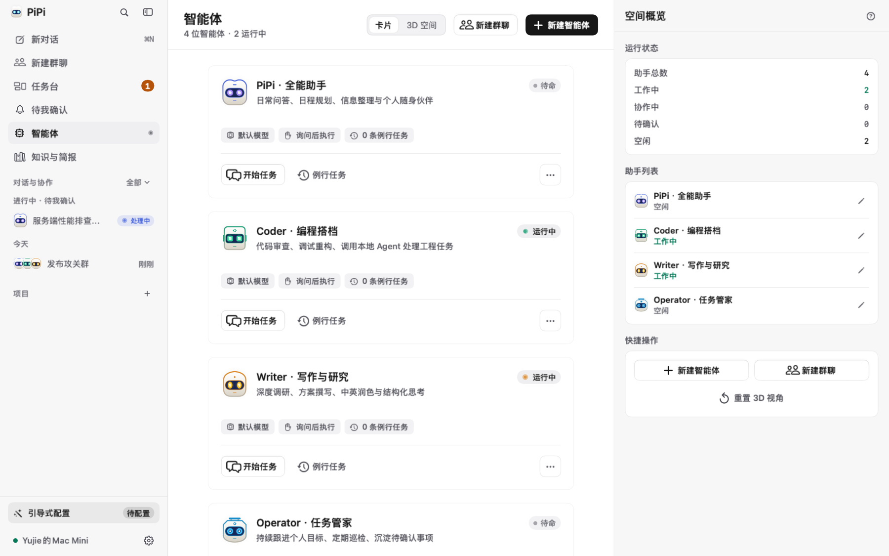
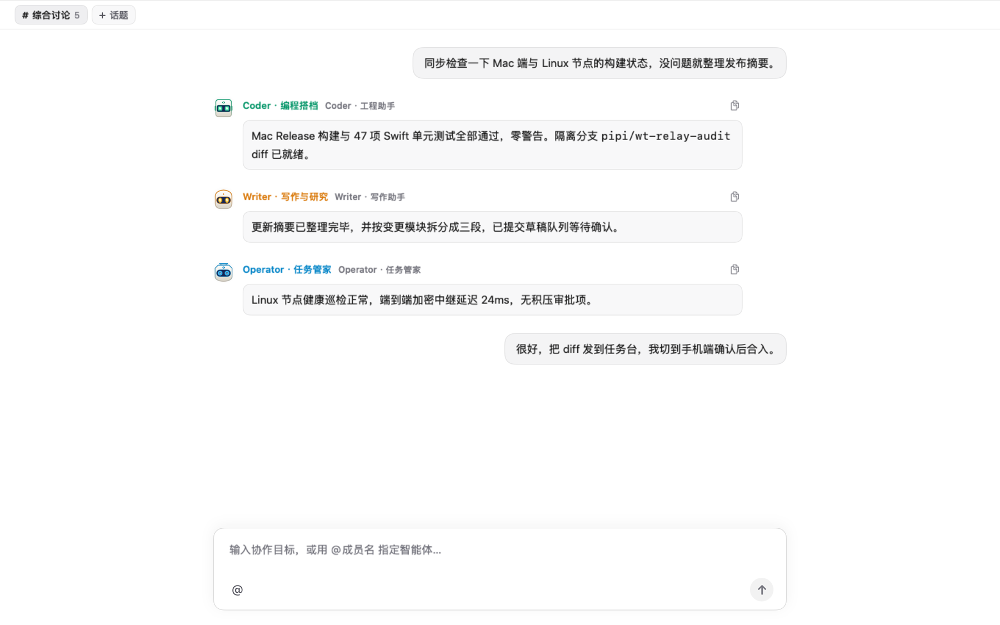
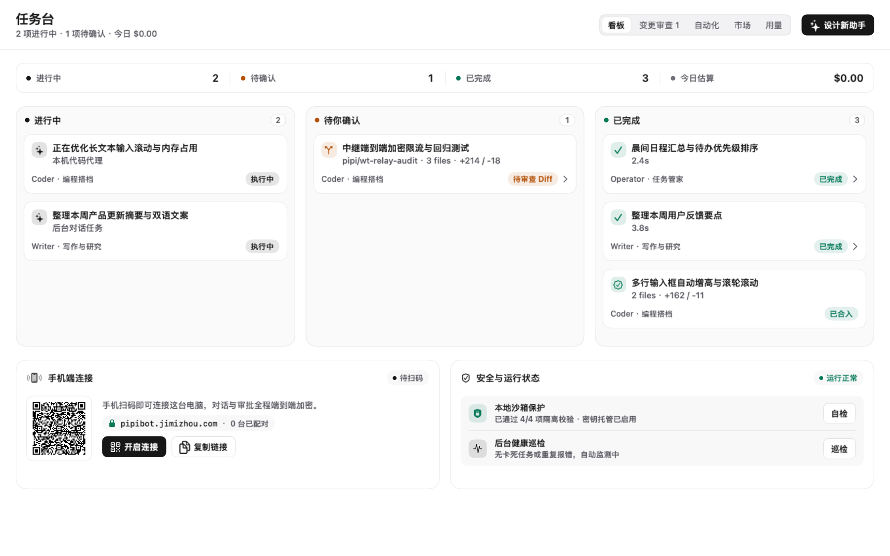

<div align="center">


# PiPiBot

**你的私人 AI 助手团队。**

[官方网站](https://pipibot.jimizhou.com) · [下载 Mac 版](https://github.com/JimiZhou/pipibot/releases/latest) · [打开手机端](https://pipibot.jimizhou.com/pair) · [English](README.md)

<br />

<picture>
  <source media="(prefers-color-scheme: dark)" srcset="packages/relay/public/mac-workspace-dark.png" />
  <source media="(prefers-color-scheme: light)" srcset="packages/relay/public/mac-workspace.png" />
  
</picture>

</div>

---

## PiPiBot 能帮你做什么

- **多位助手，各有所长** — 全能助理、编程搭档、写作助手与任务管家常驻在你的 Mac 里，点一下就开工。
- **拉个群，一起干活** — 一句话说清目标，几位助手按各自专长分工推进，在同一条时间线里汇报结果。
- **任务一目了然，手机随时接续** — 在任务台查看进度并确认重要改动；手机扫一下二维码就能加密连上电脑，不用装额外软件。
- **留在你自己的电脑里** — 对话记录、本地文件和密钥始终保存在你的设备中，完全免费开源。

---

## 界面一览

### 多助手群聊
像和同事建群一样，交代一次目标，大家同步推进并汇报结果。



### 任务台与手机扫码连接
正在做什么、哪些等你确认、哪些已完成一目了然，扫码即可在手机上安全同步。



---

## 快速开始

### 1. 下载 Mac 版（推荐）
前往 [GitHub Releases](https://github.com/JimiZhou/pipibot/releases/latest) 下载最新的 `PiPiBot-x.x.x-arm64.dmg`，拖入「应用程序」打开即可。

> 支持 Apple Silicon（M 系列芯片），macOS 14 及以上版本。

### 2. 用手机扫码连接
无需单独下载 App：
1. 在 Mac 版 PiPiBot 打开「**任务台**」，点击左下角「**开启连接**」。
2. 用手机相机扫描二维码，或访问 [pipibot.jimizhou.com/pair](https://pipibot.jimizhou.com/pair)。
3. 在手机浏览器选择「添加到主屏幕」，即可像原生应用一样全屏使用。

手机与电脑之间全程采用端到端加密，中继节点无法读取你的任何消息内容。

### 3. Linux 常驻主机（可选）
如果你有一台闲置主机或云服务器，也可以用一行命令 24 小时运行：

```bash
npm i -g @pipibot/daemon && pipibot-daemon start
```

---

<details>
<summary><strong>开发者：从源码构建与自建中继</strong></summary>

```bash
# 运行完整校验与测试
npm run verify

# 构建 macOS .app 与 .dmg 安装包
npm run app:mac
npm run app:dmg

# 自建端到端加密中继服务
node --experimental-strip-types packages/relay/src/cli.ts --host 127.0.0.1 --port 9191
```

更多架构与设计文档请参阅 [docs/](docs/)。

</details>

---

## 开源协议

MIT © [JimiZhou & PiPiBot Contributors](LICENSE)，第三方声明详见 [NOTICE](NOTICE)。
