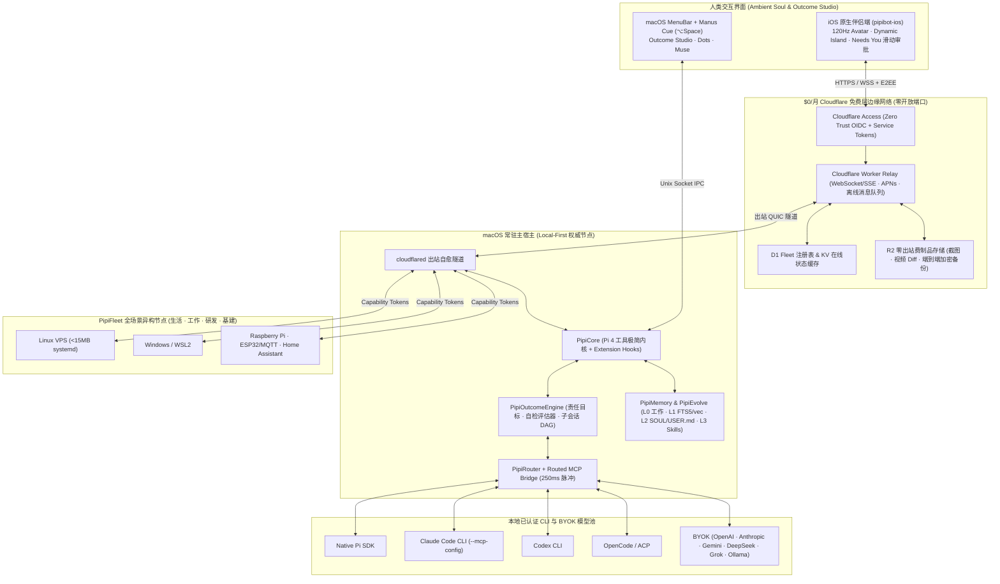

<div align="center">

# PipiBot

**从“单次任务”走向“持续结果”，从“被动聊天框”进化为“活着的跨端 AI 总管”。**

*From Tasks to Outcomes. From Chatbots to a Living Cross-Device AI Manager.*

[](docs/roadmap/02-PROGRESS-TRACKER.md)
[](LICENSE)
[](docs/architecture/03-CLOUDFLARE-AND-FLEET-INFRA.md)
[](design-system/index.html)
[](docs/architecture/02-SYSTEM-ARCHITECTURE-AND-HARNESS.md)

[English](README.md) · **简体中文**

</div>

---

## 产品愿景：一人 + 活体 Bot 舰队 (One Human + Bot Fleet)

今天的 AI 工具依然在强迫人类扮演一个“微观管理型一线执行者（IC）”——盯紧一个个终端窗口、在不同工具间来回复制报错、为同一套模型能力重复付费买 API Key，合上电脑后对话上下文便支离破碎。

**PipiBot** 将范式彻底反转为 **AI Manager（结果总管）**：

- 你负责定义跨越 **日常生活、职场办公、软件研发与多节点基础设施** 的长期 **Responsibility（责任目标与边界）**，由后台自治闭环推进交付。
- **macOS 常驻宿主 (`launchd`)** 作为 24 小时在线且 Local-First 的数据主权中心，无缝调度本地已登录的 `claude-code`、`codex`、`opencode` CLI、嵌入式 **Pi Core** 内核及 **BYOK** 模型——绝不重复购买冗余 Key。
- 一个 **120Hz 程序化活体 SVG 角色** 在你的 Mac 菜单栏呼吸；按下 **`⌥Space` 唤起 Manus Cue 悬浮胶囊**感知当前窗口一键推进下一步；用 **Dots** 极简点阵秒懂全网节点活力；在 **Muse** 自由空间画布上语音随时打断插话；出门在外仅在出现高价值阻塞时，于 **iPhone 灵动岛与 "Needs You" 收件箱** 单手右滑批阅。
- 每个夜晚，**PipiEvolve** 在后台整合四层认知记忆并自动提炼可复用的 Pi Skills——**越用越懂你**，并通过 **$0/月 Cloudflare 免费层**零开放端口隧道实现全端安全互联。

---

## 系统全景架构 (System Architecture)



---

## 六大核心技术支柱 (Six Core Pillars)

| 核心支柱 | 技术方案与核心亮点 | 深入阅读 |
| :--- | :--- | :--- |
| **1. Pi 内核 + 多 Harness BYOK 路由器** | 嵌入极简 4 工具 `@mariozechner/pi-coding-agent`（`read`/`write`/`edit`/`bash` + 25+ 钩子），并通过 **Routed MCP Bridge** 复用本地已登录的 `claude`、`codex`、`opencode` CLI 与 `pi-ai` BYOK 接口，零重复计费。 | [`02-SYSTEM-ARCHITECTURE-AND-HARNESS.md`](docs/architecture/02-SYSTEM-ARCHITECTURE-AND-HARNESS.md) · [`harness-router.ts`](packages/core/src/harness-router.ts) |
| **2. 120Hz 程序化活体头像 + 多范式 UX** | 借鉴 GrokBot 的零依赖 SVG 引擎（**192 射线**轮廓插值、**6 轨道**贝塞尔关键帧、**120Hz** Euler 弹簧、**Rodrigues 3D** 眼球追踪、`0.26s` 眨眼、**53 状态 / 9 表情**），融合 **Manus Cue (`⌥Space`)**、**Dots** 点阵与 **Muse** 空间画布。 | [`01-UIUX-DESIGN-SYSTEM.md`](docs/design-system/01-UIUX-DESIGN-SYSTEM.md) · [`pipibot-avatar.js`](design-system/pipibot-avatar.js) |
| **3. Devin 式结果负责制与 "Needs You" 收件箱** | 以 **Responsibility Spec**（目标 + 约束 + 成功指标）和 Cron/Webhook/FS 触发器取代被动聊天，内置独立 Evaluator 自检与并行子会话，仅将高信号决策附带前后对比证据送入 **"Needs You"**。 | [`01-PRODUCT-VISION-AND-RESEARCH.md`](docs/architecture/01-PRODUCT-VISION-AND-RESEARCH.md) · [`protocol/src/index.ts`](packages/protocol/src/index.ts) |
| **4. 四层认知记忆与夜间自我进化** | **L0** 瞬时上下文 -> **L1** SQLite FTS5 + `sqlite-vec` 情景日志 -> **L2** 人类可读的 `SOUL.md` / `USER.md` / `MEMORY.md`（支持时间线覆盖） -> **L3** 自动合成 Pi `skills/*.md`，每日呈现 **Evolution Diff** 透明审计。 | [`04-MEMORY-AND-SELF-EVOLUTION.md`](docs/architecture/04-MEMORY-AND-SELF-EVOLUTION.md) · [`memory-engine.ts`](packages/core/src/memory-engine.ts) |
| **5. Mac 常驻 + iOS 伴侣 × $0/月 Cloudflare 边缘** | Mac `launchd` 主机承担重执行与隐私存储；`cloudflared` 出站隧道、**Workers**、**D1**、**KV**、**R2**（零出站费传输截图/录屏/加密备份）与 **Access** 实现 **$0/月** 零公网暴露跨网互联。 | [`03-CLOUDFLARE-AND-FLEET-INFRA.md`](docs/architecture/03-CLOUDFLARE-AND-FLEET-INFRA.md) · [`worker.ts`](packages/cloudflare-edge/src/worker.ts) |
| **6. 横跨生活/工作/研发/IoT 的 `PipiFleet`** | 通过最小权限 Capability Token 统一编排 **macOS**、**iOS**、**Linux VPS** (`<15MB` 空闲内存)、**Windows/WSL2** 与 **Embedded/IoT**（树莓派、ESP32/MQTT、Home Assistant）。 | [`03-CLOUDFLARE-AND-FLEET-INFRA.md`](docs/architecture/03-CLOUDFLARE-AND-FLEET-INFRA.md) · [`01-DEVELOPMENT-PLAN.md`](docs/roadmap/01-DEVELOPMENT-PLAN.md) |

---

## 快速体验：交互式设计系统与 120Hz 程序化头像工作台

> **当前版本说明 (`v0.1.0-alpha`)**：本开源初始基线包含完整的系统架构文档、UI/UX 设计规范、可直接在浏览器运行的零依赖设计系统工作台、`@pipibot/protocol` 契约、`@pipibot/core` 路由与记忆引擎骨架及 `@pipibot/cloudflare-edge` 边缘模板。原生 macOS `launchd` 守护进程与 `pipibot-ios` SwiftUI 客户端将在 [Phase 1–5 路线图](docs/roadmap/01-DEVELOPMENT-PLAN.md) 中分阶段交付。

无需安装任何前端打包工具或第三方依赖，10 秒即可在本地运行交互式工作台：

```bash
# 1. 克隆仓库
git clone https://github.com/JimiZhou/pipibot.git
cd pipibot

# 2. 校验程序化头像引擎语法 (需 Node >= 22)
node --check design-system/pipibot-avatar.js

# 3. 启动本地静态服务
python3 -m http.server 8080 --bind 127.0.0.1
```

随后在浏览器打开 **`http://127.0.0.1:8080/design-system/`**，即可实时把玩：
- **120Hz `PipiAvatar` 交互舞台**：移动鼠标体验 Rodrigues 3D 眼球跟随、点击头像触发 `0.26s` 眨眼、动态极坐标形变并实时观测 Euler 弹簧遥测曲线。
- **Obsidian Dark / Warm Vellum Light 双主题切换** 与完整 **53 状态矩阵浏览器**。
- **macOS 宿主与 Manus Cue (`⌥Space`) 模拟器**：一键切换 `Pi` / `Claude Code` / `Codex` / `OpenCode` / `BYOK` 并体验上下文悬浮建议胶囊。
- **iOS 伴侣端与 Devin "Needs You" 模拟器**：可交互灵动岛 (Dynamic Island)、左右滑动的 PR/VPS/夜间记忆审计审批卡片、Muse 空间卡片与 Dots 节点呼吸矩阵。

---

## 仓库目录结构 (Repository Structure)

```text
pipibot/
├── README.md                                  # 英文旗舰文档
├── README.zh-CN.md                            # 简体中文旗舰文档 (当前文件)
├── CONTRIBUTING.md                            # 开源贡献指南与代码规范
├── LICENSE                                    # MIT 开源协议 (Copyright 2026 JimiZhou & Contributors)
├── package.json                               # 根 npm Monorepo 配置
├── tsconfig.base.json                         # 共享 TypeScript 严格编译配置
├── .gitignore                                 # 忽略 node_modules, dist, .wrangler, *.sqlite, .env* 等
├── design-system/
│   ├── index.html                             # 交互式 UI/UX 工作台与 Mac/iOS 模拟器
│   ├── pipibot-avatar.js                      # 零依赖 192 射线 120Hz 程序化 SVG 头像引擎
│   └── tokens.css                             # Obsidian Dark / Warm Vellum Light 设计 Token
├── docs/
│   ├── architecture/
│   │   ├── 01-PRODUCT-VISION-AND-RESEARCH.md  # 深度竞品拆解与产品愿景
│   │   ├── 02-SYSTEM-ARCHITECTURE-AND-HARNESS.md # Pi 内核、多 Harness 路由与结果引擎
│   │   ├── 03-CLOUDFLARE-AND-FLEET-INFRA.md   # $0/月 Cloudflare 架构与 PipiFleet 节点拓扑
│   │   └── 04-MEMORY-AND-SELF-EVOLUTION.md    # 四层认知记忆与夜间技能自合成引擎
│   ├── design-system/
│   │   └── 01-UIUX-DESIGN-SYSTEM.md           # Ambient Soul & Outcome Studio 完整设计规范
│   └── roadmap/
│       ├── 01-DEVELOPMENT-PLAN.md             # Phase 0-5 工程 WBS、验证测试套、SLA 与风险矩阵
│       └── 02-PROGRESS-TRACKER.md             # 实时进度看板、ADR-001~008 与变更日志
└── packages/
    ├── protocol/
    │   ├── package.json                       # @pipibot/protocol 包清单
    │   └── src/index.ts                       # 零依赖共享类型与通信契约
    ├── core/
    │   ├── package.json                       # @pipibot/core 包清单
    │   ├── src/harness-router.ts              # PipiHarnessRouter 与 RoutedMcpBridge
    │   └── src/memory-engine.ts               # 四层 PipiMemoryEngine 与 PipiEvolutionLoop
    └── cloudflare-edge/
        ├── wrangler.toml                      # Cloudflare Workers / D1 / R2 / KV 绑定配置
        ├── schema.sql                         # D1 Fleet 注册表与离线队列 SQL Schema
        └── src/worker.ts                      # Zero Trust WebSocket/SSE 中继与 APNs 桥接
```

---

## 文档索引 (Documentation Index)

| 文档路径 | 核心内容摘要 | 语言 |
| :--- | :--- | :--- |
| [01-PRODUCT-VISION-AND-RESEARCH.md](docs/architecture/01-PRODUCT-VISION-AND-RESEARCH.md) | 深度拆解 Devin Bots、GrokBot 0.18、GrokBot Animation Anatomy、Pi Harness 与 Manus Cue/Dots/Muse；统一“一人 + Bot 舰队”跨场景体验旅程 | 中文 + EN Terms |
| [02-SYSTEM-ARCHITECTURE-AND-HARNESS.md](docs/architecture/02-SYSTEM-ARCHITECTURE-AND-HARNESS.md) | `PipiCore` (Pi SDK)、`PipiRouter` (`pi`, `claude-code`, `codex`, `opencode`, `byok`)、Routed MCP Bridge、客户端工具中继与 `PipiOutcomeEngine` | 中文 + EN Terms |
| [03-CLOUDFLARE-AND-FLEET-INFRA.md](docs/architecture/03-CLOUDFLARE-AND-FLEET-INFRA.md) | Mac 常驻宿主 + iOS 伴侣端、$0/月 Cloudflare 免费层技术栈（Tunnel/Workers/D1/R2/KV/Access）、配额预算表与 `PipiFleet` 五类节点沙盒 | 中文 + EN Terms |
| [04-MEMORY-AND-SELF-EVOLUTION.md](docs/architecture/04-MEMORY-AND-SELF-EVOLUTION.md) | 四层记忆（L0–L3）、SQLite FTS5 + `sqlite-vec`、复合显著性评分公式、时间线覆盖、夜间做梦整合与 `SOUL.md`/`USER.md`/Pi Skill 自动合成 | 中文 + EN Terms |
| [01-UIUX-DESIGN-SYSTEM.md](docs/design-system/01-UIUX-DESIGN-SYSTEM.md) | "Ambient Soul & Outcome Studio" 语义 Token、`PipiAvatar` 192 射线 / Rodrigues 3D / 53 状态机规范、Mac Cue 与 iOS 灵动岛/Needs You 交互规范 | 中文 + EN Terms |
| [01-DEVELOPMENT-PLAN.md](docs/roadmap/01-DEVELOPMENT-PLAN.md) | Phase 0–5 全量 WBS、分阶段验证测试套件、非功能性硬指标（节点 `<15MB`、头像 `120fps <1% CPU`、`$0/月` 云成本）与风险缓解矩阵 | 中文 + EN Terms |
| [02-PROGRESS-TRACKER.md](docs/roadmap/02-PROGRESS-TRACKER.md) | 实时里程碑追踪看板、**ADR-001 至 ADR-008** 关键架构决策记录及 `v0.1.0-alpha` 变更日志 | 中文 + EN Terms |
| [CONTRIBUTING.md](CONTRIBUTING.md) | Monorepo 本地开发环境、新增 Harness/Avatar 状态/Fleet 节点指南与 PR 自检清单 | English |

---

## 工程路线图概览 (Roadmap Snapshot)

- **Phase 0 (`v0.1.0-alpha`) — 已完成**：深度研究与系统架构文档、UI/UX 设计系统与可交互 120Hz SVG 工作台、Protocol/Core/Edge 代码骨架、全量开发计划与 ADR 基线。
- **Phase 1 (Weeks 1–2)**：macOS `launchd` 常驻守护进程、Pi SDK 嵌入、本地 `claude-code` / `codex` / `opencode` + Routed MCP Bridge、SQLite FTS5 + `sqlite-vec` 四层记忆库。
- **Phase 2 (Week 3)**：`$0/月` Cloudflare 免费层自动隧道 (`cloudflared`)、Worker 中继与离线消息重放、D1、R2 零出站费制品及 Access Zero Trust。
- **Phase 3 (Weeks 4–5)**：macOS MenuBar 与 Manus Cue (`⌥Space`) 悬浮胶囊 + `pipibot-ios` SwiftUI 原生端（120Hz 头像、Dynamic Island 灵动岛、Needs You 滑动审批、Muse 画布）。
- **Phase 4 (Week 6)**：Devin 式 Outcome 责任闭环引擎、Autonomous Evaluators 与夜间自我进化 / Pi Skill 自动合成。
- **Phase 5 (Weeks 7–8)**：`PipiFleet` 扩展至 Linux VPS (`<15MB`)、Windows/WSL2 与 Embedded/IoT（树莓派、ESP32/MQTT、Home Assistant）。

详细拆解请查阅 [`docs/roadmap/01-DEVELOPMENT-PLAN.md`](docs/roadmap/01-DEVELOPMENT-PLAN.md)，实时追踪请查阅 [`docs/roadmap/02-PROGRESS-TRACKER.md`](docs/roadmap/02-PROGRESS-TRACKER.md)。

---

## 参与贡献与致谢 (Contributing & Acknowledgements)

欢迎通过 Issue 与 Pull Request 共建 PipiBot！提交前请先阅读 [CONTRIBUTING.md](CONTRIBUTING.md)。

PipiBot 的设计深受以下卓越理念与开源项目的启发：
- **Devin Bots**（*"From Tasks to Outcomes"*）：开创了 AI Manager 与结果负责制的核心范式。
- **Pi Coding Agent (`@mariozechner/pi-coding-agent` / `pi-ai`)**：验证了极简 4 工具可扩展内核的优雅与强大。
- **GrokBot Animation Anatomy** 与 **Grok Bot 0.18 Reconstructed**：为程序化 SVG 物理角色与 Routed MCP 多端桥接提供了宝贵灵感。
- **Manus Cue**、**Dots** 与 **Muse**：启发了无感上下文微建议、点阵节点活力指示以及空间化语音协同交互。

本项目基于 [MIT License](LICENSE) 开源 — Copyright © 2026 JimiZhou & PipiBot Contributors.
