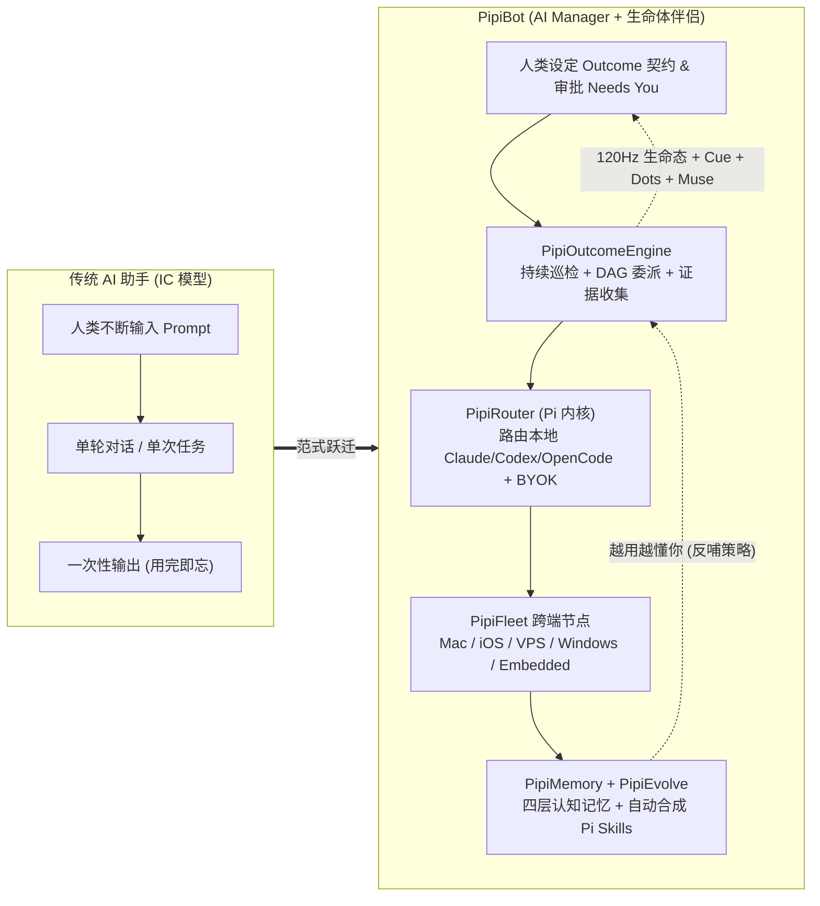
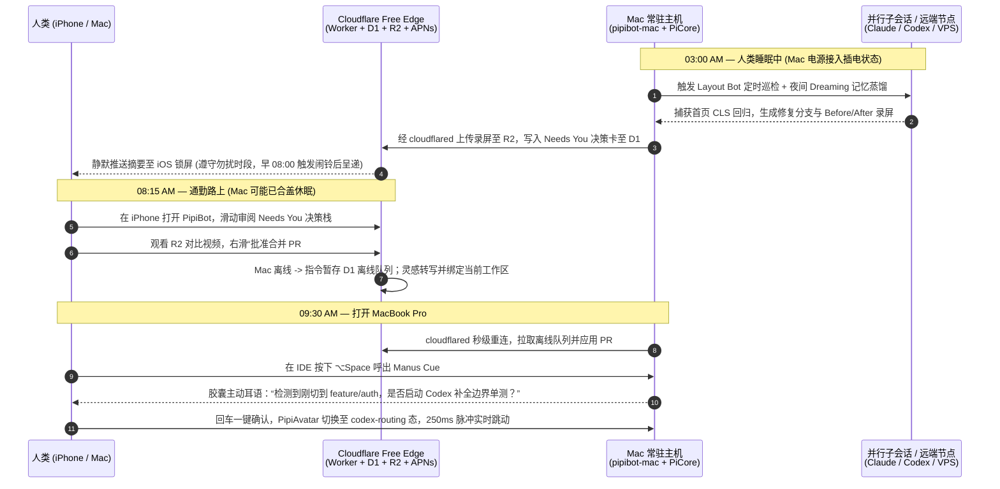

# 01 · PipiBot 产品愿景与前沿技术深度解构

> **定位宣言**：**From Tasks to Outcomes, From Chatbots to a Living Cross-Device AI Manager.**  
> 从“单轮对话工具”与“单任务执行器”，演进为**有生命力、跨终端、全栈自治、越用越懂你的个人与基础设施 AI 经理（Personal & Infrastructure AI Manager）**。

---

## 目录

- [1. 产品愿景与核心哲学](#1-产品愿景与核心哲学)
  - [1.1 为什么现有的 AI Agent 仍停留在“实习生”阶段](#11-为什么现有的-ai-agent-仍停留在实习生阶段)
  - [1.2 PipiBot 的三重范式跃迁](#12-pipibot-的三重范式跃迁)
  - [1.3 V1 务实落地的端云边界：Mac 常驻大脑 + iOS 随身伴侣 + $0 Cloudflare 边缘](#13-v1-务实落地的端云边界mac-常驻大脑--ios-随身伴侣--0-cloudflare-边缘)
- [2. 五大前沿参考源深度解构 (Comparative Teardown)](#2-五大前沿参考源深度解构-comparative-teardown)
  - [2.1 Devin Bots：从 Tasks 到 Outcomes 的 AI Manager 范式](#21-devin-bots从-tasks-到-outcomes-的-ai-manager-范式)
  - [2.2 Grok Bot 0.18 Reconstructed：分域运行时、推理路由与 MCP 反向桥接](#22-grok-bot-018-reconstructed分域运行时推理路由与-mcp-反向桥接)
  - [2.3 GrokBot Animation Anatomy：零依赖 120 Hz 程序化 SVG 生命体征引擎](#23-grokbot-animation-anatomy零依赖-120-hz-程序化-svg-生命体征引擎)
  - [2.4 Pi Harness (`pi-coding-agent` / `pi-ai`)：反框架极简内核与四工具哲学](#24-pi-harness-pi-coding-agent--pi-ai反框架极简内核与四工具哲学)
  - [2.5 交互美学三杰：Manus Cue、Dots 与 Muse](#25-交互美学三杰manus-cuedots-与-muse)
- [3. PipiBot 融合矩阵 (Synthesis Matrix)](#3-pipibot-融合矩阵-synthesis-matrix)
  - [3.1 五源合一技术融合矩阵](#31-五源合一技术融合矩阵)
  - [3.2 全域场景覆盖矩阵：Daily Life × Work × Development × Multi-Node Infra](#32-全域场景覆盖矩阵daily-life--work--development--multi-node-infra)
- [4. 核心端到端用户旅程 (User Journeys)](#4-核心端到端用户旅程-user-journeys)
  - [4.1 旅程一：“一人 + Bot 舰队”的日常 24 小时协同节律](#41-旅程一一人--bot-舰队的日常-24-小时协同节律)
  - [4.2 旅程二：生活、工作与多端基础设施的统一结果问责 (Unified Outcome Ownership)](#42-旅程二生活工作与多端基础设施的统一结果问责-unified-outcome-ownership)
  - [4.3 旅程三：从第 1 天到第 30 天——“越用越懂你”的记忆复利](#43-旅程三从第-1-天到第-30-天越用越懂你的记忆复利)
- [5. 架构文档导航](#5-架构文档导航)

---

## 1. 产品愿景与核心哲学

### 1.1 为什么现有的 AI Agent 仍停留在“实习生”阶段

当前主流 AI Coding 与个人助手产品虽然在单次上下文推理上已接近资深工程师水准，但在系统架构与交互关系上仍停留在**“被动响应式 IC（Individual Contributor）模型”**：

1. **交互成本未收敛（High Supervision Tax）**：用户必须像“微管理（Micromanage）实习生”一样不断切换窗口、拆解子任务、复制报错、人工验收结果，人类依然是状态机里的阻塞节点。
2. **上下文与身份割裂（Fragmented Harnesses & Subscriptions）**：开发者本地往往已经登录了 `Claude Code`、`OpenAI Codex`、`OpenCode`，同时又持有 OpenRouter / Gemini / DeepSeek / 本地 Ollama 算力。传统桌面端强行要求用户重复配置 API Key 或锁定单一厂商后端，造成算力与订阅资产浪费。
3. **缺乏生命感与空间在场（Cold Chatbox Syndrome）**：千篇一律的滚动气泡对话框既无法在桌面驻留时传递“正在悄悄巡检”的安全感，也无法在移动端呈现高密度、低摩擦的审批体验。
4. **“记性差”与跨端断层（Amnesia & Device Silo）**：昨天在 Mac 终端修正过的代码偏好、上个月在 VPS 处理的 Nginx 故障经验、日常生活中的饮食习惯与行程偏好，往往困在一次性对话日志里，次日清零；离开 Mac 后，手机端几乎无法感知或指挥家里/云上的机器。

### 1.2 PipiBot 的三重范式跃迁

PipiBot 通过整合全球五个最具启发性的 AI 工程与交互原型，提出**“一人 + 多端 Bot 舰队（One Human + Bot Fleet）”**架构，完成三重跃迁：



| 跃迁维度 | 传统 Agent (Task IC) | PipiBot (Outcome AI Manager) |
| :--- | :--- | :--- |
| **权责模型** | 单次指令驱动（“帮我修这个 Bug”） | **结果问责制（Outcome Ownership）**（“持续保障服务稳定性与分支 Parity”） |
| **执行内核** | 绑定单一厂商闭源沙盒与固定模型 | **Pi 极简四工具内核 + Universal Harness Router**，原生复用本地已认证 CLI 与 BYOK |
| **人机界面** | 单一线性聊天框 | **GrokBot 120Hz 程序化生命头像 + Manus Cue 环境耳语 + Dots 点阵脉冲 + Muse 空间画布** |
| **基础设施** | 昂贵的云端按量 VM 与中心化 SaaS 数据库 | **Mac 本地算力主机 + Cloudflare $0 免费边缘层（Tunnel / Access / Worker / D1 / R2 / KV）** |
| **演进能力** | 静态 Prompt 模板，每次从零开始 | **L0–L3 四层认知记忆 + 夜间 Dreaming 蒸馏 + 自动生成可审计 Pi Skills** |

### 1.3 V1 务实落地的端云边界：Mac 常驻大脑 + iOS 随身伴侣 + $0 Cloudflare 边缘

为了避免“过度设计导致难以自用”，PipiBot V1 采用极其克制的拓扑定位：

- **macOS 常驻宿主（`pipibot-mac`）作为控制与重算力中枢**：通过 `launchd` 以低于 15MB 空闲内存常驻后台，挂载本地 SQLite 认知库、调度 Pi 内核与本地 `claude`/`codex`/`opencode` CLI，并在菜单栏与 `⌥Space` 全局热键提供零延迟交互。
- **iOS 随身伴侣（`pipibot-ios`）作为移动指挥与审批终端**：通过 iOS 原生 SwiftUI 呈现 Devin 式 `"Needs You"` 滑动审批卡、灵动岛（Dynamic Island）实时生命状态、Dots 节点心跳矩阵与 Muse 语音随手记。
- **Cloudflare 100% 免费层（$0/month）作为零暴露穿透与状态中继**：使用 `cloudflared` 出站隧道彻底消灭公网 IP 与端口映射，借助 Zero Trust Access（50 席免费）保障端到端身份鉴权，并用 Workers + D1 + KV + R2 实现 Mac 休眠期间的离线指令队列、APNs 推送桥接与修复前后视频/截图零流出费（$0 Egress）托管。

---

## 2. 五大前沿参考源深度解构 (Comparative Teardown)

本节对构筑 PipiBot 技术底座的五大前沿标杆进行源码级与系统级的深度拆解，明确“吸纳什么、改造什么、超越什么”。

### 2.1 Devin Bots：从 Tasks 到 Outcomes 的 AI Manager 范式

*参考来源：[devin.ai/bots](https://devin.ai/bots) & [Introducing Devin Bots: From Tasks to Outcomes](https://devin.ai/blog/introducing-devin-bots)*

#### 1. 核心理念：从 Individual Contributor 到 AI Manager
Devin Bots 揭示了 AI 工程化的一道分水岭：此前的 Coding Agent 本质上是“按 Ticket 干活的个人贡献者”，人类必须充当产品经理兼工头，手工拆解每个任务并全程盯盘；而 **Devin Bot** 是一个持久化、自治的 **AI Manager（项目经理）**——人类只负责向 Bot 声明**期望结果（Outcome）**、约束边界与成功指标，Bot 则跨越多天乃至数周持续运行，自行拆解工作、在独立沙盒并行拉起多个子 Devin 实例（Child Sessions）、主动收集可验证证据（视频、测试报告、Diff），并在真正需要人类拍板时统一收敛到决策收件箱。

#### 2. 三个标杆真实案例的工程启示

| 案例名称 | 任务定义 (Outcome Spec) | 自治运行机制 | 量化成果与杠杆率 | 对 PipiBot 的直接映射 |
| :--- | :--- | :--- | :--- | :--- |
| **Android App Bot** | 接管 Android 客户端开发，持续保持与 iOS 主干功能的 Feature Parity | 长期驻留监听 iOS PR 与功能差异，自动拆解模块并在并行子虚拟机中编写 Kotlin 代码、跑通编译与单测 | **44 天**内人类仅发 **183 条消息**，累计合入 **1,100+ PR**（约 1,134 个 PR / 34.4 万行 Kotlin） | PipiBot 的 **Responsibility YAML** 必须支持跨仓库/跨平台差异追踪与长周期多轮子会话编排 |
| **Layout Bot** | 持续保障 Web 应用首屏与二次加载的布局稳定性与渲染流畅度 | 每 **3 小时**在 `main` 分支自动巡检，录制**首次访问与重复访问**性能/视觉轨迹，定位引发 CLS 抖动的提交 PR 并拉起子会话修复，PR 附带**修复前后对比视频** | **3 周**内合并 **159 个 PR**，应用端布局卡顿与滞后下降约 **70%** | PipiBot 的 **Cron + Telemetry Evaluator** 与 **R2 证据包机制**（自动上传修复前后录屏与指标截图到 R2，iOS 端一键验片审批） |
| **Autonomous Game Studio** | 多专业分工的独立游戏工程管线 | **1 名人类**统筹管理约 **20 个各司其职的 Bots**（渲染、物理、关卡、QA 等），7×24 协同迭代 | 从每周约 50 PR 跃升至 **1,900 合并 PR/周**（近 **38×** 吞吐量提升） | PipiBot 的 **Multi-Bot Swarm 编排能力**与“一人舰队”日/周简报汇总机制 |

#### 3. Devin Bots 的五大核心原语
1. **Responsibility Specification（职责契约）**：用结构化契约替代一次性 Prompt，包含 `Goal`（终态目标）、`Constraints`（安全护栏/预算/禁区）、`Success Metrics`（量化验收条件）。
2. **Autonomous Evaluator & Triggers（自治评估与触发器）**：支持定时 Cron（如每 3 小时）与事件 Webhook（Git Push、CI 失败、错误日志突增、日历临近），在主会话休眠时周期性判定“当前状态 vs 终态目标”的偏差。
3. **Parallel Sub-Session Delegation（并行子会话委派）**：Manager Bot 本身保持轻量决策上下文，将具体编码、调研、测试委派给彼此隔离的 Child Sessions 并行推进，防止单上下文窗口膨胀污染。
4. **Proactive Evidence & Memory Adaptation（主动证据与记忆适配）**：交付物不能只是“我修好了”的文本宣称，必须绑定可观测证据（Before/After 视频、DOM 快照、Benchmark 数值、Exit Code），并将人类纠偏沉淀为跨会话持久记忆。
5. **Unified `"Needs You"` Decision Inbox（统一“需要你”决策收件箱）**：将所有子会话的权限审批、歧义澄清、PR 合并确认与异常升级收敛到一个低噪音待办队列，彻底消除碎片化弹窗打扰。

#### 4. Devin Bots 的盲区与 PipiBot 的突破
Devin Bots 生于重型云端团队 SaaS：每个子任务启动高成本云端 VM、记忆孤立于工作流沙盒内部、无法触达用户本地 Mac/家居物联网硬件、也不覆盖日常个人生活管理。PipiBot 将 Devin 的 Outcome Ownership 引擎**本地化、轻量级化与全场景化**，运行在用户自己的 Mac 与 Cloudflare 免费边缘之上。

---

### 2.2 Grok Bot 0.18 Reconstructed：分域运行时、推理路由与 MCP 反向桥接

*参考来源：[b-nnett/grok-bot-0.18-reconstructed](https://github.com/b-nnett/grok-bot-0.18-reconstructed)*

通过对 Grok Bot 0.18.0 桌面端源码重建项目的深入研读，我们提炼出其极具实战价值的四项底层架构资产：

#### 1. 七层分域运行时边界 (Split Runtime Architecture)
```
+------------------------------------------------------------------------+
| frontend (React UI / Renderer)  <-- 250ms Activity Pulse + IPC Stream  |
+------------------------------------------------------------------------+
                                    ^
                                    | IPC / WebSocket
                                    v
+------------------------------------------------------------------------+
| electron-main (应用生命周期 / 窗口状态 / 系统 Keychain 凭证托管)          |
+------------------------------------------------------------------------+
                                    |
                                    v
+------------------------------------------------------------------------+
| host + node-agent-coordinator                                          |
|   ├── inference-router.ts      (多源推理路由: 本地 CLI + BYOK)          |
|   ├── routed-mcp-bridge.ts     (向 CLI 反向暴露宿主工具的 MCP Server)    |
|   └── Client-Side Tool Relay   (高危/端侧交互工具安全回流至宿主审批)     |
+------------------------------------------------------------------------+
              |                                     |
              v                                     v
+---------------------------+         +----------------------------------+
| local-exec-daemon         |         | box-exec-daemon                  |
| (宿主机受控本地执行守护)    |         | (容器/Worktree 隔离沙盒执行守护)   |
+---------------------------+         +----------------------------------+
```
*跨层契约统一沉淀于 `shared` 模块。*

#### 2. 四项可复用架构模式
- **`inference-router.ts`（免重复配置的多源推理路由）**：不强制用户重新申请 API Key，而是直接识别并路由至本机已登录认证的外部 CLI Harness（如 `claude-code`、`codex`）以及 BYOK 云端点（如 `openrouter`）。这使得用户已有的 Claude Pro/Max 或 ChatGPT Plus/Pro 订阅算力能够零摩擦接入统一桌面体。
- **`routed-mcp-bridge.ts`（反向 MCP 工具桥接）**：当推理被路由到外部 CLI（如 `claude` 或 `codex`）时，外部 CLI 本身并不认识宿主侧的“记忆库、生活日程、iOS 推送、头像状态或桌面屏幕上下文”。`routed-mcp-bridge` 在本地拉起一个轻量 MCP Server（stdio 或 Streamable HTTP），通过 CLI 原生支持（如 `--mcp-config`）反向注入给外部 Agent，使外部强力推理引擎瞬间获得 PipiBot 的全套私有感知与执行器官。
- **`Client-Side Tool Relay`（客户端工具中继）**：当隔离沙盒（`box-exec-daemon`）或远程推理侧触发诸如“请求 Apple Keychain 密钥”、“弹出系统确认”、“操控活跃桌面应用”等客户端专属工具时，调用不直接失败，而是经由 Relay 通道挂起并回传宿主侧安全执行，再把结果注回推理流。
- **`250ms` Activity Pulse（250 毫秒节律脉冲）**：大模型流式输出（Streaming）往往以每几毫秒一个 Token 的高频率到达；直接驱动 React/SwiftUI 重绘会拖垮 CPU。每隔 `250ms` 聚合一次当前推理阶段、活跃工具名、子会话计数并广播脉冲快照，既保证 UI 生命感极其顺滑，又将渲染开销压到极低。

#### 3. 从 Grok Bot 0.18 到 PipiBot 的工程进化
- **去 Electron 瘦身**：放弃动辄 300MB+ 内存的 Electron 主壳，底层协调器采用纯 Node.js / TypeScript 常驻后台守护进程（`pipibot-daemon`），macOS 前端使用原生 SwiftUI MenuBar + 轻量 WebView/Canvas 承接程序化 SVG 引擎。
- **路由扩展至全栈**：在 `claude-code`、`codex` 与 OpenRouter 基础上，原生内嵌 **`pi` Harness（核心引擎）**、**`opencode`（ACP + HTTP `serve` 协议）**，以及覆盖 OpenAI / Anthropic / Gemini / DeepSeek / X.AI Grok / Ollama / vLLM 的完整 `pi-ai` BYOK 矩阵。

---

### 2.3 GrokBot Animation Anatomy：零依赖 120 Hz 程序化 SVG 生命体征引擎

*参考来源：[ArvinYin1/grokbot-animation-anatomy](https://github.com/ArvinYin1/grokbot-animation-anatomy)*

#### 1. 为什么放弃 Lottie / GIF / WebGL？
| 维度 | GIF / APNG | Lottie (JSON 帧动画) | WebGL / 3D Canvas | 程序化 SVG (`grok-player.js` 范式) |
| :--- | :--- | :--- | :--- | :--- |
| **包体积** | 数 MB（位图模糊） | 数百 KB（静态预设） | 数 MB（着色器 + 运行时） | **~15–25 KB 零依赖纯代码 + 配方 JSON** |
| **任意分辨率缩放** | 锯齿/马赛克 | 矢量清晰 | 需高倍 DPI 离屏缓冲 | **22×22pt MenuBar 到 4K 巨幕均数学级锐利** |
| **连续物理交互** | 不可能 | 仅能分段播放/跳帧 | 可行但 GPU 上下文开销高 | **原生支持 120Hz 实时凝视追踪、弹簧抖动与态间插值** |
| **空闲/常驻功耗** | 较高 | 中等 | 高（唤醒独显风险） | **< 1% CPU，按需 120Hz / 空闲自动降频** |

#### 2. 六大数学与工程支柱 (The 6 Pillars)
1. **192-ray 极坐标径向轮廓插值（192-Ray Radial Outline Interpolation）**：在 `25` 种几何与有机母体形状间变换时，以质心为原点发射 192 条等角射线（每条间隔 $1.875^\circ$）采样边界半径 $r(\theta_i)$，从而彻底规避贝塞尔控制点数目不一致导致的拓扑撕裂，实现任意形状间的无缝流体形变。
2. **28 个三次贝塞尔片段 × 6 轨道编排（28 Cubic-Bézier Clips × 6 Tracks）**：每个动作片段同时驱动 6 条正交轨道：`x`（水平位移）、`y`（垂直位移）、`rot`（旋转角）、`squash`（体积守恒挤压拉伸）、`scale`（整体缩放）、`lids`（眼睑开合度），并支持控制点超出 $[0, 1]$ 区间的**过冲缓动（Overshoot Easing）**，赋予角色物理弹性与“呼吸感”。
3. **120 Hz 半隐式欧拉弹簧三元组（120 Hz Semi-Implicit Euler Springs）**：状态切换、点击交互与突发事件由物理弹簧驱动而非硬编码 CSS `transition`：
   $$v_{t+\Delta t} = v_t + \left(k (x_{\text{target}} - x_t) - c \cdot v_t\right)\Delta t, \quad x_{t+\Delta t} = x_t + v_{t+\Delta t}\Delta t \quad (\Delta t = \tfrac{1}{120}\text{s})$$
   通过 **`amount`**（形变/幅度阻尼）、**`swap`**（左右姿态/双态交叉摆动）与 **`spin`**（角动量回正）三个弹簧变量组合，实现不中断且永远可打断的自然响应。
4. **伪 3D Rodrigues 球面眼睛投影 + SVG 发光滤镜**：双眼并非平面圆点，而是落在三维虚拟球面上的点，使用 **Rodrigues 旋转公式**跟随用户鼠标/视线目标或思考方向旋转：
   $$\mathbf{v}_{\text{rot}} = \mathbf{v}\cos\theta + (\mathbf{k} \times \mathbf{v})\sin\theta + \mathbf{k}(\mathbf{k}\cdot\mathbf{v})(1 - \cos\theta)$$
   随后通过正交投影映射回 2D SVG 平面，并结合 `<feGaussianBlur>` + 混合滤镜形成深邃的暗夜微光与日间温润质地。
5. **片段内嵌 `0.26s` 眨眼 + 命令式 `blink()`**：自然眨眼周期内嵌在动画时间轴中，总时长严格为 `0.26s`（在 `45%` 处即 `117ms` 达到完全闭合，随后以更柔和的速率回弹睁开），同时暴露可被任意工具完成事件或用户轻戳触发的命令式 `blink()` 接口。
6. **53 状态机 × 5 生命周期组 × 9 核心表情 + Seeded-PRNG 洗牌**：将全部 `53` 个微状态归类到 `5` 大生命周期组（如闲置、思考、工具路由/执行、告警协同、自我进化/睡眠）和 `9` 种基础表情，配合确定性伪随机数生成器（Seeded-PRNG）对片段池进行去重洗牌，确保角色长久陪伴下“灵动而不神经质”。

---

### 2.4 Pi Harness (`pi-coding-agent` / `pi-ai`)：反框架极简内核与四工具哲学

*参考来源：[mariozechner/pi-coding-agent](https://github.com/badlogic/pi-mono) / [pi.dev](https://pi.dev)*

大多数主流 Agent 框架因为过度工程化（内置复杂的 Planner、多层级隐式 Prompt 注入、数十个冗余工具），反而挤占了前沿推理模型的上下文预算并降低了可预测性。**Pi Harness** 验证了一条截然相反的高效路线：

1. **极简四工具正交集 (`read`, `write`, `edit`, `bash`)**：
   - 将 Agent 必须理解的原生工具压缩到极致：`read`（按行读取文本/图像）、`write`（原子新建/覆写）、`edit`（精准局部 Diff 替换）、`bash`（通往 OS 一切命令行工具、Git、Docker、网络与硬件探针的万能门户）。
   - 系统核心 Prompt 控制在 **< 1,000 tokens**，把绝大部分上下文窗口留给真正的项目代码、长期记忆与任务证据。
2. **`pi-ai` 统一多模型协议网关**：
   - 底层仅需适配四条工业级线协议（OpenAI Chat Completions、OpenAI Responses API、Anthropic Messages、Google Generative AI），即可通吃 OpenAI、Anthropic、Gemini、DeepSeek、X.AI Grok、OpenRouter 及本地 Ollama / vLLM / llama.cpp。
   - 支持**单会话中途无损切模（Mid-session Model Switching）**：例如规划阶段用 Claude Opus / GPT-5，大批量机械重构切换到 DeepSeek / 本地模型，上下文消息流自动归一化转换。
3. **四种运行形态与强类型扩展系统**：
   - 支持 **Interactive TUI**、**Print / JSON Stream**、**RPC Mode**（标准 JSON-RPC 事件流，外部宿主可精准订阅每个 Tool Call、Thinking Block 与 Token 用量）以及 **Embeddable TypeScript SDK**。
   - 提供 **25+ TypeScript Extension Hooks** 与 **Markdown Skills 包系统**（`SKILL.md`），让所有高阶能力（如 Devin Outcome 循环、记忆检索、安全沙盒拦截、MCP 适配）都能以**正交插件**方式挂载，而不是硬编码污染核心循环。

**为什么 PipiBot 选择 Pi 作为唯一核心运行时底座？**  
因为 Pi 的 **SDK/RPC 嵌入式基因**与 **4 工具 + TypeScript Hooks 架构**，让 PipiBot 能够做到：① 内核极度轻量化（< 15MB 空闲常驻内存）；② 所有外部 CLI（Claude Code、Codex、OpenCode）均可作为 `PipiRouter` 中的可插拔后端接入同一个事件总线；③ 自动进化系统（`PipiEvolve`）合成的产物可以直接落盘为标准 Pi `SKILL.md` 或 TS Hook，天然可执行、可版本控制、可跨设备分发。

---

### 2.5 交互美学三杰：Manus Cue、Dots 与 Muse

如果说 Devin 定义了“做什么（Outcomes）”，Pi 与 GrokBot 0.18 定义了“怎么算（Runtime）”，GrokBot Animation Anatomy 定义了“长什么样（Living Character）”，那么以下三种交互原语则共同决定了 PipiBot 在用户生活与工作流中的**呼吸节奏与空间质感**：

1. **Manus Cue —— 桌面环境感知悬浮耳语胶囊 (`⌥Space`)**
   - 传统聊天应用需要人主动切屏、描述背景。Manus Cue 常驻于操作系统最轻量的角落或通过全局快捷键 `⌥Space` 呼出。
   - 它静默读取当前活跃应用标题、Git 仓库状态、剪贴板语义或终端最近退出码，在胶囊里浮现**1-Click 主动式下一步建议（Whisper Action）**：例如检测到浏览器停留在报错 PR 页面时提示 `“让 Layout Bot 复现并提交修复 PR”`；检测到日历 15 分钟后有评审会时提示 `“生成昨日舰队产出简报”`。
2. **Dots —— 极简点阵集群生命体征 (Dot-Matrix Fleet Vitality)**
   - 多设备多 Bot 并行时代，列表文字与百分比数字会引发视觉疲劳。Dots 用极其克制的点阵光点矩阵（单节点一个可呼吸、变色、闪烁频率各异的像素光簇）实时映射 **Mac、iOS、Linux VPS、Windows、Embedded IoT** 五类节点与各自治 Bot 的健康度、推理负载与排队阻塞状态——余光一瞥即知全局生死。
3. **Muse —— 空间自由画布、触感卡片与语音即时打断**
   - 工作与生活本质上是**非线性的空间关系**而非线性时间轴。Muse 提供一块无边界空间画布，让“冰箱待补清单卡片”、“VPS 内存曲线卡”、“Android Parity 进度卡”、“灵感语音便签卡”自由拼接关联。
   - 原生支持**全双工语音输入与随时打断（Voice Barge-in）**：散步或开车时用自然语音随时插话修改 Outcome 优先级，GrokBot 头像立即从 `thinking` 弹簧弹跳切换至 `listening` 倾听态。

---

## 3. PipiBot 融合矩阵 (Synthesis Matrix)

### 3.1 五源合一技术融合矩阵

| 核心支柱 | 汲取源头 | 提炼的关键原语 | PipiBot 的工程重构与深化 | 对应架构章节 / 模块 |
| :--- | :--- | :--- | :--- | :--- |
| **1. 结果问责大脑** | **Devin Bots** | Responsibility Spec、Cron/Event Evaluator、并行 Child Sessions、Before/After 证据、`Needs You` Inbox | 将云端重 VM 替换为本地 Git Worktree / 轻量沙盒；将单一编码场景扩展至生活、工作与基础设施运维 | [02-架构 §4](./02-SYSTEM-ARCHITECTURE-AND-HARNESS.md#4-devin-风格结果管理引擎-pipioutcomeengine) |
| **2. 极简推理底座** | **Pi Harness** | 4 工具极简核心 (`read/write/edit/bash`)、`pi-ai` 四线协议、RPC/SDK 内嵌、25+ TS Hooks、`SKILL.md` | 构建 `PipiCore` 宿主运行时，将记忆注入、安全审批、工具审计与自动技能加载全部封装为 Pi Extensions | [02-架构 §2](./02-SYSTEM-ARCHITECTURE-AND-HARNESS.md#2-pi-极简内核设计-pipicore) |
| **3. 混合推理路由** | **Grok Bot 0.18** | `inference-router.ts`、`routed-mcp-bridge.ts`、Client-Side Tool Relay、`250ms` 脉冲、Split Runtime | 构建 `PipiRouter`，统一驱动 `pi` 原生、`claude-code`、`codex`、`opencode` (ACP/HTTP) 与全量 BYOK；去除 Electron 改用原生常驻 Daemon | [02-架构 §3](./02-SYSTEM-ARCHITECTURE-AND-HARNESS.md#3-通用多引擎与-byok-路由器-pipirouter) |
| **4. 生命体征界面** | **GrokBot Anatomy + Cue + Dots + Muse** | 192 射线插值、6 轨 Bézier、120Hz 欧拉弹簧、Rodrigues 3D 眼球、0.26s 眨眼、53 状态机 + 悬浮胶囊 + 点阵 + 空间画布 | 打造 `PipiAvatar` 引擎与“Ambient Soul & Outcome Studio”跨端 UI，适配 macOS MenuBar / `⌥Space` / iOS 灵动岛与卡片流 | [UI/UX 设计系统](../design-system/01-UIUX-DESIGN-SYSTEM.md) |
| **5. 零成本端云 Mesh** | **PipiBot 原创基础设施 + Cloudflare Free Tier** | 本地优先（Local-First）隐私主权 + 零公网暴露穿透 + 离线抗休眠中继 | 100% 运行在 Cloudflare Free Tier（Tunnel + Access + Worker + DO/D1/R2/KV）上，打通 Mac + iOS + VPS + Windows + Embedded | [03-基础设施与集群](./03-CLOUDFLARE-AND-FLEET-INFRA.md) |
| **6. 越用越懂你记忆** | **Pi Skills + 时序认知图谱** | 情景日志 + 语义画像 + 程序性技能 | 构建 L0–L3 四层认知记忆 (`PipiMemory`) 与夜间 Dreaming 蒸馏引擎 (`PipiEvolve`)，可审计 `Evolution Diff` | [04-记忆与自我进化](./04-MEMORY-AND-SELF-EVOLUTION.md) |

### 3.2 全域场景覆盖矩阵：Daily Life × Work × Development × Multi-Node Infra

PipiBot 拒绝成为“只能在 IDE 里写代码的工具”，而是以统一 Outcome 契约覆盖用户的四大生活与工程领地，并调度五类硬件终端：

| 场景领地 | 典型 Outcome 职责契约 (Responsibility) | 首选触发与感知方式 | 典型路由引擎 (`PipiRouter`) | 跨端协同节点 (`PipiFleet`) | `"Needs You"` 人类决策边界 |
| :--- | :--- | :--- | :--- | :--- | :--- |
| **Daily Life<br/>(日常生活)** | 家庭账单与订阅防扣费巡检、生鲜耗材补货提醒、家庭传感器异常联动、周末出行天气与行程整理 | iOS 地理围栏 / 语音碎片 (`Muse`) / 定时 Cron / Home Assistant MQTT | `pi` + 低成本 BYOK (Gemini Flash / DeepSeek / 本地 Ollama) | **iOS** (定位/日程/捷径) + **Embedded** (ESP32/树莓派传感器) + **Mac** (本地知识库) | 涉及真实支付下单、对外发送微信/邮件、更改智能门锁或空调安全阈值 |
| **Work<br/>(知识工作)** | 每日邮件/Slack/Linear 降噪摘要、竞品动态周报、会议纪要与行动项闭环追踪 | **Manus Cue (`⌥Space`)** 感知邮件/文档/会议窗口 + 每日早晚 Cron | `pi` + `claude-code` / BYOK (Claude Sonnet / GPT / Grok) | **Mac** (桌面文档/浏览器状态) + **iOS** (碎片时间卡片审阅) | 对外部客户或团队公开频道群发内容、变更项目排期优先级 |
| **Development<br/>(软件工程)** | 分支 Feature Parity、CI 失败自愈、UI 布局回归巡检 (Layout Bot)、依赖安全升级 PR | GitHub Webhook / 本地文件监听 / 每 3h Cron / Terminal 报错感知 | `claude-code` (复杂跨文件重构)、`codex` (高并发单测修复)、`opencode` / `pi` (本地迭代) | **Mac** (主研发机 + Worktree 沙盒) + **Linux VPS** (Staging 预览与浏览器录制) | 向受保护 `main` 分支合入重大破坏性变更 PR、删除数据库迁移脚本 |
| **Multi-Node Infra<br/>(多节点基建)** | 个人 VPS TLS 证书与磁盘容量守护、Windows 算力机 GPU 训练/渲染队列监控、家庭树莓派/NAS 备份校验 | 节点心跳丢失 (`Dots` 变红)、Prometheus/Systemd 指标超阈值、定时备份校验 | `pi` 原生极简脚本诊断 + `bash` 远程探针 | **Linux VPS** + **Windows (WSL2/Native)** + **Embedded (RPi/ESP32)** + **Mac** (中枢) | 重启生产核心服务、清理超过阈值的高危卷、更新节点 SSH/Access 密钥 |

---

## 4. 核心端到端用户旅程 (User Journeys)

### 4.1 旅程一：“一人 + Bot 舰队”的日常 24 小时协同节律

以下展示一位独立开发者/技术管理者如何通过 **Mac 常驻 + iOS 随身** 驾驭自己的 PipiBot 舰队：



1. **早间 3 分钟管理者晨会（iPhone 端）**：醒来无需打开电脑，打开 `pipibot-ios`，灵动岛上的 `PipiAvatar` 呈现轻盈的 `proud` 微笑并眨眼（`0.26s`）。滑动 **Needs You 决策栈**：第 1 张卡是 `Layout Bot` 夜间发现的移动端导航栏抖动修复 PR，卡内直接流式播放托管在 Cloudflare R2 上的修复前后 5 秒对比视频（$0 流量费），右滑批准合入；第 2 张卡是 `Infra Guardian` 提交的 VPS `/var/log` 归档清理申请，点击批准；第 3 张卡是 `Life Steward` 提示“净水器滤芯寿命剩 5 天，已比价去年购买记录”，一键加入待办。
2. **日间沉浸心流与 `⌥Space` 零切换协作（Mac 端）**：回到 Mac 工作台，Dots 点阵面板全部呈温润的琥珀/翠绿呼吸脉冲。遇到复杂架构重构时，按 `⌥Space` 呼出 Manus Cue，它通过辅助功能接口识别到当前聚焦的是 `packages/core` 与终端里的类型报错，直接建议“委派给已认证的 `claude-code` 深度推理，并通过 Routed MCP Bridge 读取昨日 `Evolution Diff` 中的代码规范偏好”。
3. **夜间无人值守的自我演进（Mac 夜间周期）**：凌晨 Mac 闲置插电时，`PipiEvolve` 启动 `Dreaming` 周期，将白天 38 轮跨端交互、2 次用户纠偏与 4 次相似的部署排查流程蒸馏压缩——更新 `USER.md` 中的偏好权重，并将重复出现 3 次以上的排查步骤自动合成为一个新的 Pi Skill (`~/.pipibot/skills/vps-nginx-triage/SKILL.md`)，供次日早间 `Evolution Diff` 卡片供主人审阅。

### 4.2 旅程二：生活、工作与多端基础设施的统一结果问责 (Unified Outcome Ownership)

在 PipiBot 中，**不存在“写代码是一个 App、管服务器是另一个工具、记生活备忘是第三个 App”的割裂**。三者共享同一套 `OutcomeResponsibility` 模型与 `PipiMemory` 上下文：

- **联动实例**：用户在周三傍晚用 iPhone Muse 语音说了一句*“周六带父母去杭州自驾，帮我盯一下高速和天气，另外别忘了给家里 NAS 和香港 VPS 做个全量快照，免得周末路上出故障。”*
- PipiBot 将这一句自然语言自动拆解为两项并行的短期 Outcome 契约：
  1. **生活结果契约 (`life.hangzhou-trip`)**：关联杭州周末天气 API、出发前 24 小时高速路况监控，以及父母忌口偏好（自动从 L2 `USER.md` 记忆图谱召回“父亲低盐偏好、避免爬坡过多景区”），在周五 18:00 前产出可交互的 Muse 行程卡片。
  2. **基建结果契约 (`infra.pre-trip-snapshot`)**：通过 `PipiFleet` 向 Linux VPS 与家庭 NAS（Mac/Linux 节点）派发只读盘点与快照验证任务；校验加密备份成功上传至 Cloudflare R2 后，在周四晚呈报绿色验收证据；若某个节点磁盘不足，提前 48 小时进入 `Needs You` 队列请求人类确认清理旧镜象。

### 4.3 旅程三：从第 1 天到第 30 天——“越用越懂你”的记忆复利

| 演进阶段 | PipiMemory 状态 | PipiEvolve 行为 | 用户体感变化 |
| :--- | :--- | :--- | :--- |
| **Day 1（冷启动）** | 仅含基础用户引导配置与初始 `SOUL.md` | 记录 L1 情景流，标注显式约束（如“不要自动 push 到 origin”） | 像一位反应极快、遵守规矩、多模型切换自如的高级执行官 |
| **Day 7（习惯对齐）** | L2 图谱识别出代码风格（如 TS 严格模式偏好、喜欢中文注释 + 英文专业术语）、作息节奏（23:00 后仅推送 P0 告警）与常用节点拓扑 | 连续两次被用户纠正后自动生成 `UserPersonaFact` 并提升权重，次晨弹出 `Evolution Diff` 请求确认 | Manus Cue 给出的耳语建议命中率显著飙升；`"Needs You"` 推送不再在休息时间打扰 |
| **Day 30+（心智共生）** | L3 程序性记忆沉淀出 10+ 专属自动合成的 Pi `SKILL.md` 与 TS 拦截钩子 | 将高频成功的“多端排查路径 / 个人周报模板 / 生活账单对账流”封装为零样本复用技能 | 一句极短的高层结果声明即可启动跨 Mac/VPS/iOS 的复杂自治流程，真正实现“未言先知、越用越懂你” |

---

## 5. 架构文档导航

本产品愿景与调研解构为整套 PipiBot 架构蓝图的总纲，后续各专项设计请按以下索引深入阅读：

- **核心内核、多 Harness 路由与 Outcome 引擎**：[02-SYSTEM-ARCHITECTURE-AND-HARNESS.md](./02-SYSTEM-ARCHITECTURE-AND-HARNESS.md)
- **V1 Mac+iOS 端云设计、$0 Cloudflare 免费基建与多端 Fleet 节点**：[03-CLOUDFLARE-AND-FLEET-INFRA.md](./03-CLOUDFLARE-AND-FLEET-INFRA.md)
- **L0–L3 四层认知记忆与自我进化系统**：[04-MEMORY-AND-SELF-EVOLUTION.md](./04-MEMORY-AND-SELF-EVOLUTION.md)
- **交互设计系统、120Hz 程序化头像规范与原语组件**：[01-UIUX-DESIGN-SYSTEM.md](../design-system/01-UIUX-DESIGN-SYSTEM.md)
- **分阶段研发路线图、里程碑与工程决策记录**：[01-DEVELOPMENT-PLAN.md](../roadmap/01-DEVELOPMENT-PLAN.md) 与 [02-PROGRESS-TRACKER.md](../roadmap/02-PROGRESS-TRACKER.md)
