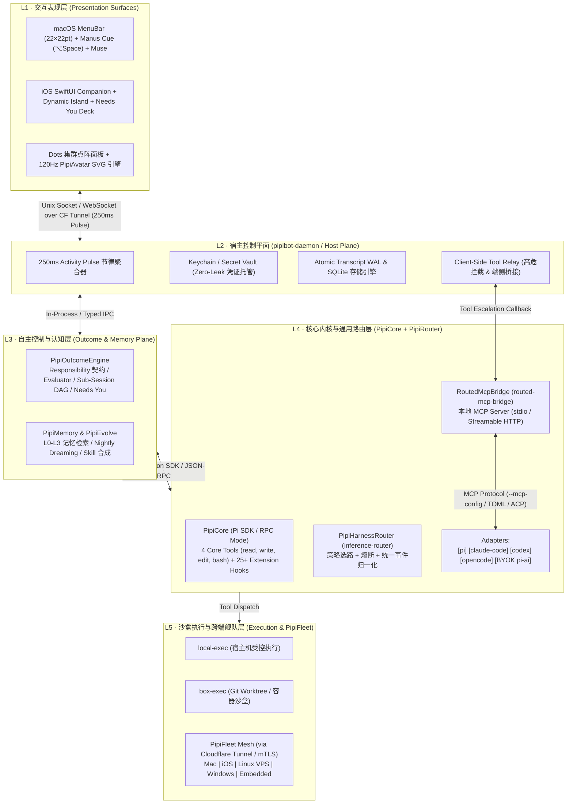
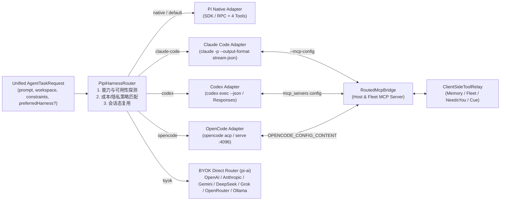
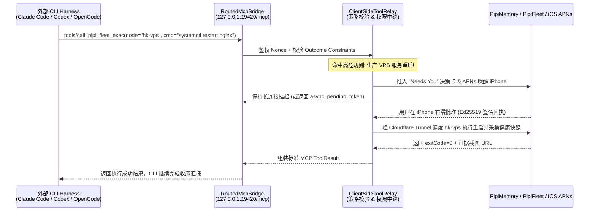
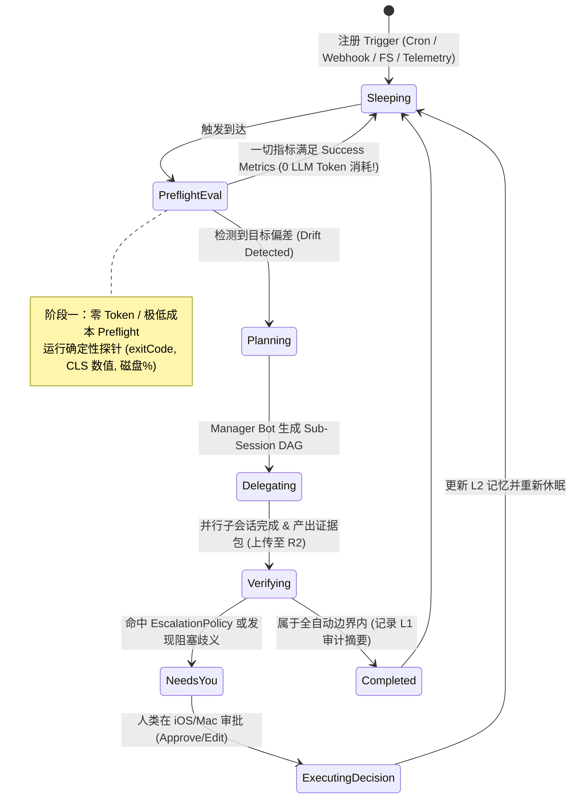

# 02 · 系统核心架构、Pi 内核、多引擎路由与 Outcome 管理引擎

> **架构原则**：**Minimalist Core, Universal Routing, Outcome-First Control.**  
> 以 `@mariozechner/pi-coding-agent` (`pi` / `pi-ai`) 极简四工具内核为唯一中枢，融合 `grok-bot-0.18-reconstructed` 的分域运行时与反向 MCP 桥接思想，叠加 Devin Bots 的结果问责制（Outcome Ownership）引擎，打造轻量化、可插拔、本地优先的个人与基础设施 AI 调度中心。

---

## 目录

- [1. 总体五层分域架构 (System Topology)](#1-总体五层分域架构-system-topology)
  - [1.1 架构分层图与跨进程通信边界](#11-架构分层图与跨进程通信边界)
  - [1.2 关键设计约束与性能基线](#12-关键设计约束与性能基线)
- [2. 基于 Pi 的极简核心底座 (`PipiCore`)](#2-基于-pi-的极简核心底座-pipicore)
  - [2.1 为什么以 Pi 作为内核而非重型 Agent 框架](#21-为什么以-pi-作为内核而非重型-agent-框架)
  - [2.2 极简四工具核心与安全封装](#22-极简四工具核心与安全封装)
  - [2.3 嵌入式 SDK 与 JSON-RPC 事件流架构](#23-嵌入式-sdk-与-json-rpc-事件流架构)
  - [2.4 PipiBot 核心 Pi Extension Hooks 规范](#24-pipibot-核心-pi-extension-hooks-规范)
  - [2.5 250ms 活动脉冲与原子化 Transcript 持久化](#25-250ms-活动脉冲与原子化-transcript-持久化)
- [3. 通用多引擎与 BYOK 路由器 (`PipiRouter`)](#3-通用多引擎与-byok-路由器-pipirouter)
  - [3.1 统一路由架构与本地 CLI 自动发现](#31-统一路由架构与本地-cli-自动发现)
  - [3.2 五大执行适配器详细设计](#32-五大执行适配器详细设计)
    - [Adapter 1：Native `pi` Harness 适配器](#adapter-1native-pi-harness-适配器)
    - [Adapter 2：`claude-code` CLI 适配器](#adapter-2claude-code-cli-适配器)
    - [Adapter 3：`codex` CLI & Responses 适配器](#adapter-3codex-cli--responses-适配器)
    - [Adapter 4：`opencode` CLI / HTTP Server / ACP 适配器](#adapter-4opencode-cli--http-server--acp-适配器)
    - [Adapter 5：BYOK Direct LLM API Router (via `pi-ai`)](#adapter-5byok-direct-llm-api-router-via-pi-ai)
  - [3.3 Routed MCP Bridge 与 Client-Side Tool Relay](#33-routed-mcp-bridge-与-client-side-tool-relay)
  - [3.4 策略路由矩阵与成本熔断器](#34-策略路由矩阵与成本熔断器)
- [4. Devin 风格结果管理引擎 (`PipiOutcomeEngine`)](#4-devin-风格结果管理引擎-pipioutcomeengine)
  - [4.1 Responsibility 职责契约规范 (YAML / TypeScript)](#41-responsibility-职责契约规范-yaml--typescript)
  - [4.2 Trigger 与 Autonomous Evaluator 两阶段省流巡检闭环](#42-trigger-与-autonomous-evaluator-两阶段省流巡检闭环)
  - [4.3 Parallel Sub-Session DAG 编排与 Worktree 隔离沙盒](#43-parallel-sub-session-dag-编排与-worktree-隔离沙盒)
  - [4.4 `"Needs You"` 人类协同决策协议 (Escalation Protocol)](#44-needs-you-人类协同决策协议-escalation-protocol)

---

## 1. 总体五层分域架构 (System Topology)

吸取 `grok-bot-0.18-reconstructed` 清晰拆分的工程教训——将渲染层、宿主协调层、推理路由层与沙盒执行层严格解耦，同时剔除 Electron 的高内存开销——PipiBot 采用**五层分域运行时架构（5-Layer Split Runtime）**：

### 1.1 架构分层图与跨进程通信边界



### 1.2 关键设计约束与性能基线

| 架构指标 | V1 工程基线目标 | 实现保障机制 |
| :--- | :--- | :--- |
| **常驻守护空闲内存** | `< 15 MB` RSS（无活跃推理时） | 纯 Node.js / TypeScript 无 UI 常驻进程 + 外部 CLI 按需冷启 |
| **状态脉冲广播延迟** | `250 ms` 节律聚合心跳 | 借鉴 `grok-bot-0.18` 节流模式，将高频 token/tool 事件合并广播 |
| **系统提示词开销** | `< 1,000 tokens` 核心 Prompt | 承袭 Pi 极简 4 工具设计，绝不塞入冗长框架说教 |
| **单条消息持久化** | 零截断崩溃安全（Crash-Safe） | 先写 `.tmp` 并 `fsync`，再原子 `rename` 覆盖状态文件 + SQLite WAL |
| **CLI 凭证零二次配置** | 复用本地 `claude` / `codex` / `opencode` | 自动探测原生 OAuth/Keychain 登录态，不搬运也不明文复制密钥 |

---

## 2. 基于 Pi 的极简核心底座 (`PipiCore`)

### 2.1 为什么以 Pi 作为内核而非重型 Agent 框架

PipiBot 的 `PipiCore` 直接建立在 `@mariozechner/pi-coding-agent` 与 `@mariozechner/pi-ai` 之上，拒绝将框架逻辑硬编码进推理循环：

1. **可内嵌的双形态控制面**：Pi 同时提供 **TypeScript SDK (`createAgentSession`)** 与 **JSON-RPC 无头模式 (`pi --mode rpc`)**。当 `pipibot-daemon` 启动本地核心任务时，可直接以 SDK 同进程运行，实现微秒级 Hook 拦截；当需要进程级隔离（例如子会话并行探索或沙盒隔离）时，无缝切换至 RPC 子进程模式。
2. **原生 Extension Hooks 即插即用**：所有非通用的业务能力——包括 `PipiMemory` 的记忆注入、`PipiOutcomeEngine` 的权限拦截、`PipiAvatar` 的状态推送——全部以标准的 Pi Extension 挂载，保持内核纯净、可单独单元测试。
3. **Tree-Structured Session（树状会话分支）**：支持从对话历史的任意节点分叉实验（Branching）与局部上下文压缩（Compaction），完美契合 Devin Bot 的“尝试多种修复方案 → 择优合入”机制。

### 2.2 极简四工具核心与安全封装

`PipiCore` 坚守 Pi 的四工具正交设计，并在此基础上叠加路径白名单与幂等性校验护栏：

| 工具名 | 核心职责 | 参数契约核心字段 | PipiBot 安全护栏 |
| :--- | :--- | :--- | :--- |
| **`read`** | 读取文本文件内容或图像（支持按行偏移与行数分页） | `path`, `offset?`, `limit?` | 禁止越界读取 `~/.ssh`、`Keychain` 等黑名单路径；单次上限 2,000 行 / 50 KB 防上下文溢出 |
| **`write`** | 创建新文件或完整覆写文件 | `path`, `content` | 写前校验目标路径位于授权 `workspace` 或 `~/.pipibot/` 内；自动创建父目录 |
| **`edit`** | 基于精确匹配块（`oldText` → `newText`）的局部编辑 | `path`, `oldText`, `newText` | 必须唯一匹配否则报错，杜绝大模型幻觉导致的整文件误删 |
| **`bash`** | 在工作区/节点上执行 Shell 命令并捕获 stdout/stderr/exitCode | `command`, `timeoutMs?`, `cwd?` | 经过 `tool_call` 安全策略评估器：高危命令（`rm -rf /`, `sudo`, 外部网络写入）强制挂起进入 `"Needs You"` 审批 |

> **为什么不内置几十个静态工具？**  
> 日常工程中 95% 的动作（Git 操作、Docker、Curl、Python 数据处理、Homebrew、Systemd 探针）通过 `bash` 组合调用即可获得极高的灵活性与可调试性；其余跨端私有能力（iOS 推送、R2 上传、记忆检索、集群远程执行）则通过**按需加载的 Pi Extension Tools** 或 **`RoutedMcpBridge`** 暴露，既不浪费首轮 Token，又能统一经过权限中继层审计。

### 2.3 嵌入式 SDK 与 JSON-RPC 事件流架构

无论采用同进程 SDK 还是外部 `pi --mode rpc`，`PipiCore` 内部均产出一套标准的细粒度事件流，与 `@pipibot/protocol` 中定义的协议模型严格对齐：

```
+-------------------+       stdin (JSONL Commands)        +-------------------------+
|                   |  -------------------------------->  |                         |
|  pipibot-daemon   |    prompt / steer / follow_up       |   PipiCore Runtime      |
|  (Host Loop)      |    abort / set_model / compact      |   (Pi SDK or RPC Child) |
|                   |  <--------------------------------  |                         |
+-------------------+       stdout (JSONL Events)         +-------------------------+
                              agent_start
                              turn_start
                              message_update (text/thinking delta)
                              tool_execution_start (toolName, args)
                              tool_execution_update (partialOutput)
                              tool_execution_end (isError, durationMs)
                              turn_end (usage, cost)
                              agent_end
```

### 2.4 PipiBot 核心 Pi Extension Hooks 规范

PipiBot 利用 Pi 提供的生命周期 Hook 构建了四个系统级插件（均位于 `packages/core` 运行时装配管道中）：

| Hook 阶段 | 所属 PipiBot 扩展 | 核心执行动作 |
| :--- | :--- | :--- |
| **`before_agent_start`** | `pipi-memory-injector` | 召回 L0 当前 Manus Cue 活跃窗口上下文 + L2 高置信度 `USER.md` 事实（Salience Top-K），以紧凑 XML 块注入 System Context 末尾 |
| **`tool_call`** | `pipi-safety-gate` | 拦截 `bash`/`write`/`edit` 参数：匹配正则风险策略或当前 `OutcomeResponsibility.constraints` 边界；若命中高危动作，挂起执行并向 `PipiOutcomeEngine` 发射 `NeedsYouDecision` |
| **`tool_result`** | `pipi-evidence-auditor` | 对超长命令输出进行智能摘要与落盘引用；若输出包含密钥模式（`sk-`, `Bearer`, AWS Key）实时脱敏；将工具调用轨迹记入 L1 SQLite 情景表 |
| **`turn_end`** | `pipi-evolution-hook` | 计算当前轮次 Token 消耗与预算水位；若检测到用户连续否定/纠偏指令，立即异步触发轻量微反思（Micro-Reflection）提取偏好候选 |

### 2.5 250ms 活动脉冲与原子化 Transcript 持久化

借鉴 `grok-bot-0.18-reconstructed` 的黄金工程实践：
1. **250ms 脉冲聚合（Activity Pulse Throttler）**：
   - 模型在流式推理时可能每秒触发 60–120 次 delta 更新。直接经由 Cloudflare Tunnel 向 iOS 或 macOS MenuBar 广播会浪费大量免费请求额度并卡顿界面。
   - `PipiHarnessRouter` 内部维护一个 `250ms` 滑动窗口聚合器（Timer Interval = `250ms`），仅当窗口内状态发生实质变化（`phase`, `activeTool`, `avatarState53`, `textDeltaBuffer`）时，打包发射一帧紧凑的 `ActivityPulsePacket`。
2. **崩溃安全原子写入（Atomic Transcript Persistence）**：
   - 任何会话状态的更新先写入 `<sessionId>.jsonl.tmp`，调用 `fs.fsyncSync` 确保物理落盘，随后执行 POSIX 原子 `rename` 替换主文件，并同步追加 SQLite WAL 索引，彻底杜绝 Mac 突然断电或强制睡眠造成的会话损坏。

---

## 3. 通用多引擎与 BYOK 路由器 (`PipiRouter`)

### 3.1 统一路由架构与本地 CLI 自动发现

`PipiHarnessRouter`（具体实现框架参见 [harness-router.ts](../../packages/core/src/harness-router.ts) 与 [protocol/src/index.ts](../../packages/protocol/src/index.ts)）解决了多模型、多 CLI 时代的核心痛点：**既能直接使用用户本机已付费认证的头部 Coding Agent CLI，又能无缝兜底直连任意 BYOK 大模型 API。**



启动阶段，`PipiHarnessRouter` 异步执行**本地探针扫描（Local Binary & Auth Discovery）**并每 5 分钟刷新健康缓存：

| Harness 标识 | 可执行文件探测 | 本地登录态 / 凭证复用依据 | 典型健康探针命令 |
| :--- | :--- | :--- | :--- |
| **`pi`** | 内嵌 `@mariozechner/pi-coding-agent` | 读取 Keychain BYOK 或本地 Ollama | 进程内模块加载校验 |
| **`claude-code`** | `which claude` | `~/.claude/.credentials.json` 或 macOS Keychain（Claude Pro/Max OAuth）或 `ANTHROPIC_API_KEY` | `claude --version` + 轻量鉴权预检 |
| **`codex`** | `which codex` | `~/.codex/auth.json`（ChatGPT Plus/Pro OAuth）或 `OPENAI_API_KEY` | `codex --version` + `~/.codex/config.toml` 解析 |
| **`opencode`** | `which opencode` | `~/.local/share/opencode/auth.json` + `~/.config/opencode/opencode.json` | `opencode --version` 或探活 `127.0.0.1:4096/global/health` |
| **`byok`** | 无需外部二进制 | macOS Keychain 托管的 API Key 或本地 `http://127.0.0.1:11434` (Ollama) | HTTP `/models` 探活（仅针对本地端点） |

---

### 3.2 五大执行适配器详细设计

#### Adapter 1：Native `pi` Harness 适配器
- **定位**：PipiBot 默认主脑、高频日常事务、低开销后台守护与 `PipiOutcomeEngine` 的 Preflight 评估器。
- **执行方式**：
  - 主会话通过 `AgentSession` TypeScript API 直接运行于 `pipibot-daemon` 内部（或专用 Worker 线程）。
  - 并行子会话通过 `spawn('pi', ['--mode', 'rpc', '--cwd', worktreePath])` 独立进程隔离。
- **能力增强**：直接共享进程内 `PipiMemory` 与 `ClientSideToolRelay`，无需序列化跨进程 MCP，工具延迟 `< 2ms`。支持在单轮任务中先用 `claude-sonnet-4` 规划，再动态调用 `session.setModel('deepseek-reasoner')` 或 `ollama/qwen2.5-coder` 续写，上下文消息自动经 `pi-ai` 转换为目标模型结构。

#### Adapter 2：`claude-code` CLI 适配器
- **定位**：高难度跨仓库深度重构、复杂架构分析，优先复用用户已有的 Claude Max/Pro 桌面订阅。
- **调用规范（Zero-Duplicate-Key Spawn）**：
  1. 在 `/tmp/pipibot-mcp-<sessionId>.json` 动态生成一次性 MCP 配置文件，指向本地 `RoutedMcpBridge` 监听的随机空闲端口或 stdio 代理：
     ```json
     {
       "mcpServers": {
         "pipibot_host": {
           "type": "http",
           "url": "http://127.0.0.1:19420/mcp",
           "headers": {
             "Authorization": "Bearer <ephemeral-session-nonce>"
           }
         }
       }
     }
     ```
  2. 以非交互流式 JSON 模式拉起子进程：
     ```bash
     claude -p "<enriched_prompt_with_L2_memory>" \
       --input-format stream-json \
       --output-format stream-json \
       --verbose \
       --mcp-config /tmp/pipibot-mcp-<sessionId>.json \
       --permission-mode acceptEdits
     ```
  3. **多轮双向续传**：支持 `--resume <claude_session_id>` 或持续通过 `stdin` 写入 JSONL `user` 消息帧实现多轮对话续接与人类中途插话纠偏（Steer）。
- **事件归一化映射**：
  - `type: "system", subtype: "init"` → 提取 `session_id` 与已挂载 MCP 工具列表 → 发射 `harness_ready`。
  - `assistant` 内容块包含 `thinking` / `text` → 触发 `PipiAvatar` 状态 `claude-routing` 并喂给 250ms 脉冲缓冲。
  - `assistant` 内容块包含 `tool_use`（如 `mcp__pipibot_host__pipi_needs_you_ask`）→ 经 `RoutedMcpBridge` 回流宿主侧处理。
  - `result` → 提取 `total_cost_usd`（订阅制为估算额度）、`duration_ms`、`num_turns` 并写入 L1 审计记录。

#### Adapter 3：`codex` CLI & Responses 适配器
- **定位**：高并发单元测试生成、边界条件排错、沙盒隔离代码修改与 OpenAI 订阅复用。
- **双模式架构**：
  1. **模式 A — Codex CLI 无头隔离执行 (`codex exec`)**：
     - 不篡改用户的 `~/.codex/config.toml`！而是通过命令行 `-c`（override）参数或独立隔离的临时 `CODEX_HOME`（软链 `~/.codex/auth.json` 以复用登录态）按会话注入 PipiBot MCP 服务：
       ```toml
       # 注入到会话临时 config.toml 或 -c 参数
       [mcp_servers.pipibot_host]
       url = "http://127.0.0.1:19420/mcp"
       bearer_token_env_var = "PIPIBOT_MCP_NONCE"
       ```
     - 执行命令：
       ```bash
       PIPIBOT_MCP_NONCE="<nonce>" codex exec --json \
         --cd <worktree_path> \
         --sandbox workspace-write \
         "<enriched_prompt>"
       ```
     - 解析 stdout JSONL：`thread.started`、`turn.started`、`item.completed`（区分 `reasoning`、`command_execution`、`file_change`、`mcp_tool_call`），并驱动 `PipiAvatar` 切换至 `codex-routing` 状态。
  2. **模式 B — Direct Responses Transport（低延迟 API 直连）**：
     - 当配置为 BYOK OpenAI Key 且只需快速文本推理或调用 PipiBot 私有工具（不依赖 Codex 本地沙盒）时，直接通过 `pi-ai` OpenAI Responses API 传输通道流式执行，将冷启动延迟从 ~800ms 降至 `< 150ms`。

#### Adapter 4：`opencode` CLI / HTTP Server / ACP 适配器
- **定位**：开源极客工作流、本地自定义 Provider 聚合、IDE 级精准 Diff 与多终端长会话协同。
- **三级协议适配优先级**：
  1. **首选 — Agent Client Protocol (`opencode acp`)**：
     - 通过标准 JSON-RPC 2.0 over stdio 驱动 `opencode acp`。ACP 原生定义了 `initialize`、`session/new`、`session/prompt`、`session/update`（细粒度文本流、工具调用状态、Diff 块）与双向 `session/request_permission` 回调——可直接将权限询问无缝转化为 PipiBot `"Needs You"` 卡片！
  2. **备选 — Persistent Headless Server (`opencode serve`)**：
     - 由 `pipibot-daemon` 托管一个常驻本地端口的 `opencode serve --hostname 127.0.0.1 --port 4096`（使用 `OPENCODE_SERVER_PASSWORD` 双向鉴权）。
     - 通过 HTTP REST 创建/恢复会话（`POST /session`, `POST /session/:id/message`）并订阅 SSE 事件流，实现近零毫秒冷启动与跨 Mac/iOS 热接管。
  3. **轻量化降级 — One-shot JSON (`opencode run --format json`)**：
     - 适用于独立一次性的脚本诊断任务，配合 `OPENCODE_CONFIG_CONTENT` 环境变量动态挂载 `pipibot_host` MCP Server。

#### Adapter 5：BYOK Direct LLM API Router (via `pi-ai`)
当任务无需外部 CLI 专有沙盒、或者外部 CLI 触发速率限制（Rate Limit）时，路由器直接经由 `pi-ai` 协议归一化网关直连用户自己的密钥或本地推理引擎：

| Provider ID | 底层线协议 (Wire Protocol) | 典型模型路由定位 | 凭证来源与隐私属性 |
| :--- | :--- | :--- | :--- |
| **`anthropic`** | Anthropic Messages API | 复杂架构决策、高质量中文/英文写作 | macOS Keychain (`pipibot.byok.anthropic`) |
| **`openai`** | OpenAI Responses / Completions | 复杂推理 (`o3`/`gpt-5`)、工具精确调用 | macOS Keychain (`pipibot.byok.openai`) |
| **`google`** | Google Generative AI | 超长上下文日志/视频帧分析 (`Gemini 2.5 Pro/Flash`) | macOS Keychain (`pipibot.byok.google`) |
| **`deepseek`** | OpenAI-Compatible + `reasoning_content` | 高性价比深度代码生成与夜间大规模记忆蒸馏 | macOS Keychain (`pipibot.byok.deepseek`) |
| **`xai`** | OpenAI-Compatible / Responses | 实时热点调研与快速对话 (`Grok`) | macOS Keychain (`pipibot.byok.xai`) |
| **`openrouter`** | OpenAI-Compatible Aggregator | 多模型统一账单与跨厂商自动 Fallback | macOS Keychain (`pipibot.byok.openrouter`) |
| **`ollama` / `vllm`** | Local OpenAI-Compatible HTTP | **100% 离线隐私敏感数据**（个人健康、财务、私密日记、夜间 L0→L1 初步索引） | 本地环回 `127.0.0.1:11434`，零数据出境 |

---

### 3.3 Routed MCP Bridge 与 Client-Side Tool Relay

当 `claude-code`、`codex` 或 `opencode` 作为子执行引擎运行时，它们默认“看不见”用户的苹果备忘录、iOS 地理状态、家庭树莓派或 L2 长期记忆。`RoutedMcpBridge` 与 `ClientSideToolRelay` 解决了这一孤岛问题：



**核心暴露工具集 (`pipibot_host` MCP Server)**：
- `pipi_memory_recall`：按时空/语义权重从 L1/L2 召回用户历史偏好与工程约定。
- `pipi_needs_you_ask`：主动挂起当前推理并向人类发起结构化多选/审批卡。
- `pipi_fleet_exec`：向 `Mac / iOS / VPS / Windows / Embedded` 已授权节点派发受限指令。
- `pipi_artifact_publish`：将本地测试截图、对比视频、HTML 报告加密或签名上传至 Cloudflare R2 并换取预览链接。
- `pipi_cue_get_context`：实时拉取当前桌面活跃窗口、Git 分支与剪贴板脱敏语义摘要。

---

### 3.4 策略路由矩阵与成本熔断器

`PipiHarnessRouter` 依据以下规则自动决策（用户亦可随时在指令中以 `@claude`、`@codex`、`@opencode`、`@local` 显式覆盖）：

| 路由维度 | 选路优先级链路 | 触发与熔断逻辑 |
| :--- | :--- | :--- |
| **复杂多文件代码重构** | `claude-code` (订阅) → `pi` + Anthropic BYOK → `opencode` | 若检测到 Claude CLI 配额限流 (`429`)，自动携带当前 Diff 摘要降级切换至 `codex` 或 OpenRouter |
| **高并发测试与 Bug 定点修补** | `codex` (订阅) → `pi` + OpenAI/DeepSeek BYOK | 若测试环境需隔离运行，优先启用 `codex exec --sandbox` |
| **生活/财务/私密日记蒸馏** | `pi` + `ollama` (本地离线) → 用户显式授权后的云端模型 | **隐私硬护栏**：标记为 `sensitivity: "private-local"` 的任务严禁流出本机环回接口 |
| **夜间 3 小时巡检 & Preflight** | 本地规则脚本 (0 Token) → `pi` + Gemini Flash / DeepSeek / Ollama | 每日单 Bot 默认预算上限（如 BYOK `$1.50/day`），达 80% 预警、100% 熔断转入 `"Needs You"` |

---

## 4. Devin 风格结果管理引擎 (`PipiOutcomeEngine`)

`PipiOutcomeEngine` 将 Devin Bots 的 **"From Tasks to Outcomes"** 思想彻底代码化，运行于 `pipibot-daemon` 内部，负责管理用户所有的长期/周期性目标。

### 4.1 Responsibility 职责契约规范 (YAML / TypeScript)

每个长期运行的 Bot 均由一份版本化的 `Responsibility` 契约文件（存放于 `~/.pipibot/outcomes/*.yaml`，与 `@pipibot/protocol` 中 `OutcomeResponsibility` 类型 1:1 映射）定义：

#### 示例 A：软件工程域 —— `dev-layout-guardian.yaml`（复刻并超越 Devin Layout Bot）
```yaml
apiVersion: pipibot.dev/v1alpha1
kind: OutcomeResponsibility
metadata:
  id: outcome_layout_guardian
  name: "Frontend Layout & CLS Guardian"
  domain: dev
  owner: "jimizhou"
spec:
  goal: >
    持续保障 web-app 仓库 main 分支首屏与二次访问零布局偏移（CLS < 0.05），
    发现回归时自动定位源 PR、在隔离 worktree 生成修复分支、录制修复前后对比视频并提交审核。
  constraints:
    repoPath: "~/Desktop/Projects/web-app"
    allowedTools: ["read", "write", "edit", "bash", "pipi_artifact_publish", "pipi_needs_you_ask"]
    forbiddenActions: ["git push --force", "merge to main directly"]
    dailyBudgetUsd: 2.00
    quietHours: "23:30-07:30"
    sensitivity: "workspace"
  successMetrics:
    - metric: "lighthouse_cls"
      operator: "<"
      target: 0.05
    - metric: "e2e_smoke_pass_rate"
      operator: "=="
      target: 1.0
  triggers:
    - type: cron
      schedule: "0 */3 * * *" # 每 3 小时运行
    - type: webhook
      source: "github.push.main"
  routingPolicy:
    preflight: "script://scripts/measure-cls.mjs" # 零 Token 预检
    planner: "pi:claude-sonnet-4"
    workerHarness: "claude-code" # 修复编码委派给已认证本地 claude CLI
  escalationPolicy:
    requireHumanApprovalOn: ["open_pull_request", "budget_exceeded_80pct"]
    defaultTimeoutAction: "defer_until_morning"
```

#### 示例 B：生活与基建复合域 —— `infra-life-nightwatch.yaml`
```yaml
apiVersion: pipibot.dev/v1alpha1
kind: OutcomeResponsibility
metadata:
  id: outcome_infra_nightwatch
  name: "Personal Fleet & Home Sanctuary Guardian"
  domain: infra
spec:
  goal: >
    守护香港 VPS、家庭树莓派网关与 Mac 备份盘的健康与 TLS 证书有效期；
    同步关注家庭净水/空气传感器告警，仅在确需人类介入时生成可一键执行的 Needs You 卡片。
  constraints:
    targetNodes: ["hk-vps-01", "home-rpi-01", "mac-studio-main"]
    forbiddenActions: ["reboot_without_approval", "delete_backup_volumes"]
    sensitivity: "private-local"
  triggers:
    - type: telemetry_threshold
      nodeId: "hk-vps-01"
      metric: "disk_used_pct"
      operator: ">"
      value: 85
    - type: cron
      schedule: "0 2 * * *"
  routingPolicy:
    preflight: "fleet://health-probe"
    workerHarness: "pi:ollama/qwen2.5-coder"
  escalationPolicy:
    requireHumanApprovalOn: ["service_restart", "cleanup_logs_over_1gb"]
    priorityOverride: "P0_bypass_quiet_hours_if_down"
```

### 4.2 Trigger 与 Autonomous Evaluator 两阶段省流巡检闭环

为了避免“每 3 小时唤醒一次大模型空烧 Token”，`PipiOutcomeEngine` 严格执行**两阶段评估闭环**：



### 4.3 Parallel Sub-Session DAG 编排与 Worktree 隔离沙盒

当需要同时解决多个子问题或对比多种修复策略时，Manager Bot 保持自身上下文精简，调度 `SubSession` 有向无环图（DAG）：

1. **隔离单元**：每个涉及代码修改的子会话自动在 `.pipibot-worktrees/<outcomeId>/<subSessionId>` 创建独立 `git worktree`；涉及跨机器的任务则通过 `PipiFleet` 派发至目标节点沙盒。
2. **并发上限控制**：默认单台 Mac 同时允许 `maxConcurrentSubSessions = 3`（防止风扇狂转与 API 并发限流），其余排入轻量内存队列。
3. **证据强制要求（Evidence-First Contract）**：任何代码修复或运维变更子会话在回报父节点时，必须附带结构化 `EvidenceBundle`（`diffSummary`、`testCommandExitCode`、由 Playwright/FFmpeg 录制的 Before/After 视频或系统快照，上传至 Cloudflare R2 返回签名访问路径），否则 `Verifying` 阶段自动驳回重做。

### 4.4 `"Needs You"` 人类协同决策协议 (Escalation Protocol)

人类时间是整个系统最昂贵的稀缺资源。`PipiOutcomeEngine` 对外只暴露一个统一的高信噪比决策收件箱 **`NeedsYouInbox`**，其数据结构与 [packages/protocol/src/index.ts](../../packages/protocol/src/index.ts) 中的 `NeedsYouDecision` 严格一致：

```typescript
// 直接对齐 @pipibot/protocol 中的 NeedsYouDecision 契约
export interface NeedsYouDecision {
  id: string;
  outcomeId?: string;
  sessionId: string;
  sourceNodeId: string;
  severity: "info" | "warning" | "critical";
  category:
    | "code_merge_or_push"
    | "infra_mutation"
    | "financial_or_purchase"
    | "external_communication"
    | "memory_evolution_review"
    | "ambiguous_requirement";
  title: string;                // 一句话直达核心，如 "批准 PR #142 修复移动端导航抖动？"
  summary: string;              // 3 行以内背景与根因说明
  recommendedOptionId: string;
  options: Array<{
    id: string;                 // e.g. "approve_merge", "request_rerun", "reject_abort"
    label: string;
    style: "primary" | "secondary" | "destructive";
    actionPayload?: Record<string, unknown>;
  }>;
  evidence: Array<{
    artifactId: string;
    r2Key: string;              // 托管于 Cloudflare R2 (0 Egress Fee)
    kind: "screenshot" | "video" | "diff_patch" | "html_preview" | "log_excerpt";
    caption: string;
    signedUrl?: string;
    expiresAt?: string;
  }>;
  timeoutSeconds?: number;
  fallbackAction?: "pause" | "abort" | "auto_recommended";
  status: "pending" | "resolved" | "expired";
  chosenOptionId?: string;
  userNote?: string;
  resolvedBy?: string;
  createdAt: string;
  resolvedAt?: string;
}
```

- **智能聚合与勿扰降噪**：除非触发 `critical`（如生产 VPS 宕机、家庭漏水传感器告警），否则夜间 `info` / `warning` 级别决策自动合并为次日早间的**“晨间 3 分钟决策栈（Morning Decision Deck）”**，经 Cloudflare Worker + APNs 在用户醒来后一次性呈递至 iPhone，真正做到**“静默替你扛下 95% 脏活累活，只在 5% 关键分叉点优雅敲门”**。

---

## 5. 相关文档索引

- 产品愿景与五大前沿源解构：[01-PRODUCT-VISION-AND-RESEARCH.md](./01-PRODUCT-VISION-AND-RESEARCH.md)
- V1 Mac+iOS、Cloudflare 免费边缘层与多端舰队基础设施：[03-CLOUDFLARE-AND-FLEET-INFRA.md](./03-CLOUDFLARE-AND-FLEET-INFRA.md)
- 四层认知记忆与自我进化系统：[04-MEMORY-AND-SELF-EVOLUTION.md](./04-MEMORY-AND-SELF-EVOLUTION.md)
- 协议包定义与路由器实现：[packages/protocol/src/index.ts](../../packages/protocol/src/index.ts) 与 [packages/core/src/harness-router.ts](../../packages/core/src/harness-router.ts)
