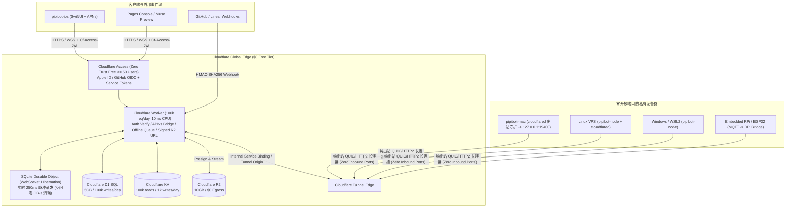
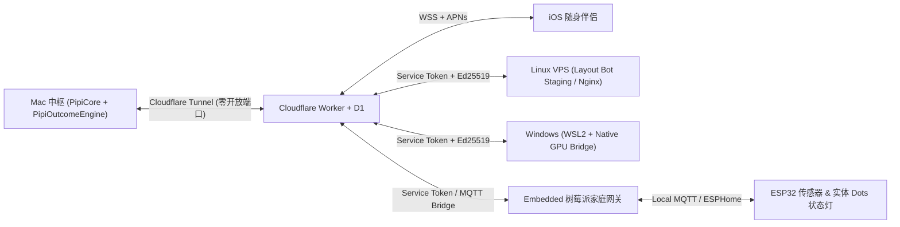

# 03 · Cloudflare $0 免费边缘基建与 PipiFleet 跨端集群架构

> **基础设施信条**：**Local-First Brain, Zero-Port Exposure, $0/Month Global Edge Mesh.**  
> 以 `pipibot-mac` 为常驻核心主机、`pipibot-ios` 为随身决策终端，架设在 **100% Cloudflare Free Tier（零公网端口开放、零每月固定云账单）** 之上，并向外无缝统辖 `Mac`、`iOS`、`Linux VPS`、`Windows` 与 `Embedded/IoT` 五类异构节点。

---

## 目录

- [1. V1 核心端云闭环：`pipibot-mac` + `pipibot-ios`](#1-v1-核心端云闭环pipibot-mac--pipibot-ios)
  - [1.1 为什么 V1 锁定 Mac 常驻主机 + iOS 原生伴侣](#11-为什么-v1-锁定-mac-常驻主机--ios-原生伴侣)
  - [1.2 `pipibot-mac` 常驻守护与桌面共生架构](#12-pipibot-mac-常驻守护与桌面共生架构)
  - [1.3 `pipibot-ios` 随身指挥终端与抗 Mac 休眠韧性](#13-pipibot-ios-随身指挥终端与抗-mac-休眠韧性)
- [2. 100% Cloudflare Free-Tier 边缘基础设施全栈设计](#2-100-cloudflare-free-tier-边缘基础设施全栈设计)
  - [2.1 零公网暴露端云互联拓扑](#21-零公网暴露端云互联拓扑)
  - [2.2 Cloudflare Tunnel (`cloudflared`)：出站加密与零端口暴露](#22-cloudflare-tunnel-cloudflared出站加密与零端口暴露)
  - [2.3 Cloudflare Access (Zero Trust Free 50 席)：OIDC 与 Service Token 双重鉴权](#23-cloudflare-access-zero-trust-free-50-席oidc-与-service-token-双重鉴权)
  - [2.4 Cloudflare Workers + Durable Objects WebSocket Hibernation：低功耗中继、APNs 与离线队列](#24-cloudflare-workers--durable-objects-websocket-hibernation低功耗中继apns-与离线队列)
  - [2.5 Cloudflare D1 + KV：写读分离的元数据与低频缓存架构](#25-cloudflare-d1--kv写读分离的元数据与低频缓存架构)
  - [2.6 Cloudflare R2 + Pages：$0 Egress 工件存储与静态预览托管](#26-cloudflare-r2--pages0-egress-工件存储与静态预览托管)
  - [2.7 Free-Tier 配额精算表（严格证明 $0/月 成本上限）](#27-free-tier-配额精算表严格证明-0月-成本上限)
- [3. 统一多节点集群管理 (`PipiFleet`)](#3-统一多节点集群管理-pipifleet)
  - [3.1 节点能力声明与最小权限沙盒 (Capability Sandbox)](#31-节点能力声明与最小权限沙盒-capability-sandbox)
  - [3.2 五大节点平台部署与运行时规范 (Mac / iOS / VPS / Windows / Embedded)](#32-五大节点平台部署与运行时规范-mac--ios--vps--windows--embedded)
  - [3.3 跨场景调度矩阵：Daily Life × Work × Development](#33-跨场景调度矩阵daily-life--work--development)
- [4. 关联实现与文档索引](#4-关联实现与文档索引)

---

## 1. V1 核心端云闭环：`pipibot-mac` + `pipibot-ios`

### 1.1 为什么 V1 锁定 Mac 常驻主机 + iOS 原生伴侣

开源个人 Agent 最常见的失败原因，是在 V1 就试图从零打造庞大的多云分布式调度系统，结果既花钱又难以每天稳定自用。PipiBot V1 采用极其务实的**“单中心重算力宿主机 + 全天候便携决策端 + 免费全球边缘中继”**架构：

- **算力与隐私落于 Mac**：开发者的代码仓库、本地已认证 CLI（`claude-code`、`codex`、`opencode`）、Apple Keychain、以及私密本地大模型（Apple Silicon Ollama）天然都在 Mac 上。
- **注意力与审批落于 iPhone**：人类并不一直坐在书桌前。Devin 式的 `"Needs You"` 决策卡、Layout Bot 的 Before/After 视频验片、Muse 语音碎片采集以及突发故障 P0 告警，必须能够在地铁上、咖啡馆里单手 10 秒内处理完毕。
- **通信与穿透交由 Cloudflare Free Tier**：彻底摆脱家庭宽带无公网 IP、动态 DDNS 不稳定以及自购中转 VPS 的固定开销与运维负担。

### 1.2 `pipibot-mac` 常驻守护与桌面共生架构

`pipibot-mac` 由两个协同进程组成，既保证后台 7×24 稳定性，又保证前台交互的丝滑响应：

1. **后台脑核守护进程 (`pipibot-daemon` via `launchd`)**
   - 通过 `~/Library/LaunchAgents/dev.pipibot.daemon.plist` 注册为 macOS 用户级常驻服务（支持 `KeepAlive: true`、`ProcessType: Background`、`Nice: 5`）。
   - **进程内运行组件**：`PipiCore` (Pi Embedded SDK)、`PipiHarnessRouter`、`PipiOutcomeEngine`（Cron/FS 监听器）、`PipiMemory`（SQLite FTS5 + `sqlite-vec`）及本地 Unix Domain Socket (`~/.pipibot/run/daemon.sock`) + 环回 HTTP/WS (`127.0.0.1:19400`)。
   - **空闲内存控制**：未拉起外部 CLI 或推理子会话时，常驻内存稳定在 **< 15 MB RSS**；当配置了插电夜间巡检任务（如凌晨 02:00 Dreaming 记忆蒸馏）时，自动调用系统受控工具 `caffeinate -i -t <seconds>` 防止任务中途休眠。
   - **加密端云备份**：每日夜间蒸馏完成后，使用本地 Keychain 派生的 **AES-256-GCM** 密钥对 SQLite 快照与 `SOUL.md`/`USER.md` 打包加密，上传至 Cloudflare R2（Cloudflare 侧仅见密文）。

   ```xml
   <!-- ~/Library/LaunchAgents/dev.pipibot.daemon.plist 核心结构示例 -->
   <?xml version="1.0" encoding="UTF-8"?>
   <!DOCTYPE plist PUBLIC "-//Apple//DTD PLIST 1.0//EN" "http://www.apple.com/DTDs/PropertyList-1.0.dtd">
   <plist version="1.0">
   <dict>
     <key>Label</key>
     <string>dev.pipibot.daemon</string>
     <key>ProgramArguments</key>
     <array>
       <string>/usr/local/bin/pipibot-daemon</string>
       <string>--home</string>
       <string>/Users/USER/.pipibot</string>
     </array>
     <key>RunAtLoad</key><true/>
     <key>KeepAlive</key>
     <dict><key>SuccessfulExit</key><false/></dict>
     <key>ProcessType</key><string>Background</string>
     <key>EnvironmentVariables</key>
     <dict><key>NODE_ENV</key><string>production</string></dict>
   </dict>
   </plist>
   ```

2. **前台原生 SwiftUI 伴随壳 (`PipiBotMenuBar.app`)**
   - **MenuBar 22×22pt 活体图标**：挂载零依赖 `PipiAvatar` WebView/Metal 视图，接收 `250ms` Activity Pulse 实时呈递呼吸、思考、不同 Harness 颜色映射与 `Needs You` 角标。
   - **Manus Cue 全局悬浮胶囊 (`⌥Space`)**：监听 `CGEventTap` 全局热键；唤起前读取 macOS Accessibility API（`NSWorkspace` + 前台窗口标题 + Finder/IDE 路径 + Git 分支），零打扰展示 1-Click 建议动作。

### 1.3 `pipibot-ios` 随身指挥终端与抗 Mac 休眠韧性

```
[ iPhone (pipibot-ios) ]
   ├── 1. Needs You Swipe Deck  ──> 拉取 R2 签名视频/Diff预览 ──> Face ID 审批回执
   ├── 2. Dynamic Island & Live Activity ──> ActivityKit 实时呈现运行中任务与心跳态
   ├── 3. Dots Fleet Matrix     ──> 读取 D1/KV 展现 Mac/iOS/VPS/Windows/Embedded 状态
   └── 4. Muse Voice & Capture  ──> 语音实时打断 + 地理围栏/快捷指令触发生活 Outcome
```

**Mac 合盖休眠时的核心韧性设计（Sleep-Resilient Command Loop）**：
- 笔记本用户日常合盖离开书桌后，Mac 的 `cloudflared` 隧道断开，边缘将 Mac 节点标记为 `sleeping`。
- **读不停**：iOS 端依然能通过 Cloudflare Worker 秒级读取已经同步至 **D1** 的待审批 `NeedsYouDecision` 列表、节点最后遥测快照，并直接在 **R2** 播放修复前后视频与 HTML 报告（不依赖 Mac 在线！）。
- **写不丢**：用户在地铁上右滑“批准 PR #142”或录入语音新指令时，Worker 将带 `idempotencyKey` 的 `OfflineWebhookItem` 持久化写入 D1 离线队列；当用户回到公司或家中打开 Mac 盖子，`cloudflared` 在 **1–2 秒**内自动重连边缘，Mac 守护进程随即通过 WebSocket 或拉取接口有序消费并确认（ACK）全部积压指令。

---

## 2. 100% Cloudflare Free-Tier 边缘基础设施全栈设计

整个端云桥接层的 Edge 代码定义与数据库契约位于 [packages/cloudflare-edge](../../packages/cloudflare-edge/src/worker.ts)，面向 **“单人重度使用 + 5 节点 Fleet”** 场景做了精细化配额治理，确保 **100% 落入 Cloudflare 免费套餐内（$0.00/月）**。

### 2.1 零公网暴露端云互联拓扑



### 2.2 Cloudflare Tunnel (`cloudflared`)：出站加密与零端口暴露

- **工作机制**：`pipibot-mac` 安装官方 `cloudflared` 守护进程，由 Mac 主动向最近的两个 Cloudflare 边缘数据中心建立 4 条高可用纯出站 QUIC（失败自动降级 HTTP/2）加密长连接，路由至本机环回地址 `http://127.0.0.1:19400`。
- **安全意义**：Mac 防火墙可保持“阻止所有传入连接”；即使在咖啡馆、酒店或校园 NAT 内网下，iPhone 依然能通过固定域名 `edge-mac.pipibot.yourdomain.com` 安全回连。
- **典型 `~/.cloudflared/config.yml` 配置**：
  ```yaml
  tunnel: <mac-tunnel-uuid>
  credentials-file: /Users/USER/.cloudflared/<mac-tunnel-uuid>.json
  protocol: quic
  retries: 10
  grace-period: 15s
  ingress:
    - hostname: mac-origin.pipibot.yourdomain.com
      service: http://127.0.0.1:19400
      originRequest:
        connectTimeout: 5s
        noTLSVerify: false
    - service: http_status:404
  ```

### 2.3 Cloudflare Access (Zero Trust Free 50 席)：OIDC 与 Service Token 双重鉴权

利用 Cloudflare Zero Trust 免费层级（支持高达 **50 名用户** 免费使用 Access 与 Gateway）：

1. **人类终端认证（`pipibot-ios` & Web 控制台）**：
   - 在 Cloudflare Zero Trust 启用 **Apple ID / GitHub OIDC** 登录，策略规则严格限定 `Email is <owner_email>`。
   - 客户端请求必须携带有效 `Cf-Access-Jwt-Assertion` Header；Worker 边缘利用 Cloudflare 公钥端点（`/cdn-cgi/access/certs`）或 Access 传入签名头完成 JWT 验签，提取 `AccessIdentityContext`。
2. **机器节点认证（Mac / VPS / Windows / Embedded Bridge）**：
   - 为每个节点颁发独立的 **Cloudflare Access Service Token**（`CF-Access-Client-Id` + `CF-Access-Client-Secret`），并存入本地 macOS Keychain 或 Linux `0600` 密钥文件。
   - **应用层纵深防御**：除 Zero Trust 网关令牌外，Worker 与 `pipibot-daemon` 之间所有关键控制命令（如批准高危决策 `decision.resolved` 或远程下发 `fleet_exec`）均携带 **Ed25519 / HMAC-SHA256** 应用层时间戳签名（防 60 秒以上重放攻击），确保即使某个边缘配置误放行也绝不越权执行。

### 2.4 Cloudflare Workers + Durable Objects WebSocket Hibernation：低功耗中继、APNs 与离线队列

Worker（对应源码蓝图 [packages/cloudflare-edge/src/worker.ts](../../packages/cloudflare-edge/src/worker.ts) 与 [wrangler.toml](../../packages/cloudflare-edge/wrangler.toml)）承担四大轻量级粘合职责，每次调用均严格控制在 Free Tier **10 ms CPU 时间**上限之内（注意：网络等待 `fetch`/WebSocket I/O 不计入 CPU 时间）：

1. **WebSocket / SSE 实时脉冲中继（SQLite-Backed Durable Objects Hibernation）**：
   - Cloudflare 已将 **SQLite-backed Durable Objects** 开放至 Workers Free Plan（100k req/day，13,000 GB-s/day，1 GB 存储）。
   - 采用 **WebSocket Hibernation API (`ctx.acceptWebSocket(ws)`)**：当 iOS 与 Mac 均连接但无任务活动时，Durable Object 实例自动进入休眠态——**连接不断开，但 Duration (GB-s) 计费完全归零！**仅在 `250ms` 脉冲到达或指令发送的几毫秒内被唤醒转发。
2. **APNs 原生直连推送桥接**：
   - 当 Mac 推送 `NeedsYouDecision` 到 Worker 且检测到 iOS 未处于活跃前台 WS 时，Worker 利用浏览器标准的 `crypto.subtle`（Web Crypto ES256）对 `.p8` Auth Key 签发短期 JWT，直接调用 Apple `https://api.push.apple.com/3/device/<device_token>` 推送高信噪比通知，支持 iOS Notification Service Extension 挂载 R2 缩略图预览及 Dynamic Island 静默更新（`apns-push-type: liveactivity`）。
3. **Mac 休眠离线队列与幂等 Webhook 入口**：
   - 接收 GitHub、Linear、Home Assistant 或 iOS 的离线请求。先校验来源签名（如 `X-Hub-Signature-256`），若探测到目标 `mac` 节点在线且 WS 活跃则直通转发；否则写入 D1 `offline_webhook_queue`（包含 `idempotency_key` 与 `expires_at`）。
   - 支持配置 Free Tier 允许的 **最多 3 个 Cron Triggers**（例如每 15 分钟清理过期队列与僵尸节点状态）。
4. **R2 短时效签名 URL 生成器**：
   - 所有 R2 对象不公开暴露！iOS 端获取列表时，Worker 动态计算过期时间为 `15 分钟` 的 HMAC-SHA256 签名路径 `/r2/signed/<key>?exp=...&sig=...`，校验通过后通过 Worker `env.ARTIFACTS_BUCKET.get(key)` 流式透传（支持 HTTP `Range` 分片播放 MP4 视频）。

### 2.5 Cloudflare D1 + KV：写读分离的元数据与低频缓存架构

在 Cloudflare Free Plan 下，**KV 的写入配额仅有 1,000 writes/day（且同 Key 1 write/sec）**，而 **D1 高达 100,000 rows written/day 与 5,000,000 rows read/day**。忽视这一差异是无服务器架构踩坑的最大元凶。因此 PipiBot 严格执行**写读分离**：

| 存储引擎 | Free Tier 硬上限 | PipiBot 精确用途（扬长避短设计） |
| :--- | :--- | :--- |
| **Cloudflare D1 (SQLite)** | 10 库 · 500 MB/库 (总计 5 GB)<br/>5M 行读/天 · **100k 行写/天** | 存储所有持久化高频写入表（参见 [schema.sql](../../packages/cloudflare-edge/schema.sql)）：<br/>• `fleet_nodes`（节点注册、能力集与每 60s 聚合遥测）<br/>• `outcomes_snapshot`（Outcome 摘要镜像）<br/>• `needs_you_decisions`（待办决策栈与审批审计）<br/>• `offline_webhook_queue`（Mac 休眠离线队列）<br/>• `artifacts_index`（R2 工件元数据与 SHA-256） |
| **Cloudflare KV** | 1 GB 存储 · **100k 读/天**<br/>**1k 写/天** | **仅限低频写、高频读的路由元数据**：<br/>• `presence:<nodeId>`：**仅在节点状态迁移时**（`offline <-> alive <-> sleeping`）写入一次 KV，绝不随心跳刷写！<br/>• `device:apns:<userId>`：iOS Push Token 缓存<br/>• `config:access_revocations`：应急吊销节点名单 |

### 2.6 Cloudflare R2 + Pages：$0 Egress 工件存储与静态预览托管

- **Cloudflare R2（10 GB-month 免费 · 1M Class A 写/月 · 10M Class B 读/月 · $0 流出流量费）**：
  - 桶结构规划：
    - `artifacts/{outcomeId}/{YYYY-MM}/{artifactId}.{mp4|png|patch|html}` —— Devin Layout Bot 风格的修复前后对比视频、截图、Git Diff。
    - `backups/{nodeId}/{YYYY-MM-DD}.sqlite.enc` —— Mac 本地记忆库每日 AES-256-GCM 加密备份。
    - `voice/{YYYY-MM}/{memoId}.m4a` —— iOS Muse 语音碎片归档。
  - **自动桶生命周期规则（Lifecycle Rules）**：`artifacts/` 前缀对象 **30 天自动过期删除**；`voice/` **14 天过期**；`backups/` 通过滚动覆写仅保留最近 **14 天**快照，确保存储容量永远健康地压在 10 GB 的一半以下。
- **Cloudflare Pages（100 项目 · 20k 文件/站 · 3,000 构建分钟/月 · 无限带宽）**：
  - 部署零依赖设计工作台与加密只读 Muse 分享页、HTML 工件交互式预览站点，前置绑定同一套 Cloudflare Access Zero Trust 策略。

### 2.7 Free-Tier 配额精算表（严格证明 $0/月 成本上限）

下表以一位重度用户（每日运行 1 个 Mac 主机 + 1 台 iPhone + 2 台 VPS/Windows + 1 套家庭 IoT 节点，每日触发 80 次 Agent 会话、产生 20 个决策卡与 15 份截图/短视频证据）为基准进行**极端饱和测算**：

| Cloudflare 服务 | 官方 Free Tier 硬上限 | 单人重度日常消耗估算 | 配额占用率 | 越界防线 / 熔断策略 | 月度账单 |
| :--- | :--- | :--- | :--- | :--- | :--- |
| **Workers 请求数** | `100,000 req / 天` | 脉冲合并WS直连 + iOS API 拉取 + Webhook ≈ **4,500 req / 天** | **4.5%** | 客户端 `250ms` 合并 + 非活跃自动降频至 `2s` | **$0.00** |
| **Durable Objects (SQLite)** | `100,000 req / 天`<br/>`13,000 GB-s / 天` | WebSocket Hibernation 空闲零计费 ≈ **2,500 req/天**, **< 80 GB-s/天** | **2.5% / <1%** | 仅在活跃流式推理期间连接唤醒 | **$0.00** |
| **D1 写入 / 读取** | `100k 行写 / 天`<br/>`5M 行读 / 天` | 心跳 60s 一次（5 节点 × 1,440 ≈ 7.2k 写）+ 决策/队列 ≈ **12k 写 / 60k 读** | **12% / 1.2%** | 节点离线时不写入；合并批量遥测语句 | **$0.00** |
| **KV 写入 / 读取** | `1,000 写 / 天`<br/>`100,000 读 / 天` | 仅节点上线/下线迁移写 KV ≈ **40 写 / 天**，读取约 **4,000 / 天** | **4.0% / 4.0%** | 代码层硬禁止心跳路径调用 `KV.put` | **$0.00** |
| **R2 存储 & 流量** | `10 GB 存储/月`<br/>`1M A写 / 10M B读`<br/>**$0 Egress** | 14 天滚动加密备份 (~1.2 GB) + 30 天视频/截图 (~2.8 GB) ≈ **4.0 GB** | **40%** | 30 天 R2 生命周期自动淘汰 + 视频 H.265 压缩 | **$0.00** |
| **Tunnel (`cloudflared`)** | 标准账户隧道免费 | 1–3 条长连接隧道（Mac + VPS），个人级并发 | **安全区内** | 断线指数退避重连，防止重连风暴 | **$0.00** |
| **Zero Trust Access** | 最多 **50 位用户免费** | **1 位**人类用户 + 5 个 Service Tokens | **2%** | 个人自托管固定成员上限 | **$0.00** |
| **Pages 静态托管** | `3,000 构建分钟/月`<br/>无限带宽 | 每周发布 2–3 次设计台/静态预览 ≈ **15 分钟/月** | **0.5%** | 仅变更 `design-system` 或静态文档时触发 | **$0.00** |
| **合计固定月费** | — | — | **全维安全冗余 > 60%** | 触发 80% 日配额告警自动推送至 Dots 面板 | **$0.00 / mo** |

---

## 3. 统一多节点集群管理 (`PipiFleet`)

`PipiFleet` 将不同操作系统、网络位置与算力特征的硬件设备抽象为统一的节点注册表，节点状态由 `@pipibot/protocol` 中的 `FleetNodeTelemetry` 与 `DotsVitalityState` 实时刻画，并在 UI 呈现为极简的 **Dots 点阵生命体征**。

### 3.1 节点能力声明与最小权限沙盒 (Capability Sandbox)

每个加入 `PipiFleet` 的节点在首次握手时必须声明一份不可自行提权的**能力与安全清单（Capability Manifest）**：

1. **能力通告 (`FleetNodeCapabilities`)**：声明是否可运行 `pi`、本地已安装的外部 CLI（`claude-code` / `codex` / `opencode`）、是否具备 Apple Neural Engine / CUDA GPU、是否允许采集 GUI 上下文。
2. **三档执行沙盒边界**：
   - `Tier 0 · Read-Only Telemetry`：CPU/内存/磁盘/传感器读取、日志 `tail`、Git 状态检查 —— **允许全自动执行**。
   - `Tier 1 · Scoped Workspace Write`：仅限在注册的 `allowedWorkspaces` 目录或 Worktree 内执行代码生成、编译与单元测试 —— **在 Outcome 契约授权内自动执行**。
   - `Tier 2 · Privileged / System Mutation`：服务启停（`systemctl restart`）、包管理器升级、防火墙调整、物理设备控制 —— **默认拦截并经 `ClientSideToolRelay` 生成 `"Needs You"` 卡片，必须人类在 Mac/iOS 审批后携带一次性签名 Token 方可执行**。

### 3.2 五大节点平台部署与运行时规范 (Mac / iOS / VPS / Windows / Embedded)

| 节点类型 (`FleetNodeKind`) | 硬件/系统形态 | 守护进程 / 接入技术栈 | 算力与本地能力 | 安全隔离边界 |
| :--- | :--- | :--- | :--- | :--- |
| **`mac`** | Apple Silicon MacBook / Mac Studio (macOS) | `launchd` 常驻 `pipibot-daemon` (`< 15MB`) + SwiftUI MenuBar + `cloudflared` | **中枢主机**：全量 Pi Core + Claude/Codex/OpenCode + Ollama 本地隐私推理 + Playwright + Cue | Keychain 托管密钥；TCC 辅助功能仅提取活跃窗口标题与路径；Worktree 沙盒 |
| **`ios`** | iPhone / iPad (iOS 17+) | 原生 SwiftUI App + WidgetKit / ActivityKit + Shortcuts / EventKit 桥接 | **随身终端**：Apple Intelligence/本地语音转写、日程/健康/位置采集（显式开关）、Face ID 审批签名 | 严格遵循 iOS 沙盒与权限弹窗；敏感信息仅在授权后摘要脱敏上传 |
| **`vps`** | Ubuntu / Debian / Alpine Linux 云服务器 | `systemd` 单服务 `pipibot-node` (`< 12MB`) + `cloudflared` 出站隧道 | **常驻远端阵地**：Staging 网站部署、每 3 小时 Layout Bot 无头浏览器录屏、Docker/Nginx/TLS 守护 | 非 root 专用系统用户 `pipibot` 运行；仅开放受限脚本白名单或指定项目容器权限 |
| **`windows`** | Windows 11 PC / GPU 深度学习工作站 | **双模桥接**：WSL2 (`systemd` 运行 `pipibot-node`) + 原生 Windows Service (`Named Pipe` 桥接) | **重算力/游戏节点**：CUDA / vLLM 高吞吐本地大模型推理、Unreal/Unity 构建、GPU 显存与温度遥测 | WSL2 负责代码与容器沙盒；PowerShell 原生桥仅放行签名后的白名单控制命令 |
| **`embedded`** | **Raspberry Pi** / **ESP32** / **Home Assistant** | • 树莓派：ARM64 `pipibot-node` (`systemd`)<br/>• ESP32：ESPHome / **MQTT over TLS** 接入树莓派网关或 Worker Webhook | **物理世界触角**：家庭温湿度/空气质量/净水器 TDS 采集、NAS RAID 健康与 UPS 断电保护、**实体桌面 Dots LED 状态点阵灯** | ESP32 无完整操作系统，绝不下发任意 Shell；仅支持结构化 MQTT JSON 话题订阅与白名单继电器指令 |



### 3.3 跨场景调度矩阵：Daily Life × Work × Development

| 应用域 | `mac` | `ios` | `vps` | `windows` | `embedded` |
| :--- | :--- | :--- | :--- | :--- | :--- |
| **Daily Life<br/>(日常生活)** | 隐私财务账单本地分类（Ollama 零出境）、家庭相册/文档归档 | 语音随手记 (`Muse`)、地理围栏买菜提醒、早间决策卡审批 | 自建RSS/日历同步服务与家庭密码库备份守护 | 媒体库转码与本地语音合成渲染 | 净水器滤芯预警、室内 CO2 超标提示、物理桌面 Dots 呼吸灯指示工作/勿扰态 |
| **Work<br/>(知识工作)** | Manus Cue (`⌥Space`) 感知文档/邮件给出 1-Click 总结与跟进 | 通勤途中收听语音早报、滑动批准邮件草稿或排期调整 | 7×24 托管竞品情报抓取与定时生成周报 HTML（Pages 预览） | 运行大型本地模型辅助长文档离线分析 | 书房桌面环境自动协同（进入深度会议态亮起柔和琥珀光） |
| **Development<br/>(软件工程)** | 主力代码库、Git Worktree 并行子会话、`claude-code`/`codex`/`opencode` 路由 | 随时查看测试报告、流式播放 R2 修复前后对比视频并一键合入 PR | Staging 自动部署、Layout Bot 定时浏览器巡检与 CLS 录屏 | Windows 跨平台客户端编译、GPU 训练任务监控与 CUDA OOM 自愈 | CI/CD 构建通过率与线上故障实体红灯/蜂鸣瞬时感知 |

---

## 4. 关联实现与文档索引

- 顶层产品愿景与五大原型解构：[01-PRODUCT-VISION-AND-RESEARCH.md](./01-PRODUCT-VISION-AND-RESEARCH.md)
- Pi 内核、多 Harness 路由与 Outcome 引擎：[02-SYSTEM-ARCHITECTURE-AND-HARNESS.md](./02-SYSTEM-ARCHITECTURE-AND-HARNESS.md)
- 四层认知记忆与自我进化系统：[04-MEMORY-AND-SELF-EVOLUTION.md](./04-MEMORY-AND-SELF-EVOLUTION.md)
- 交互设计系统与 120Hz 生命头像规范：[01-UIUX-DESIGN-SYSTEM.md](../design-system/01-UIUX-DESIGN-SYSTEM.md)
- Cloudflare Edge 核心源码、配置与数据库 Schema：
  - [packages/cloudflare-edge/wrangler.toml](../../packages/cloudflare-edge/wrangler.toml)
  - [packages/cloudflare-edge/schema.sql](../../packages/cloudflare-edge/schema.sql)
  - [packages/cloudflare-edge/src/worker.ts](../../packages/cloudflare-edge/src/worker.ts)
- 统一协议契约：[packages/protocol/src/index.ts](../../packages/protocol/src/index.ts)
