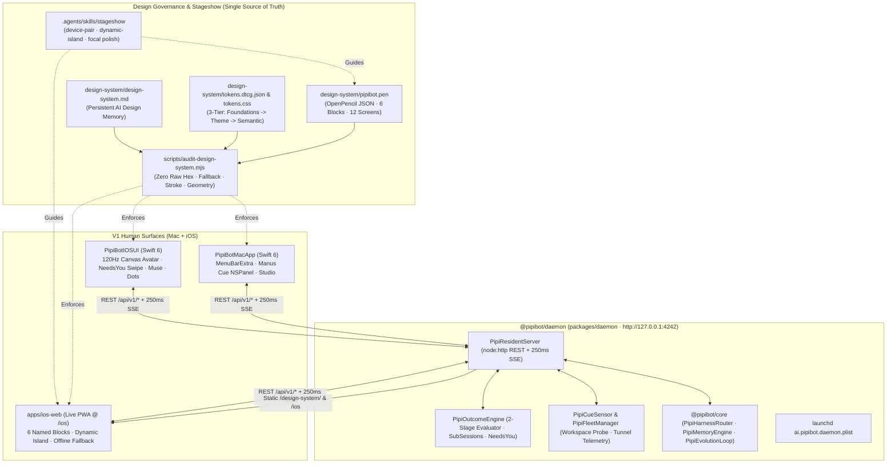

# 05 · V1 macOS 常驻宿主、iOS 原生/PWA 伴侣与 OpenPencil 设计治理实现规范 (`v0.2.0-beta`)

> **版本基线**: `v0.2.0-beta` (Wave 2 V1 可运行栈 + Wave 3 All-in-One 原生 `PipiBot.app` 打包升级)
> **前置与关联文档**: [01 产品愿景](./01-PRODUCT-VISION-AND-RESEARCH.md) · [02 系统架构与 Harness](./02-SYSTEM-ARCHITECTURE-AND-HARNESS.md) · [03 Cloudflare 免费层与 Fleet](./03-CLOUDFLARE-AND-FLEET-INFRA.md) · [04 记忆与自我进化](./04-MEMORY-AND-SELF-EVOLUTION.md) · [06 Mac 原生应用功能指南](./06-MAC-NATIVE-APP-GUIDE.md) · [UI/UX 设计系统](../design-system/01-UIUX-DESIGN-SYSTEM.md)

---

## 1. V1 实现全景拓扑 (V1 Implementation Topology)

在 Phase 0（`v0.1.0-alpha`）完成协议与交互工作台验证的基础上，`v0.2.0-beta` 交付完整的 **V1 可运行闭环**：以 **OpenPencil 5-Rule 设计治理 + Stageshow** 作为跨 Web/Swift 视觉唯一权威源，在 macOS 桌面端通过 **All-in-One 原生 `PipiBot.app`**（内置 `PipiNativeMacRuntime` + 自动托管 `PipiEmbeddedBridgeSupervisor`）开箱即用运行，并按需桥接 **Native Swift 6 iOS UI (`PipiBotIOSUI`)**、**Live iOS Companion PWA (`apps/ios-web`)** 及 Headless/VPS 场景下的独立 **`@pipibot/daemon` (`packages/daemon`)**。

---

## 2. OpenPencil 五规则设计治理与 Stageshow 集成

为了杜绝 AI 在跨文件生成前端 CSS 与 SwiftUI 代码时出现“色彩漂移、圆角不统一、卡片套卡片、生硬紫色发光特效”等问题，V1 引入工程化的 **Design Governance Layer**：

### 2.1 三大权威设计资产与三层 Token 架构

1. **持久化设计记忆 ([`design-system/design-system.md`](../../design-system/design-system.md))**：
   - 采用严格格式：**一句话规则 + 工程原因 + 生效日期 (`2026-11-19`)**，确保 AI Coding Agent 与人类开发者共享同一套设计约束记忆。
2. **三层 Token 体系 ([`design-system/tokens.dtcg.json`](../../design-system/tokens.dtcg.json) & [`design-system/tokens.css`](../../design-system/tokens.css))**：
   - **Tier 1 · Foundations**：原始色板、字体族、物理弹簧曲线与原子间距刻度。
   - **Tier 2 · Theme (12-Step Scale)**：严格映射 **Obsidian Dark (`#0B0C0E`)** 与 **Warm Vellum Light (`#F7F5F0`)** 双模式 12 阶明度与表面层级。
   - **Tier 3 · Semantic Tokens**：面向组件意图的语义变量（如 `--bg-canvas`, `--bg-surface`, `--text-primary`, `--harness-pi`, `--fleet-mac`），严禁在组件样式中直接书写原始十六进制色值。
3. **OpenPencil 规范文档 ([`design-system/pipibot.pen`](../../design-system/pipibot.pen))**：
   - 完整定义 `schemaVersion`、`variableCollections`、`textStyles`、6 个可复用 `COMPONENT` 模块与 12 个桌面/移动端 `FRAME`（覆盖 macOS MenuBar Popover、Manus Cue 胶囊、Stageshow Device-Pair Hero 及 iOS 各核心页面）。
   - 所有节点色值绑定均强制要求 `fallbackColor` **严格等于** 该变量在默认主题下的解析值（杜绝 `#000000` 占位错配）。

### 2.2 六大规范命名积木 (6 Canonical Named Blocks)

全端（`pipibot.pen`、`apps/ios-web` 与 `apps/apple` SwiftUI）统一收敛为 6 个规范积木，禁止随意发明孤立容器：

| Block 名称 | SwiftUI 实现 (`CanonicalBlocks.swift`) | Web/PWA 语义角色 (`apps/ios-web`) | 关键几何与设计约束 |
| :--- | :--- | :--- | :--- |
| **`list-card`** | `PipiListCard` | Outcome / Memory / Fleet 列表项 | 统一圆角与 1px 微妙描边，禁止盒中盒嵌套 |
| **`sheet`** | `PipiSheet` | 详情抽屉与 Harness 切换面板 | 顶边距 (`topEdge`) 严格锁定 **`54px` (Expanded 展开态)** 或 **`102px` (Compact 紧凑检视态)**，禁用中间模糊值 |
| **`form-sheet`** | `PipiFormSheet` | 创建 Outcome / 记忆修正表单 | 表单字段组 + 底部全宽 **`44px`** 主操作按钮 |
| **`dock`** | `PipiDock` | 运行状态底座栏 | 左侧摘要 + 活体 `PipiAvatar`，右侧主行动按钮 |
| **`bottom-bar`** | `PipiBottomBar` | 移动端贴底导航/控制栏 | 接地气贴底设计（Grounded Bottom Bar），禁止悬浮阴影卡片套卡片 |
| **`empty-state`** | `PipiEmptyState` | 空队列/无告警占位视图 | **严格上限**：1 个图标 + 1 个标题 + 1 句话 + 最多 1 个按钮 |

### 2.3 五项几何与视觉硬规范 + Stageshow Craft

- **交互尺寸与间距**：移动端触控按钮高度 **`44px`**（`18px` 图标，`8px` 间距）；macOS 紧凑按钮高度 **`32px`**（`16px` 图标，`6px` 间距）。
- **图标描边层级**：小尺寸图标（`16–18px`）统一 `1.5px` 描边，中大图标（`20–24px`）统一 `1.75px` 描边。
- **裁剪边界 (`clip: true`)**：仅允许在包含 `effects`（阴影/模糊）或存在滚动溢出（`overflowDirection !== 'NONE'`）的容器上启用，避免无意义渲染裁剪与阴影截断。
- **Stageshow 展示工艺 (`.agents/skills/stageshow`)**：
  - `device-pair` 布局让 macOS Studio 与 iPhone Companion 跨越视口边界构图；
  - `dynamic-island` 采用独立黑色药丸胶囊与分层内容渲染；
  - 每个视口仅呈现 3–7 条真实高信息密度文案配合克制的结构化信息条，严禁滥用廉价的紫色 AI 闪烁星星（Zero Stock AI Purple Sparkles）。

### 2.4 自动化设计审计器 (`scripts/audit-design-system.mjs`)

通过 `npm run audit:design` 自动扫描以下四个目标，任何违规直接返回非零退出码阻止发布：
1. [`design-system/pipibot.pen`](../../design-system/pipibot.pen)：校验无原始 `#hex` 字面量、变量 `fallbackColor` 100% 精确匹配解析值、`TEXT` 均绑定 `textStyleId`、`ICON` 描边权重符合 `1.5` / `1.75`、按钮与 Sheet 几何合规、`clip` 规则合规。
2. [`design-system/design-system.md`](../../design-system/design-system.md)：校验每条设计规则均具备“一句话规则 + 原因 + 日期”三要素。
3. [`apps/ios-web/styles.css`](../../apps/ios-web/styles.css)：校验 **0 个原始十六进制色值**（所有颜色必须走 `var(--...)`）。
4. [`apps/apple/Sources/`](../../apps/apple/Package.swift)：校验 `DesignTokens.swift` 之外的所有 Swift 视图与组件文件中 **0 个原始 `#RRGGBB` 或 `0x...` 颜色字面量**，全部通过 `PipiTokens.*` 引用。

---

## 3. `@pipibot/daemon` (`packages/daemon`): Headless 常驻服务与可托管 iOS/Cloudflare 桥接

[`packages/daemon`](../../packages/daemon/package.json) 零第三方 npm 运行时依赖，完全基于 Node.js `>=22.6.0` 原生 `--experimental-strip-types` 与 `node:http` 构建，与 `@pipibot/protocol` 和 `@pipibot/core` 实时联动。

> **桌面端与 Headless 分工**：macOS 桌面用户只需启动 All-in-One 原生 **`PipiBot.app`**（详见 [06-MAC-NATIVE-APP-GUIDE.md](./06-MAC-NATIVE-APP-GUIDE.md)），无需手动开终端运行 Daemon——App 内建 `PipiNativeMacRuntime` 与按需自拉起的 `PipiEmbeddedBridgeSupervisor`。独立运行 `@pipibot/daemon`（`npm run start:daemon`）主要用于无 GUI Headless 服务器 / Linux VPS、纯 CLI 调试或浏览器独立访问 `/ios`。

### 3.1 核心运行时组件

| 模块路径 | 核心类 / 职责 | 关键机制 |
| :--- | :--- | :--- |
| [`packages/daemon/src/outcome-engine.ts`](../../packages/daemon/src/outcome-engine.ts) | `PipiOutcomeEngine` | 管理 `dev`、`work`、`daily_life`、`infra` 四大领域 `OutcomeResponsibility`；执行 **2-Stage Autonomous Evaluator**（触发评估 -> 通过 `PipiHarnessRouter` 拉起 `SubSession` -> 校验成本预算 `spentTodayUsd <= dailyBudgetUsd` -> 生成带 R2 `ArtifactEvidenceRef` 对比证据的 `NeedsYouDecision`）。预置 4 个跨场景初始 Outcome、3 个子会话与 3 条待审批决策。 |
| [`packages/daemon/src/cue-fleet-sensor.ts`](../../packages/daemon/src/cue-fleet-sensor.ts) | `PipiCueSensor` & `PipiFleetManager` | `PipiCueSensor` 安全探测当前工作区与 Git 分支上下文生成 `⌥Space` `CueSuggestion`，并将用户的 `accepted`/`dismissed`/`ignored` 反馈写入 `PipiMemoryEngine`。 `PipiFleetManager` 采集实时 macOS 硬件指标（CPU/内存/系统版本/运行时间），维护 `mac`/`ios`/`vps`/`windows`/`embedded` 的 `DotsVitalityState` 心跳，并暴露 `cloudflared` 隧道状态与免费额度指标。 |
| [`packages/daemon/src/server.ts`](../../packages/daemon/src/server.ts) | `PipiResidentServer` | 默认监听 `127.0.0.1:4242`（支持 `PIPIBOT_PORT` / `--port` 与测试随机端口 `0`），内置 CORS、全套 REST API、250ms SSE 事件流、`ai.pipibot.daemon.plist` 生成器，并直接静态托管 `/design-system/` 与 `/ios`。 |
| [`packages/daemon/src/cli.ts`](../../packages/daemon/src/cli.ts) | Daemon CLI 入口 | 支持通过 `npm run start:daemon` 一键拉起本地常驻宿主。 |
| [`packages/daemon/test/daemon.test.ts`](../../packages/daemon/test/daemon.test.ts) | 端到端集成测试套 | 使用 `node:test` + `node:assert/strict` 在临时端口完整验证全部 `/api/v1/*` 路由、SSE 事件推流、Harness 对话轮次、夜间做梦进化与静态托管。 |

### 3.2 REST + SSE API 契约 (`/api/v1/*`)

| 方法与路径 | 功能说明 | 关联 SSE 事件 (`GET /api/v1/events`) |
| :--- | :--- | :--- |
| `GET /api/v1/status` | 返回 Daemon 版本 (`0.2.0-beta`)、Uptime、实时 `AvatarState53` / `AvatarExpression9`、CLI Probe 结果、Cloudflare Tunnel 状态与 `UnderstandingScoreBreakdown` | `harness.pulse` (250ms 节拍) |
| `GET/POST /api/v1/outcomes` | 查询/创建跨领域 `OutcomeResponsibility` | `outcome.update` |
| `POST /api/v1/outcomes/:id/evaluate` | 触发两阶段自主评估，派发 `SubSession` 并按需升级至 `NeedsYou` | `outcome.update`, `decision.needs_you` |
| `POST /api/v1/outcomes/:id/status` | 暂停/恢复/归档 Outcome | `outcome.update` |
| `GET /api/v1/decisions` | 获取 "Needs You" 人类审批收件箱列表（含 R2 Before/After 证据） | — |
| `POST /api/v1/decisions/:id/resolve` | 提交人类审批（`approve` / `steer` / `reject` + 附加指令） | `decision.resolved`, `outcome.update` |
| `GET /api/v1/cue` / `POST /api/v1/cue/refresh` | 获取或刷新当前工作区 `Manus Cue` 建议列表 | `cue.suggestion` |
| `POST /api/v1/cue/:id/execute` / `feedback` | 一键执行 Cue 建议或记录反馈用于记忆微调 | `cue.suggestion`, `outcome.update` |
| `GET /api/v1/fleet` / `POST /api/v1/fleet/heartbeat` | 获取五类节点状态矩阵或接收远程节点心跳 | `node.heartbeat` |
| `GET /api/v1/chat/transcript` / `POST /api/v1/chat/turn` | 查询历史与经由 `PipiHarnessRouter` 路由的多后端对话，并自动落盘 L1 情景记忆 | `harness.pulse` |
| `GET /api/v1/memory` / `POST /api/v1/memory/search` | 查看四层记忆摘要或执行 FTS5/显著性混合检索 | — |
| `POST /api/v1/memory/dream` | 手动触发一次 `PipiEvolutionLoop` 夜间做梦整合，生成 `EvolutionDiffItem` | `evolution.digest_ready` |
| `POST /api/v1/memory/diffs/:diffId/review` | 审批/采纳/回滚记忆进化 Diff | — |
| `GET /api/v1/memory/soul` | 获取实时渲染的 `SOUL.md` 与 `USER.md` 语义画像 | — |
| `GET /api/v1/launchd-plist` | 生成可安装至 `~/Library/LaunchAgents/ai.pipibot.daemon.plist` 的托管配置 | — |
| `GET /design-system/*` & `GET /ios` | 直接托管 120Hz 设计工作台与 iOS Companion PWA | — |

---

## 4. 原生 Apple Swift 6 工程 (`apps/apple`)

[`apps/apple/Package.swift`](../../apps/apple/Package.swift) 基于 **`swift-tools-version: 6.0`** 构建，同时声明支持 **`.macOS(.v14)`** 与 **`.iOS(.v17)`**，并开启 Swift 6 严格并发安全检查（`Sendable`、`@MainActor @Observable`）。

### 4.1 Target 架构与模块划分

| Target | 类型 | 源码路径 | 核心职责 |
| :--- | :--- | :--- | :--- |
| **`PipiBotKit`** | Library | `apps/apple/Sources/PipiBotKit/` | **跨 Apple 平台核心套件**： • `Models/ProtocolModels.swift`: 与 `@pipibot/protocol` 1:1 对齐，涵盖全部 53 个 kebab-case `AvatarState53`（10+11+14+10+8）、9 种 `AvatarExpression9` 与 8 种形体。 • `DesignSystem/DesignTokens.swift`: 三层设计 Token 实现，**全工程唯一允许存在颜色字面量的文件**。 • `DesignSystem/CanonicalBlocks.swift`: `PipiListCard`、`PipiSheet`、`PipiFormSheet`、`PipiDock`、`PipiBottomBar`、`PipiEmptyState`。 • `Avatar/PipiProceduralAvatarEngine.swift` & `PipiAvatarView.swift`: SwiftUI `Canvas` 120Hz 192 射线轮廓插值 + 6 轨道关键帧 + Euler 弹簧 + Rodrigues 3D 眼球投影 + `0.26s` 眨眼。 • `Runtime/PipiNativeMacRuntime.swift`: 原生内置运行时（`probeInstalledHarnesses`、`sampleHostTelemetry`、`detectFrontmostAppContext`、`~/Library/Application Support/PipiBot/resident-state.json` 持久化、Keep-Awake `ProcessInfo.beginActivity`）与 `PipiEmbeddedBridgeSupervisor` 自动桥接托管。 • `Networking/PipiDaemonClient.swift` & `State/PipiAppStore.swift`: `URLSession` REST + SSE 客户端与 Native All-in-One 状态管理。 |
| **`PipiBotIOSUI`** | Library | `apps/apple/Sources/PipiBotIOSUI/` | **跨 macOS 预览与 iOS 运行的原生伴侣 UI**： • `PipiIOSCompanionRootView.swift`: 四栏主控导航与灵动岛级顶部 Avatar 锚点。 • `NeedsYouSwipeDeckView.swift`: Devin 风格左滑/右滑卡片审批栈（含 R2 对比证据）。 • `MuseSpatialCanvasView.swift`: Muse 自由空间卡片与语音打断控制。 • `DotsFleetAndTunnelView.swift`: Dots 五端节点矩阵与 Cloudflare Tunnel 实时延迟仪表盘。 （所有 UIKit Haptics 均以 `#if os(iOS)` 隔离，确保在 macOS 上同样零警告编译与实时预览。） |
| **`PipiBotMacApp`** | Executable | `apps/apple/Sources/PipiBotMacApp/` | **All-in-One macOS 原生常驻桌面应用 (`dist/PipiBot.app`)**： • `PipiBotMacApp.swift`: 启动 `PipiNativeMacRuntime` 与托管桥接，提供 `MenuBarExtra` 活体头像 + Keep-Awake / Bridge 状态与 `⌥Space` 快捷键。 • `ManusCueFloatingPanel.swift`: 无边框非激活悬浮 `NSPanel` 实现 `⌥Space` Manus Cue 上下文建议条。 • `MacOutcomeStudioView.swift`: 八大功能模块主控制台（Outcomes / Needs You / Harnesses & Muse / Manus Cue / Fleet & Cloudflare / Memory & Soul / iOS Companion / PipiAvatar 53）。可通过 `npm run app:mac`（[`scripts/build-mac-app.sh`](../../scripts/build-mac-app.sh)）一键打包为 `dist/PipiBot.app`。 |
| **`PipiBotKitTests`** | Test Target | `apps/apple/Tests/PipiBotKitTests/` | `PipiBotKitTests.swift`: 校验 53 状态枚举与 9 表情完备性、Rodrigues 3D 眼球与 192 射线轮廓数学正确性、三层 Token 一致性、`PipiNativeMacRuntime` 探测/遥测/Cue 感知及持久化流转。 |

---

## 5. 实时 iOS 伴侣 PWA (`apps/ios-web`)

为了无需 Xcode 签名即可在任意 iPhone Safari（“添加到主屏幕” PWA 模式）或桌面浏览器中即时体验完整 iOS 端工作流，[`apps/ios-web/`](../../apps/ios-web/index.html) 提供了与 SwiftUI 版本能力对齐的零构建 WebApp：

- **双路径零配置资源加载**：无论通过 Daemon 托管路径 **`http://127.0.0.1:4242/ios`** 访问，还是通过仓库根静态服务器访问 [`apps/ios-web/`](../../apps/ios-web/index.html)，均可自动解析并加载 [`design-system/tokens.css`](../../design-system/tokens.css) 与 [`design-system/pipibot-avatar.js`](../../design-system/pipibot-avatar.js)。
- **100% Token 绑定与 6 大积木复用**：[`apps/ios-web/styles.css`](../../apps/ios-web/styles.css) 不含任何原始 hex 色值，全部控件严格遵守 `44px` 按钮触控高度与 `54px`/`102px` Sheet 顶部基线。
- **五大实时交互视图**：
  1. **Dynamic Island + Live `PipiAvatar`**：实时监听 `/api/v1/events` SSE 脉动同步 53 状态，无 Daemon 时优雅切换为本地仿真模式；
  2. **Devin Outcomes**：查看跨 `dev`/`work`/`daily_life`/`infra` 进展、触发两阶段评估、通过 `form-sheet` 新建 Outcome；
  3. **Needs You Swipe Deck**：支持触摸/按钮右滑批准、左滑驳回与定向引导指令；
  4. **Muse Canvas & Multi-Harness Chat**：切换 `Pi` / `Claude Code` / `Codex` / `OpenCode` / `BYOK` 对话并体验语音/Cue 触发；
  5. **Dots Fleet & 4-Tier Memory Evolution**：检视全节点在线点阵、Cloudflare 隧道延时及触发夜间做梦审批 `Evolution Diff`。
