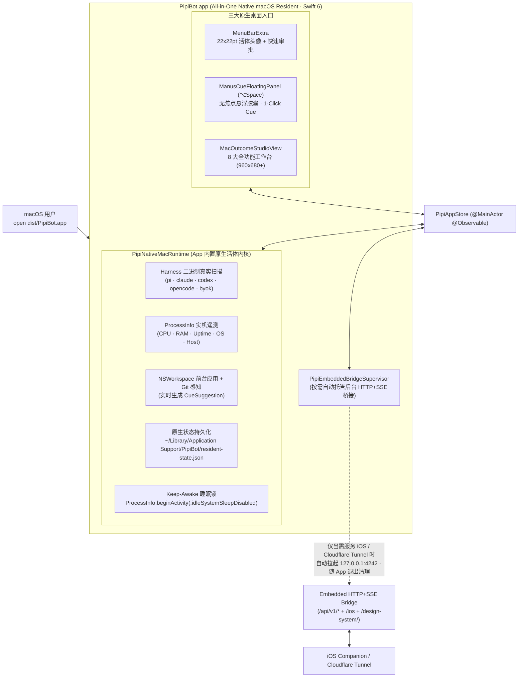

# 06 · Mac All-in-One 原生应用架构与功能指南 (`PipiBot.app`)

> **版本基线**: `v0.3.0-s2` (S0–S2 Native Shell & Session Core 升级)
> **目标形态**: 单一原生 `PipiBot.app` (`ai.pipibot.mac`)，开箱即用、零手动终端守护进程
> **相关文档**: [08 Bot Runtime 与体验蓝图](./08-BOT-RUNTIME-AND-EXPERIENCE-BLUEPRINT.md) · [05 Mac/iOS V1 实现规范](./05-MAC-AND-IOS-V1-IMPLEMENTATION.md) · [02 系统架构与 Harness](./02-SYSTEM-ARCHITECTURE-AND-HARNESS.md) · [UI/UX 设计系统](../design-system/01-UIUX-DESIGN-SYSTEM.md)

---

## 1. 为什么 Mac 端是一个 All-in-One 原生 `PipiBot.app`

在早期原型中，桌面应用常常要求用户先在终端手动启动一个后台守护进程（Daemon），然后再打开前端窗口连接它——这违背了 macOS 原生“开箱即驻留”的直觉体验，也把终端排障成本转嫁给了用户。

在 PipiBot 的 Mac 原生形态中，**`PipiBotMacApp` (`PipiBot.app`) 是一个自包含（Self-Contained）、All-in-One 的原生常驻宿主**：用户只需双击或运行 `open dist/PipiBot.app`，无需手动开启任何终端窗口，App 进程本身即具备完整感知、调度、记忆持久化与防休眠能力。



### 1.1 `PipiNativeMacRuntime` vs `PipiEmbeddedBridgeSupervisor` 职责边界

| 运行时组件 | 源码位置 | 核心职责 | 为什么内建于 App |
| :--- | :--- | :--- | :--- |
| **`PipiNativeMacRuntime`** | [`apps/apple/Sources/PipiBotKit/Runtime/PipiNativeMacRuntime.swift`](../../apps/apple/Sources/PipiBotKit/Runtime/PipiNativeMacRuntime.swift) | 1. **`probeInstalledHarnesses()`**：直接扫描 `/opt/homebrew/bin`、`/usr/local/bin`、`~/.local/bin` 与 `PATH`，返回本机 `pi`、`claude` (`claude-code`)、`codex`、`opencode`、`byok` 的真实存在状态与路径。<br/>2. **`sampleHostTelemetry()`**：调用 `ProcessInfo.processInfo` 获取真实核数、物理内存、开机时长、系统版本与主机名，生成实时 `mac` 节点 `FleetNodeTelemetry`。<br/>3. **`detectFrontmostAppContext()`**：借助 macOS `NSWorkspace.shared.frontmostApplication` 获取前台应用名称、`bundleIdentifier` 与当前工作区 Git 分支，零延迟生成可执行的 3 个 `CueAction`。<br/>4. **`stateFileUrl()`**：将 Outcomes、Needs You、记忆事实与偏好读写至 `~/Library/Application Support/PipiBot/resident-state.json`。 | 原生 Swift 直接调用 `Foundation` / `AppKit`，零 Node 启动延迟、不依赖外部端口即可在离线或单机模式下完整工作，绝不显示“Demo”降级态。 |
| **`PipiEmbeddedBridgeSupervisor`** | [`apps/apple/Sources/PipiBotKit/Runtime/PipiNativeMacRuntime.swift`](../../apps/apple/Sources/PipiBotKit/Runtime/PipiNativeMacRuntime.swift) | 1. 启动时检测本地 `127.0.0.1:4242` 是否已有桥接服务监听；若未监听且用户启用外部跨端桥接，自动查找仓库内 `packages/daemon/src/cli.ts` 并通过 `Process` 托管拉起。<br/>2. 在 `stopBridge()` 或 App 退出时向子进程发送终止信号，杜绝僵尸进程。<br/>3. 统一托管 **Keep-Awake** 开关：通过 `ProcessInfo.processInfo.beginActivity(options: .idleSystemSleepDisabled, reason: "PipiBot Always-On Resident Host")` 与 `endActivity(_:)` 控制 Mac 是否保持唤醒。 | 将 HTTP/SSE 桥接降级为 App 的**可托管子能力**而非用户必须手动维护的前置条件；同时保证 iOS 伴侣端与 Cloudflare Tunnel 随时拥有稳定端点。 |

---

## 2. 三大原生桌面入口 (Three Native Desktop Surfaces)

| 桌面入口 | 底层 SwiftUI / AppKit 实现 | 交互形态与热键 | 核心使用场景 |
| :--- | :--- | :--- | :--- |
| **1. MenuBar 活体常驻胶囊** | `MenuBarExtra(..., style: .window)` (`PipiBotMacApp.swift`) | 常驻 macOS 顶部菜单栏：待审批角标 + 快捷输入；发送时自动**新建会话** | 零切换成本瞄一眼当前状态、快速发起新会话、1-Click 批准首要 `Needs You` 决策。 |
| **2. 全局快捷浮窗 (`⌥Space`)** | `PipiQuickBarController` + `PipiQuickBarKeyPanel` (`NSPanel` 子类，`canBecomeKey`) | Carbon `RegisterEventHotKey` 全局 **`⌥Space`**（任意 App 前台有效）；Esc / 失焦收起；顶部中央展开与收回 | 随时随地提问并在面板内**新建会话并流式直出回答**；按 **`⌘↩`** 无缝切换到主窗口继续。 |
| **3. 原生三栏主工作台** | `NavigationSplitView` + `.inspector(isPresented:)` + `.toolbar` (`PipiWorkspaceView`) | 可折叠/可调宽侧边栏（`⌃⌘S`、`SidebarCommands`）；右侧 `.inspector` 推开正文（Plan / Changes / Context）；统一原生标题栏可拖动且避让红绿灯 | 全局搜索与 **`⌘K` 命令面板**、**需要你（Needs You）**统一收件箱、跨 Bot 全局会话流、多会话并发运行与结构化事件时间线。 |

### 2.1 S2 原生外壳信息架构与工艺规则 (`Blueprint §7`)

- **全局侧边栏 IA**：顶部搜索框 + `⌘K` 命令面板（检索会话标题、消息正文、Bot 与命令）→ **需要你 (Needs You)** 收件箱入口与角标 → **全局会话列表**（按「进行中/需要你 → 置顶 → 今天 → 昨天 → 前 7 天 → 更早」分组，每行显示 Bot 头像、状态点与相对时间，支持右键/菜单置顶）→ **项目分组** → 底部紧凑 **Bots 头像筛选行** + `+` → 静默 Host 徽标（`🖥 本机 · 在线 / This Mac · Online`）。
- **字体缩放与无障碍**：移除整窗 `scaleEffect`，通过 `PipiTokens.textScale` + `EnvironmentValues.pipiTextScale` 缩放字号 Token（保留 `⌘+` / `⌘-` / `⌘0` 与 HUD）；所有纯图标按钮均具备 `accessibilityLabel`；最后一条回复操作常驻可见并补充消息右键菜单与 `accessibilityAction`。
- **动效与材质层级**：默认与抽屉弹簧统一为 `response 0.3, damping 1.0`（无动量手势不回弹）；侧栏采用更厚重的结构材质（`.pipiStructuralMaterial()`），浮窗采用轻量玻璃（`.pipiLiquidGlass()`），不叠两层玻璃，并完整适配 `accessibilityReduceTransparency` 与 `accessibilityReduceMotion`。

---

## 3. 八大核心功能模块详解 (Eight Core Studio Modules)

`MacOutcomeStudioView` 左侧导航栏（`MacStudioSection`）严格遵循 **OpenPencil 5-Rule** 与 **6 Canonical Named Blocks**（零原始十六进制色值，全部经 `PipiTokens` 自适应 **Obsidian Dark** / **Warm Vellum Light**），提供以下八大核心模块：

| # | 模块 (`MacStudioSection`) | 核心定位与功能机制 | 关键数据与底层联动 |
| :---: | :--- | :--- | :--- |
| **1** | **Outcomes** | **Devin Bots 风格目标与责任管理**：支持创建与治理横跨 `dev`、`work`、`daily_life`、`infra` 四大领域的长期 `OutcomeResponsibility`；展示每日预算门控（`spentTodayUsd` / `dailyBudgetUsd`）、触发器状态、2 阶段自主评估器（Two-Stage Evaluator）与并行 `SubSession` 进度。 | `PipiAppStore` · `PipiFormSheet` 新建表单 · `PipiOutcomeEngine` |
| **2** | **Needs You** | **人类高信号决策收件箱**：汇聚所有触发预算护栏、高危命令拦截或策略歧义的阻塞请求；展示风险级别、推荐选项与 Cloudflare R2 **Before/After Diff 对比证据**，支持一键 **Approve / Steer（附带文本指令）/ Reject**。 | `NeedsYouDecision` · `ArtifactEvidenceRef` · `PipiListCard` |
| **3** | **Harnesses & Muse** | **多 Harness 路由与 Muse 空间画布**：展示本机真实探测到的 `pi`、`claude` (`claude-code`)、`codex`、`opencode` 与 `byok` 路径及可用状态；支持一键切换当前推理引擎与模型，并在下方提供 **Muse 自由空间卡片画布**与多 Harness 对话流。 | `PipiNativeMacRuntime.probeInstalledHarnesses()` · `PipiHarnessRouter` · `MuseCardItem` |
| **4** | **Manus Cue** | **环境意图识别与一键执行台**：展示 `NSWorkspace` 实时捕获的前台应用、Bundle ID 与 Git 分支上下文，列出基于当前意图的 3 个可执行 `CueAction`，并记录用户采纳/忽略反馈以训练个人习惯偏好。 | `PipiNativeMacRuntime.detectFrontmostAppContext()` · `CueSuggestion` |
| **5** | **Fleet & Cloudflare** | **全栖 Dots 节点矩阵与 $0/月边缘监控**：同屏监控 **Mac**（本地 `ProcessInfo` 实时遥测）、**iOS**、**Linux VPS**、**Windows/WSL2**、**Embedded IoT** 五端在线活力；实时追踪 Cloudflare Tunnel 连通性、RTT 延迟及 Workers/D1/R2/KV 免费额度余量。 | `DotsFleetAndTunnelView` · `CloudflareFreeTierQuotaSnapshot` |
| **6** | **Memory & Soul** | **四层认知记忆与夜间进化审计**：直接预览本地 L2 人格图谱 **`SOUL.md`** 与 **`USER.md`**（弹出 `PipiSheet` 检视），展示五维 **理解度指数 (`Understanding Score`)**、触发夜间 Dreaming 演化并审核/采纳/回滚 `EvolutionDiffItem` 与自动沉淀的 L3 Pi `SKILL.md`。 | `PipiMemoryEngine` · `PipiEvolutionLoop` · `EvolutionSummary` |
| **7** | **iOS Companion** | **Stageshow 双端同屏交互预览**：直接将跨平台库 `PipiBotIOSUI`（`PipiIOSCompanionRootView`）以逼真 iPhone 比例卡片内嵌于 Mac Studio 中，实现与真机完全一致的滑动审批、Muse 画布与 Dots 节点交互调试。 | `PipiBotIOSUI` (`#if os(macOS)` 跨平台编译) |
| **8** | **PipiAvatar 53** | **120Hz 程序化头像调试实验室**：交互式校验 **192 射线**轮廓插值（8 种几何/有机体形）、**120Hz** 半隐式欧拉弹簧（`amount`、`swap`、`spin`）、**Rodrigues 3D** 球面眼球鼠标追踪、`0.26s`（45% 闭合峰值）眨眼及完整 **53 状态 / 9 表情** 矩阵。 | `PipiProceduralAvatarEngine` · `PipiAvatarView` |

---

## 4. 打包与运行指南 (Build & Launch Guide)

### 4.1 构建并启动原生 `PipiBot.app`

```bash
# 1. 在仓库根目录打包 Release 版原生 PipiBot.app Bundle
npm run app:mac

# 2. 启动自包含 All-in-One Mac 应用（自动完成本机探针、状态持久化与托管桥接）
open dist/PipiBot.app
```

`scripts/build-mac-app.sh` 会完成以下自动化组装：
1. 在 `apps/apple` 下执行 `swift build -c release`（也可设置 `PIPIBOT_BUILD_CONFIG=debug` 进行快速调试构建）；
2. 生成标准 macOS Bundle 目录 `dist/PipiBot.app/Contents/`，写入 `Info.plist`（`CFBundleName: PipiBot`、`CFBundleIdentifier: ai.pipibot.mac`、`LSMinimumSystemVersion: 14.0`、`NSHighResolutionCapable: true`）；
3. 拷贝 `PipiBotMacApp` 可执行文件至 `Contents/MacOS/PipiBotMacApp`，并同步所需设计资源至 `Contents/Resources/`；
4. 执行本地自签名 `codesign --force --deep --sign - dist/PipiBot.app`，保证在 Apple Silicon / Intel macOS 上即打即开。

### 4.2 原生开发验证命令

```bash
# 编译 Swift 6 全目标并运行 PipiBotKitTests
npm run build:apple && npm run test:apple

# 运行 OpenPencil 五规则审计 + iOS/Avatar 校验 + Daemon 集成测试
npm run verify
```

### 4.3 何时还需要独立运行 `@pipibot/daemon`？

在绝大部分日常桌面使用场景下，**用户无需手动运行 `@pipibot/daemon`**——`PipiBot.app` 已内置原生运行时并在需要跨端服务时由 `PipiEmbeddedBridgeSupervisor` 自动托管后台桥接。

独立的 `@pipibot/daemon`（`npm run start:daemon`）仅保留用于以下三类特定场景：
1. **无 GUI 的 Headless 服务器 / Linux VPS**：没有 AppKit/SwiftUI 桌面环境，需要纯 Node.js 无头常驻服务。
2. **纯 CLI / 浏览器 PWA 独立调试**：在不启动 macOS GUI 应用的前提下，单独在浏览器打开 `http://127.0.0.1:4242/ios` 或调试 `/api/v1/*` 接口。
3. **CI / 自动化集成测试**：执行 `npm run test:daemon` 对 REST/SSE 契约进行无桌面环境回归测试。

---

## 5. Mac 原生 UI 规范更新（2026-11-19 Redesign）

- **产品品牌名统一**：所有用户可见字符串、窗口/菜单标题与 `CFBundleDisplayName`/`CFBundleName` 统一使用 **`PiPiBot`**；代码模块/目标名（`PipiBotKit`、`PipiBotMacApp`、`PipiTokens`）及构建包路径 `dist/PipiBot.app` 保持兼容不变。
- **Devin 极简灰度表面系统**：Light 模式采用纯白/中性灰阶（`#FFFFFF` 画布、`#F7F7F8` 侧边栏、`#EFEFF1` 悬停、`#171717` 主文字与强调），Dark 模式采用中性炭灰（`#0F1012` / `#141518` / `#181A1E`）；色彩仅保留给运行状态点与 16–36pt Bot 身份图标。
- **Devin 风格左侧导航与 Bots Hub (`PipiBotsHubView`)**：侧边栏顶部为 `+ 新建任务` 分割按钮 + `⌘K` 触发器；固定 2 个主导航项（`需要你`、`Bots`）；统一按时间分组的 `任务` 列表（单 Bot 会话 + 协作群聊，带 `全部 / 群聊 / Bot` 筛选）；底部精简为单行 `Host 状态弹窗 + 设置按钮`（`44pt`）。`Bots` 页面默认展示 2 列高密度 Bot 卡片网格并支持切换 `3D 空间`，点开 Bot 详情 Sheet 可配置权限等级与例行任务（`Routines`）。
- **两层接地式输入区与 Session Artifacts 检查器 (`PipiBotInspectorView`)**：会话底部为 `bgCanvas` 实底接地的两层输入区（Tier 1：`+` 文件/指令菜单、调用 `setEffectivePermissionTier(_:)` 的权限选择器、引擎选择器、单色发送按钮；Tier 2：24pt Bot 切换器与完整工作区路径）。右侧 `.inspector` 专注展示当前会话的 `计划` / `改动` / `上下文`，不再混入 Bot 传记或例行任务编辑；所有自定义 Chevron 的 macOS `Menu` 均启用 `.menuIndicator(.hidden)`。
- **4-Tab 系统设置信息架构 (`PipiSettingsView`)**：设置页收拢为 **`通用`、`模型与引擎`、`运行环境与同步`、`记忆与数据`** 四个分段，采用 `192pt` 左侧栏 + `600pt` 分组白卡 + `1px` 行间分隔线；已移除 `PipiSettingsTab.personas` 与 `PipiPersonaEditorSheet`。
