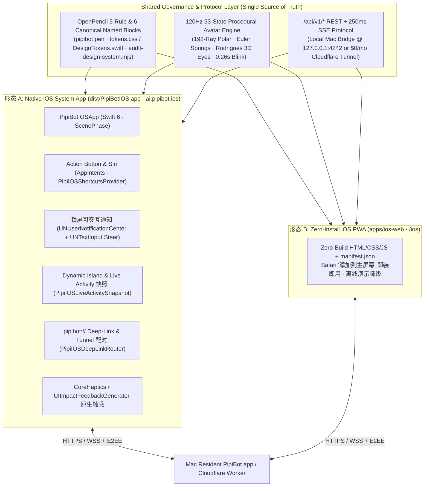

# 07 · iOS 双形态交付指南：原生系统应用 (`PipiBotIOS.app`) + 零安装 PWA (`apps/ios-web`)

> **版本基线**: `v0.2.0-beta` (Wave 4 Native iOS 系统应用与 PWA 双端交付)
> **目标形态**: Native iOS System App (`ai.pipibot.ios` -> `dist/PipiBotIOS.app`) × Zero-Install PWA (`apps/ios-web`)
> **相关文档**: [05 Mac/iOS V1 实现规范](./05-MAC-AND-IOS-V1-IMPLEMENTATION.md) · [06 Mac 原生应用指南](./06-MAC-NATIVE-APP-GUIDE.md) · [03 Cloudflare 免费层与 Fleet](./03-CLOUDFLARE-AND-FLEET-INFRA.md) · [UI/UX 设计系统](../design-system/01-UIUX-DESIGN-SYSTEM.md)

---

## 1. iOS 双形态交付架构 (Dual-Mode iOS Delivery Architecture)

为了让用户无论处于“重度随身 iPhone 深度协同”还是“零签名即开即用”场景下都能无缝指挥 Mac 常驻中枢与 `PipiFleet`，PipiBot 在 iOS 端采用 **Native 系统应用 (`PipiBotIOS.app`) + Zero-Install PWA (`apps/ios-web`)** 双形态并行的交付策略：



### 1.1 双形态互补定位对比

| 维度 | Native 系统应用 (`dist/PipiBotIOS.app`) | Zero-Install PWA (`apps/ios-web`) |
| :--- | :--- | :--- |
| **分发与启动门槛** | 需通过 Xcode / iOS Simulator / TestFlight 安装原生 `.app` Bundle (`ai.pipibot.ios`) | **零安装、零证书签名**：Safari 打开 `/ios` 并“添加到主屏幕”即可全屏运行 |
| **系统级深层能力** | 完整拥有 **Action Button / Siri `AppIntents`**、**锁屏直接文本回复 Steer 通知**、**灵动岛/小组件快照桥接**、**`pipibot://` URL Scheme** 与 **原生触感** | 受限于 WebKit 沙盒，专注于轻量实时看板、快速审批与离线演示 |
| **视觉与交互一致性** | 遵循 OpenPencil 5-Rule：引用 `PipiTokens`（0 原始十六进制色值）与 SwiftUI 6 大积木 (`CanonicalBlocks.swift`) | 100% 绑定 `design-system/tokens.css`（0 原始 hex/rgb）与 CSS 6 大积木 |
| **头像渲染引擎** | `PipiProceduralAvatarEngine.swift` + SwiftUI `Canvas` (120Hz ProMotion) | `design-system/pipibot-avatar.js` + SVG DOM (`requestAnimationFrame`) |
| **后端通信协议** | `PipiDaemonClient` 直连 `/api/v1/*` + 250ms SSE（支持 `pipibot://pair?tunnel=...` 一键重绑 Cloudflare Tunnel） | `apps/ios-web/app.js` 直连同源或远程 `/api/v1/*` + SSE（断网自动优雅降级） |

---

## 2. 原生 iOS 系统应用核心系统级集成 (`PipiIOSSystemIntegration.swift`)

[`apps/apple/Sources/PipiBotIOSUI/PipiIOSSystemIntegration.swift`](../../apps/apple/Sources/PipiBotIOSUI/PipiIOSSystemIntegration.swift) 与入口 [`apps/apple/Sources/PipiBotIOSApp/PipiBotIOSApp.swift`](../../apps/apple/Sources/PipiBotIOSApp/PipiBotIOSApp.swift) 跨 **`iPhoneSimulator` SDK** 与 **`macOS` SDK** 双端干净编译（并通过 `npm run audit:design` 零原始色值审计），提供五大 OS 级集成：

### 2.1 iPhone Action Button & Siri (`AppIntents` / `PipiIOSShortcutsProvider`)
通过 `#if canImport(AppIntents)` 原生暴露三大快捷意图与系统级 `AppShortcutsProvider`（用户可将 iPhone 15/16/17 侧边 **Action Button** 或 **Siri 语音指令** 直接绑定至 PipiBot）：
- **`PipiApproveTopDecisionIntent`**：不解锁进 App 即可直接批准当前优先级最高的 `Needs You` 阻塞项。
- **`PipiTriggerNightlyDreamIntent`**：唤醒 `PipiEvolutionLoop` 立即运行一次四层记忆整合与 Skill 提炼。
- **`PipiAskHarnessIntent`**：通过 Siri 语音提问并交由当前选定的 Harness（`Pi` / `Claude Code` / `Codex` / `OpenCode` / `BYOK`）异步执行。

### 2.2 锁屏可交互决策通知 (`UNUserNotificationCenter` + `UNTextInputNotificationAction`)
`PipiIOSNotificationManager`（`#if canImport(UserNotifications)`）在应用启动时注册两类高信息密度可交互通知类别：
1. **`NEEDS_YOU_DECISION`**：
   - `APPROVE_ACTION`：锁屏长按通知一键批准（Approve）并继续子会话。
   - `STEER_ACTION`（`UNTextInputNotificationAction`）：**直接在锁屏输入框键入 Steer 纠偏引导语**发送回 Mac 宿主，无需打开完整界面。
   - `REJECT_ACTION`：驳回并终止高风险操作。
2. **`EVOLUTION_DIGEST`**：
   - `APPROVE_DIFF_ACTION`：一键采纳夜间总结出的 `USER.md` / `SOUL.md` 进化变更。
   - `OPEN_SOUL_ACTION`：深链拉起并跳转至记忆审查视图。

### 2.3 灵动岛 (`Dynamic Island`)、Live Activity 与小组件快照桥接
- **`PipiIOSLiveActivitySnapshot` (`Codable, Sendable, Equatable`)**：封装精简跨进程状态负载——包含 `avatarState`（53 状态之一）、`expression`、`activeHarness`、`activeOutcomeTitle`、`pendingDecisionsCount`、`tunnelRttMs`、`understandingScorePct`、`onlineNodesCount` 与 `updatedAt`。
- **`PipiIOSWidgetBridge`**：在 `PipiBotIOSApp` 的 `ScenePhase` 切换（`.active` / `.background`）及用户手动点击同步时，原子读写共享快照文件 `ios-live-activity-snapshot.json`（默认存放于 `PipiNativeMacRuntime.appSupportDirectory()`，并为 WidgetKit / ActivityKit Extension 预留 App Group 容器对接位）。`Info.plist` 已开启 `NSSupportsLiveActivities = true`。

### 2.4 `pipibot://` Deep-Link 与 Cloudflare Tunnel 配对路由 (`PipiIOSDeepLinkRouter`)
[`PipiIOSCompanionRootView.swift`](../../apps/apple/Sources/PipiBotIOSUI/PipiIOSCompanionRootView.swift) 通过 `.onOpenURL` 挂载 `PipiIOSDeepLinkRouter`，支持以下标准路由：

| URL Scheme | 路由解析 (`PipiIOSDeepLinkAction`) | 触发行为 |
| :--- | :--- | :--- |
| `pipibot://pair?tunnel=https://...` | `.pairTunnel(URL)` | 动态将 `PipiAppStore` / `PipiDaemonClient` 绑定至用户的 Cloudflare Tunnel 加密地址并刷新连接，自动切换至 Fleet 页签 |
| `pipibot://tab/outcomes` | `.selectTab(.outcomes)` | 直达 Outcomes 责任看板 |
| `pipibot://tab/needs-you` | `.selectTab(.needsYou)` | 直达 Needs You 左滑/右滑决策栈 |
| `pipibot://tab/muse` | `.selectTab(.muse)` | 直达 Muse 空间画布与多 Harness 对话 |
| `pipibot://tab/fleet` | `.selectTab(.fleetSoul)` | 直达 Dots 节点矩阵、Cloudflare Tunnel 与记忆审计 |
| `pipibot://decision/<id>/approve` | `.approveDecision(id)` | 锁定并自动批准指定 ID 的阻塞决策 |

在界面中点击顶部灵动岛胶囊或 **Native iOS System Integrations** 按钮，即可弹出 `PipiSheet` 查看四大 OS 集成就绪状态，并一键测试 `pipibot://` 跳转或实时写入灵动岛快照。

### 2.5 原生触感反馈 (`UIImpactFeedbackGenerator` / CoreHaptics)
在 `#if os(iOS)` 下，针对 **Needs You** 卡片滑动越过阈值、批准/驳回落定、120Hz `PipiAvatar` 点击眨眼以及 Tab 切换，均由 `UIImpactFeedbackGenerator` 触发细腻分级震动（在 macOS 上预览 `PipiBotIOSUI` 时自动静默隔离）。

---

## 3. iOS 端四大功能工作区 (Four Core iOS Workspaces)

无论是 `PipiBotIOS.app` 还是 `apps/ios-web`，底部贴底导航栏（`PipiBottomBar`）均统一划分为四大核心工作区（`PipiIOSTab`）：

| Tab | 视图组件 (`PipiBotIOSUI`) | 核心能力 |
| :---: | :--- | :--- |
| **1. Outcomes** | `PipiIOSCompanionRootView` (`outcomesPage`) | 按 `dev` / `work` / `daily_life` / `infra` 过滤浏览自主目标、查看每日美元预算消耗、一键触发两阶段评估，并通过 `PipiFormSheet` 新建责任合约。 |
| **2. Needs You** | `NeedsYouSwipeDeckView` | Devin 风格单手滑动决策收件箱：展示阻塞摘要、风险标记与 R2 Before/After Diff 证据；右滑批准、左滑驳回或输入 Steer 指令；清空后展现严格合规的 `PipiEmptyState`（1 图标 + 1 标题 + 1 句话 + 1 按钮）。 |
| **3. Muse** | `MuseSpatialCanvasView` | 自由空间工作/生活/研发卡片画布（`MuseCardItem`），集成 `Pi` / `Claude Code` / `Codex` / `OpenCode` / `BYOK` 五大 Harness 实时切换 `PipiSheet`、语音打断控制及流式对话。 |
| **4. Fleet** | `DotsFleetAndTunnelView` | 五端 **Dots** 活力点阵（Mac / iOS / VPS / Windows / Embedded）、Cloudflare Tunnel RTT 与 $0/月 免费配额仪表盘，以及四层记忆 **Understanding Score** 与夜间 Dreaming `EvolutionDiff` 审核。 |

---

## 4. 构建与运行指南 (Build & Launch Guide)

### 4.1 打包并运行原生 iOS 系统应用 (`dist/PipiBotIOS.app`)

[`scripts/build-ios-app.sh`](../../scripts/build-ios-app.sh) 通过 `xcodebuild` 针对 `iPhoneSimulator` SDK 编译 `PipiBotIOSApp`，生成完整 `dist/PipiBotIOS.app` Bundle（含 `MinimumOSVersion: 17.0`、`NSSupportsLiveActivities: true`、`CFBundleURLTypes: ["pipibot"]`、`NSAllowsLocalNetworking: true`）并执行校验与自签名：

```bash
# 1. 一键构建并打包 Release 版 dist/PipiBotIOS.app
npm run app:ios

# 2. 验证产物架构、Plist 与签名
file dist/PipiBotIOS.app/PipiBotIOSApp
plutil -lint dist/PipiBotIOS.app/Info.plist
codesign --verify --deep --strict dist/PipiBotIOS.app

# 3. 安装并在 iOS Simulator 启动（需已创建或启动一台 iPhone 模拟器）
xcrun simctl install booted dist/PipiBotIOS.app
xcrun simctl launch booted ai.pipibot.ios

# 4. 测试 Deep-Link 与 Cloudflare Tunnel 配对路由
xcrun simctl openurl booted "pipibot://tab/needs-you"
```

### 4.2 零安装体验 iOS PWA (`apps/ios-web`)

- **随 Mac 原生 App 自动开启**：当 Mac 端运行 [`PipiBot.app`](./06-MAC-NATIVE-APP-GUIDE.md) 并开启内嵌桥接，或独立运行 `npm run start:daemon` 时，iPhone（同局域网或经 Cloudflare Tunnel）与桌面浏览器直接访问 **`http://127.0.0.1:4242/ios`**（远程访问填您的 Cloudflare Tunnel HTTPS 域名 + `/ios`）。
- **添加到主屏幕**：在 iPhone Safari 点击分享按钮 -> **“添加到主屏幕 (Add to Home Screen)”**，通过 [`apps/ios-web/manifest.json`](../../apps/ios-web/manifest.json) 以独立全屏 App 视口运行。
- **跨平台全量测试**：运行 `npm run verify`（含 `check:ios` 语法检查与 `audit:design` 五规则审计）以及 `npm run test:apple` 验证 `PipiIOSDeepLinkRouter` 与 `PipiIOSLiveActivitySnapshot` 单元测试。
