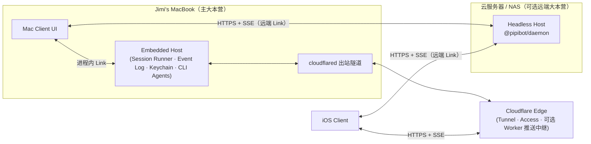
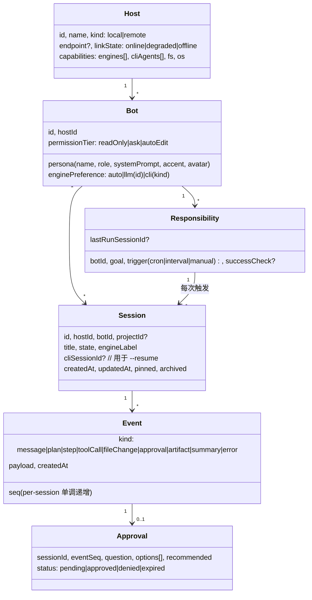
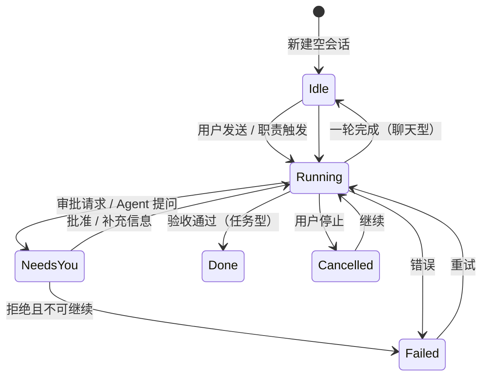
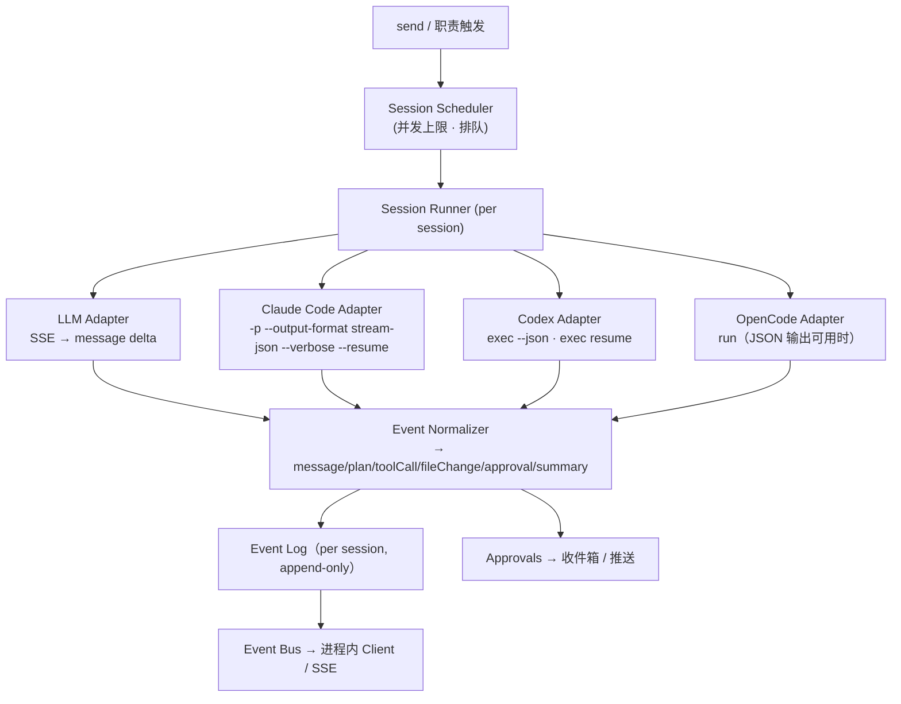

# 08 · Bot Runtime 与体验蓝图（Bot Runtime & Experience Blueprint）

> 状态：**Accepted · v1（2026-11-19）** —— 本文是 PipiBot 从“多人设聊天客户端”升级为“开源 Grok Bot / Devin Bot 复刻”的北极星文档。后续所有架构、协议与 UI 改动以本文为准；与旧文档冲突时以本文为准。
>
> 相关：[`01-PRODUCT-VISION-AND-RESEARCH.md`](01-PRODUCT-VISION-AND-RESEARCH.md) · [`03-CLOUDFLARE-AND-FLEET-INFRA.md`](03-CLOUDFLARE-AND-FLEET-INFRA.md) · [`06-MAC-NATIVE-APP-GUIDE.md`](06-MAC-NATIVE-APP-GUIDE.md)

---

## 1. 一句话原则

> **Bot 装在哪里，哪里就是它的 Runtime（大本营）；任何客户端都只是“连到这个大本营的窗口”。**

- 用户**不需要**持续的云端资源：一台常开的 Mac 就是 Bot 的电脑与常驻地。
- 有条件的用户可以把 Bot 装在云服务器 / NAS / 树莓派上——对 Mac 和 iOS 来说，这只是“添加一个远端 Bot 大本营”。
- 本地 Bot 与远端 Bot **在 UI 上是同一种东西**，区别只在一个“它住在哪”的标签与在线状态。

---

## 2. 术语（全仓统一使用）

| 术语 | 定义 | 例子 |
|---|---|---|
| **Host（大本营 / Runtime Host）** | 一个能运行 Bot 的执行环境：持有引擎凭证、文件系统、本地 CLI Agent、Session 执行器与事件日志 | Jimi 的 MacBook（PipiBot.app 内嵌 Host）、`hk-vps`（headless `@pipibot/daemon`） |
| **Bot** | 住在**唯一一个** Host 上的长期 Agent：人设 + 引擎偏好 + 工具权限 + 记忆 + 职责 | Coder、Operator |
| **Session（会话 / 任务）** | Bot 的一次工作单元，带状态机；聊天只是“只有消息事件”的 Session | “修复登录页 CLS 抖动” |
| **Event** | Session 内追加写入的不可变记录（消息、计划、工具调用、文件改动、审批请求、产物、总结） | `toolCall: npm test ✓ 12s` |
| **Approval（需要你）** | Session 暂停等待人类决策的事件；汇总进全局收件箱 | “允许执行 `git push`？” |
| **Responsibility（职责）** | 目标 + 触发器 + 验收条件；每次触发产生一个 Session | “每个工作日 9:00 汇总 GitHub 通知” |
| **Engine** | Host 本地可用的推理资源：BYOK LLM（OpenAI/Anthropic/…/Ollama）或本地 CLI Agent（Claude Code / Codex / OpenCode） | `Anthropic · claude-sonnet-4` |
| **Client** | 人机交互界面：Mac UI、iOS App、PWA | — |
| **Link** | Client 与 Host 之间的连接 | 进程内（Mac 本机）、Cloudflare Tunnel、直连 HTTPS |

**铁律**
1. **Engine 与凭证永不离开 Host。** iOS 不保存 Mac 上 Bot 的 API Key；它只发指令、收事件。
2. **Bot 不跨 Host 漂移。** 迁移 Bot = 导出/导入，而非“同一个 Bot 同时跑在两处”。
3. **Host 是事实来源（Source of Truth）。** Client 只缓存，可随时丢弃重建。

---

## 3. 部署拓扑



| 形态 | Host | Client | V1 优先级 |
|---|---|---|---|
| **A. 纯 Mac** | PipiBot.app 内嵌 Host | Mac UI（进程内） | **P0（本轮）** |
| **B. Mac + iPhone** | 同上，经 Cloudflare Tunnel 暴露 Host API | iOS 作为远端 Client | P1 |
| **C. 远端 Bot** | 云端 headless `@pipibot/daemon` | Mac / iOS 都以“添加远端大本营”接入 | P2 |
| **D. 移动端自带 Agent（参考 openminis）** | iOS 本机轻量 Host | iOS 本机 | 远期 |

---

## 4. 领域模型



### 4.1 Session 状态机



- **聊天型 Session** 一轮结束回到 `Idle`；**任务型 Session**（来自职责或“后台运行”）以 `Done/Failed` 结束。
- 状态只由 Host 写入；Client 通过事件流得知。

### 4.2 并发与资源

- 每个 Session 有独立的 `RunState`（任务句柄、开始时间、流式缓冲）。**不同 Session 互不打断。**
- Host 级并发上限（默认：CLI Agent 2 个、LLM 4 个），超出进入 `Queued`（UI 显示“排队中”）。
- 职责触发**绝不**切换用户当前视图；只在侧栏/收件箱/通知中出现。

---

## 5. Host 协议 v2（Client ⇄ Host）

本机 Mac 通过进程内实现同一协议；远端通过 HTTP。**UI 只依赖协议，不依赖实现。**

```swift
// PipiBotKit — 客户端视角的唯一入口
public protocol PipiHostConnection: AnyObject, Sendable {
    var host: PipiHostDescriptor { get }
    func listBots() async throws -> [PipiBot]
    func listSessions(since: Date?) async throws -> [PipiSessionSummary]
    func events(sessionId: String, afterSeq: Int) -> AsyncThrowingStream<PipiSessionEvent, Error>
    func send(sessionId: String?, botId: String, input: PipiUserInput) async throws -> String // sessionId
    func stop(sessionId: String) async throws
    func resolveApproval(_ id: String, optionId: String, note: String?) async throws
}
// 实现：PipiLocalHostConnection（进程内） / PipiRemoteHostConnection（HTTPS+SSE）
```

| HTTP（远端 Link） | 说明 |
|---|---|
| `GET  /api/v2/host` | Host 描述、能力、版本 |
| `GET  /api/v2/bots` · `POST/PATCH/DELETE` | Bot 管理 |
| `GET  /api/v2/sessions?since=` | 会话摘要（状态、标题、最后事件） |
| `POST /api/v2/sessions` · `POST /api/v2/sessions/:id/input` | 新建 / 继续 |
| `POST /api/v2/sessions/:id/stop` | 停止 |
| `GET  /api/v2/sessions/:id/events?after=<seq>` (SSE) | **可重放**事件流：断线重连从 `after` 续传 |
| `GET  /api/v2/approvals?status=pending` · `POST /api/v2/approvals/:id` | 收件箱 |
| `GET/POST /api/v2/responsibilities` | 职责 |

- **同步语义**：Event 日志 append-only + per-session `seq`。Client 离线回来 = 拉 `sessions?since` + 每个关注会话 `events?after`。无需 CRDT。
- **配对与鉴权**：Mac 设置页显示二维码（Host 公网 URL + 一次性配对码）→ iOS 扫码换取**可吊销的设备令牌**（存 iOS Keychain）；可叠加 Cloudflare Access Service Token。Host 侧维护“已配对设备”列表，可一键吊销。
- **推送**：Host 产生 Approval / Done / Failed 时，经可选 Worker 中继发 APNs；无推送时 iOS 前台轮询 + SSE。
- v1 `/api/v1/*` 保留只读兼容，逐步废弃。

---

## 6. Host 内部（执行层）



- **权限档位（per Bot，可被 per Project 覆盖）**
  - `readOnly`：Claude `--permission-mode plan` / Codex `--sandbox read-only`
  - `ask`（默认）：工具请求转为 Approval 事件，用户批准后继续（无法交互式批准的 CLI 退化为“先给出计划 → 用户批准 → 以 autoEdit 重新执行”）
  - `autoEdit`：Claude `--permission-mode acceptEdits` / Codex `--sandbox workspace-write`
- **流式解码**：子进程输出按字节累积，只解码完整 UTF-8 序列；按行解析 JSONL。
- **持久化**：`~/Library/Application Support/PipiBot/`
  - `host.json`（Host/Bot/Project/职责/设置，带 `schemaVersion`）
  - `sessions/<id>.json`（摘要 + 事件，或 JSONL）
  - 写入：防抖合并、后台串行队列、原子替换；解码失败**先备份为 `*.corrupt-<ts>`**，绝不覆盖。
  - 凭证：**仅 Keychain**（`service = app.pipibot.engine`，`account = providerId`）。

---

## 7. 体验蓝图（UI/UX）

### 7.1 信息架构（Mac）

```text
┌ Sidebar（NavigationSplitView）┬ Session 时间线 ─────────────────────┬ Inspector（.inspector）┐
│ 🔍 搜索 / 命令  ⌘K            │ 标题 · Bot · 项目 · 引擎 · 状态      │ 计划 │ 改动 │ 上下文  │
│ 📥 需要你 (n)                 │ ───────────────────────────────── │                       │
│ ☀️ 今日                        │ 你：……                              │ ☑ 步骤 1              │
│ 会话（全局，按状态+时间分组）    │ ▸ 计划（3 步）                      │ ◻ 步骤 2              │
│   ● 运行中 / ! 需要你           │ ▸ 读取 4 个文件 · ▸ npm test ✓ 12s │ server.ts +18 −4      │
│   今天 / 昨天 / 更早            │ ┌ 需要你：允许 git push？ ┐        │                       │
│ 项目 ▸                         │ └ [允许一次][总是][拒绝]  ┘        │                       │
│ Bots ◯◯◯ +   🖥 本机 · 在线      │ [Bot▾][引擎▾][权限▾]  输入…   ⬆     │                       │
└───────────────────────────────┴────────────────────────────────────┴───────────────────────┘
```

- **会话是全局的**，Bot 是会话属性与筛选器（不再“先选 Bot 才能看到它的历史”）。
- **“它住在哪”永远可见但安静**：Host 徽标（🖥 本机 / ☁️ hk-vps）+ 链路状态点；离线 Host 的会话变灰、可读不可发，并给出“重新连接”。
- **收件箱**汇总所有 Host 的 Approval；审批卡同时原地出现在时间线中（两处操作结果一致）。
- **Inspector 推开内容，不覆盖内容**；窄窗口时自动折叠为 sheet。

### 7.2 Session 时间线规则

| 事件 | 呈现 | 默认 |
|---|---|---|
| message (user) | 右侧轻卡片 / 全宽块 | 展开 |
| message (assistant) | Markdown 正文 | 展开 |
| plan | 可勾选清单卡，随进度更新 | 展开 |
| step / toolCall | 单行：图标 + 动词短语 + 结果 + 耗时 | **折叠**（连续步骤合并为“▸ 5 个步骤”） |
| fileChange | 文件名 +增/−删，点开在 Inspector 看 Diff | 折叠 |
| approval | 高对比卡片 + 主次按钮 | 展开、置顶提示 |
| summary | 结论 + 证据（退出码、测试、改动文件） | 展开 |
| error | 原因 + **可执行按钮**（重试 / 换引擎 / 打开设置） | 展开 |

### 7.3 状态语义（全端统一色与形）

| 状态 | 点 | 文案 |
|---|---|---|
| Running | 呼吸点（accent） | 运行中 · 2m |
| Queued | 空心点 | 排队中 |
| NeedsYou | 实心 warning + `!` | 需要你 |
| Done | ✓ success | 已完成 |
| Failed | ✕ error | 失败 |
| Offline Host | 灰色虚线点 | 大本营离线 |

### 7.4 Apple 设计工艺约束（验收标准）

1. **Response**：按下即反馈（`PipiPressButtonStyle`）；任何流式更新不得让整窗重算——计时器使用独立 `TimelineView`。
2. **Spatial consistency**：Inspector 从右进右出；快捷面板从顶部中央出现并回到原处；Sheet 来自触发处。
3. **Springs**：默认 `response 0.3, damping 1.0`；只有带动量的手势（iOS 卡片滑动审批）才允许 `damping ≈ 0.8`。
4. **Materials**：侧栏 = 结构层（较重材质），浮动面板 = 交互层（较轻）；不叠两层玻璃；尊重 `accessibilityReduceTransparency`、`accessibilityReduceMotion`、`prefers-contrast`。
5. **Typography**：系统字体；字号 token 随“界面文字大小”缩放（环境值），**禁止整窗 `scaleEffect`**。
6. **Agency**：可恢复操作给撤销（⌘Z / “已删除 · 撤销”）；不可逆操作给 `confirmationDialog`。
7. **Accessibility**：所有图标按钮有 `accessibilityLabel`；悬停才出现的操作同时提供键盘/菜单/`accessibilityAction` 入口。
8. **Wayfinding**：任一屏幕回答“我在哪个 Bot / 哪个大本营 / 它在干嘛 / 怎么停”。

### 7.5 关键流程

- **首次启动**：欢迎 → 连接引擎（BYOK 或本机 CLI，Key 存 Keychain，带“测试连接”）→ 选择/创建第一个 Bot → 进入空会话（带 3 个起手式）。
- **派活并离开**：输入 → 选“后台运行”→ 侧栏出现运行中会话 → 完成/需要你时系统通知 + 菜单栏角标。
- **全局唤起 ⌥Space**：任何 App 前台都可唤起；面板内直接流式回答；`⌘↩` “在主窗口继续”，`Esc` 收起；不污染当前会话（新建会话）。
- **添加远端大本营（P2）**：设置 → 大本营 → “添加” → 扫码/粘贴 URL+配对码 → 能力探测 → 其 Bot 出现在 Bots 行（带 ☁️ 徽标）。

---

## 8. iOS 定位（形态 B）

iOS = **口袋里的指挥台**，不是第二个聊天 App：
1. **收件箱**（默认 Tab）：Approval 卡片，支持滑动批准/拒绝（带动量的弹簧 + 触感，仅在“提交”时触发）。
2. **会话**：全局列表 + 时间线（只读完整、可继续发送、可停止）。
3. **派活**：选 Bot → 输入 → 后台运行。
4. **大本营**：已配对 Host、在线状态、重新配对。
- 使用原生 `TabView` / `NavigationStack` / 系统 Live Activity；**不在 App 内模仿灵动岛**。

---

## 9. 品质门槛（Definition of Done）

| 维度 | 门槛 |
|---|---|
| 数据 | 任何解码失败不丢数据（备份 + 提示）；凭证 0 明文落盘 |
| 并发 | 两个会话同时运行互不影响；职责触发不抢视图 |
| 流式 | 中文/emoji 0 丢字；10k 字回复滚动无可感知卡顿 |
| 可见性 | CLI Agent 会话可看到工具步骤与改动文件 |
| 可达性 | VoiceOver 可完成：新建会话、发送、停止、复制、批准 |
| 构建 | `swift build` + `swift test` 全绿；新增逻辑有单测 |

---

## 10. 路线映射

| 阶段 | 内容 | 本轮 |
|---|---|---|
| **S0 · 地基（A）** | Keychain、安全持久化、撤销/确认、UTF-8 流修复、per-session 运行状态 | ✅ |
| **S1 · Session 内核（B）** | Session/Event 模型与迁移、Host 抽象接缝（`PipiHostConnection` + Local 实现）、CLI 结构化事件、时间线 UI、权限档位、原地审批 | ✅ |
| **S2 · 原生外壳（C）** | `NavigationSplitView` + `.inspector` + toolbar、全局会话列表与 ⌘K 搜索、收件箱、全局 ⌥Space 面板内回答、无障碍 | ✅ |
| S3 · 主动性 | Responsibility 取代 Routine、今日简报、系统通知、可审阅记忆 | 下一轮 |
| S4 · 跨端 | Host API v2 HTTP 实现、Tunnel 配对、iOS 指挥台 | 下一轮 |
| S5 · 远端大本营 | headless daemon 实现 v2、Mac/iOS 添加远端 Host | 之后 |
| S6 · 移动端自带 Agent | 参考 openminis 的 iOS 本机 Host | 远期 |

---

## 11. Mac 体验对齐修订（§7.1 & §7.4 实施记录 · 2026-11-19）

- **§7.1 信息架构修订**：
  - 左侧栏收拢为 `+ 新建任务 / ⌘K` 顶部动作栏、`需要你` 与 `Bots` 两项一级导航、统一合并单聊与群聊的 `任务` 时间分组列表（支持 `全部 / 群聊 / Bot` 过滤），以及单行 `Host 弹窗 + ⚙ 设置` 底部栏；取消独立搜索栏、虚线空状态占位符与重复快捷脚栏。
  - `Bots` 入口升级为 `PipiBotsHubView`（`卡片 | 3D 空间` 双模式切换），集中管理 Bot 状态、权限档位与 `PipiBotRoutine` 例行任务；右侧 `.inspector` (`任务详情`) 仅承载当前 Session 的 `计划`、`改动` 与 `上下文`。
  - 会话输入框升级为接地式两层结构（Tier 1 执行参数：`+`、通过 `PipiAppStore.setEffectivePermissionTier(_:)` 修改的权限选择器、引擎选择器、单色发送按钮；Tier 2 环境上下文：Bot 切换与完整工作区路径），并将设置窗格重组为 4 个 Tab（`通用 / 模型与引擎 / 运行环境与同步 / 记忆与数据`）。
- **§7.4 设计工艺修订**：
  - 桌面端全界面采用黑白灰中性表面阶梯（`#FFFFFF` / `#F7F7F8` / `#EFEFF1` 对应 Dark `#0F1012` / `#141518` / `#181A1E`），消除彩色渐晕与拟物顶边高光，所有自绘指示箭头的 SwiftUI `Menu` 均附加 `.menuIndicator(.hidden)` 杜绝双箭头，用户可见品牌字符串统一为 **`PiPiBot`**。
