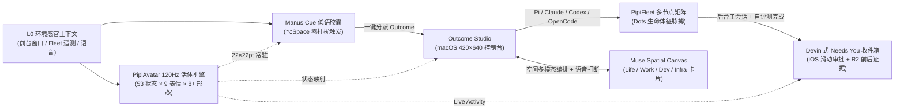

# PipiBot UI/UX 设计系统规范：Ambient Soul & Outcome Studio

> **版本**：`v0.1.0-alpha`  
> **配套可运行原型**：[`design-system/index.html`](../../design-system/index.html) · [`design-system/pipibot-avatar.js`](../../design-system/pipibot-avatar.js) · [`design-system/tokens.css`](../../design-system/tokens.css)  
> **本地零构建预览**：`python3 -m http.server 8080` → 访问 `http://127.0.0.1:8080/design-system/`

---

## 1. 设计哲学：Ambient Soul & Outcome Studio（环境灵魂与结果工作室）

传统 AI 工具存在两大体验割裂：一端是冰冷的黑盒命令行或长篇累牍的聊天流（用户被迫像监工一样逐行阅读工具日志）；另一端是缺乏上下文连续性的独立 App（每次切换设备或应用都要重新解释前情）。

PipiBot 提出 **"Ambient Soul & Outcome Studio（环境灵魂与结果工作室）"** 设计哲学，将五种前沿人机交互范式融为统一的跨端体验语言：

| 灵感源泉 | 核心基因 | 在 PipiBot 中的演进与落地 |
| :--- | :--- | :--- |
| **GrokBot** (`ArvinYin1/grokbot-animation-anatomy`) | 活体程序化角色与拟真物理反应 | 摒弃静态 PNG 与死板 Lottie，采用 192 射线矢量变形 + 120 Hz Euler 弹簧 + Rodrigues 伪 3D 球面凝视，让 AI 在 Mac 菜单栏与 iOS 灵动岛拥有可戳、会眨眼、有呼吸的「数字灵魂」。 |
| **Manus Cue** | 环境感知轻量低语胶囊 (`⌥Space`) | 极低侵入性的桌面浮层，静默感知前台窗口（Xcode / Terminal / Mail / Safari / HomeKit）与 L0 感官记忆，只在置信度足够高时“低声提示”一键可达的下一步。 |
| **Dots** | 极简点阵脉搏与分布式节点生命体征 | 用 3×3 有机呼吸光点矩阵代替喧闹的系统监控图表，一眼感知 Mac、iOS、Linux VPS、Windows、ESP32/树莓派的活性、延迟与退化告警。 |
| **Muse** | 自由空间多模态画布 + 随时语音打断 | 打破单一时间线聊天框，用空间卡片自由组织「生活（Life）/ 工作（Work）/ 研发（Dev）/ 设施（Infra）」对象，支持在任何时刻通过语音直接打断并重定向 Bot 舰队。 |
| **Devin Bots** | 结果责任制（AI Manager）与 "Needs You" 收件箱 | 从“执行单次指令（IC）”转向“对结果持续负责（Manager）”。子会话执行、自动评测与自愈在幕后静默完成，仅在遇到权限边界、高风险发布或主观取舍时收敛至统一的 **「Needs You」决策卡片栈**（附带 Cloudflare R2 Before/After 对比证据）。 |

### 1.1 五大交互范式协同架构



### 1.2 四项黄金交互原则

1. **Calm Until Decisive（平时静谧，关键时果断）**：平时仅以 `22×22pt` 菜单栏微表情与低饱和度 Dots 脉搏存在；一旦子会话完成交付或触及风险红线，立即通过 `Needs You` 卡片 + `CoreHaptics` 明确唤起人类拍板。
2. **Evidence Over Raw Logs（呈现对比证据，而非原始日志）**：永远不把 500 行终端堆栈直接甩在移动端首屏；先展示 `CLS: 0.34 → 0.01`、Before/After 截图或 1080p MP4 录屏（存储于零出流量的 Cloudflare R2），按需才展开底层 Trace。
3. **120 Hz Physicality Everywhere（全域 120 Hz 物理直觉）**：所有状态切换、形态蜕变、卡片滑出与灵动岛展开均由半隐式 Euler 弹簧方程驱动，拒绝生硬的线性 CSS `transition`。
4. **Unified Life / Work / Dev / Infra Grammar（生活与工程统一语法）**：航班值机提醒、卧室空调策略、PR #42 布局回归修复与 VPS Nginx 重载共享同一种卡片解剖结构与审批语义。

---

## 2. 活体程序化头像引擎规范（`PipiAvatar` Procedural SVG Engine）

受 `ArvinYin1/grokbot-animation-anatomy` 启发，`PipiAvatar` 采用 **零第三方运行时依赖、纯原生 ES Module + 矢量 SVG** 实现（[`design-system/pipibot-avatar.js`](../../design-system/pipibot-avatar.js)）。相比 Lottie/GIF/WebGL，程序化 SVG 具备四大不可替代优势：
- **任意态无缝插值**：任意两个状态之间均可基于当前物理位置实时向目标形态混合，无关键帧时间轴跳变；
- **全尺度无损锐利**：同一套数学内核同时驱动 macOS MenuBar `22×22pt`、Manus Cue `32×32pt`、iOS 灵动岛 `22×22pt` 与桌面舞台 `210×210pt`；
- **微秒级交互响应**：鼠标移动、点击戳击（Poke）、语音音量波动可在同一帧内注入弹簧速度；
- **极低资源占用**：引擎核心代码 `< 25 KB`，静态待机 CPU 占用 `< 1%`。

### 2.1 支柱一：192 射线极坐标轮廓采样与形态插值（`R_shape(θ)`）

所有头像外轮廓均定义在以质心为原点的极坐标系中，等分采样 **`N = 192`** 条射线：

$$\theta_i = \frac{2\pi \cdot i}{192}, \quad i \in \{0, 1, \dots, 191\}$$

在状态切换时，引擎将源轮廓半径向量 $R_{\text{from}}[0..191]$ 与目标轮廓半径向量 $R_{\text{to}}[0..191]$ 通过 `swap` 弹簧进度 $s \in \mathbb{R}$（支持轻微过冲）逐射线插值，再使用二次中点样条（Quadratic Midpoint Spline：`M ... Q ... Z`）重建丝滑闭合 SVG `<path>`：

$$R_{\text{curr}}[i] = R_{\text{from}}[i] + \big(R_{\text{to}}[i] - R_{\text{from}}[i]\big) \cdot s_{\text{swap}}$$

$$P_i = \begin{pmatrix} c_x + (\cos\theta_i \cdot r_i \cdot S_x)\cos\phi - (\sin\theta_i \cdot r_i \cdot S_y)\sin\phi \\ c_y + (\cos\theta_i \cdot r_i \cdot S_x)\sin\phi + (\sin\theta_i \cdot r_i \cdot S_y)\cos\phi \end{pmatrix}, \quad r_i = R_{\text{curr}}[i] \cdot r_{\text{base}}$$

#### 8 个核心可运行几何形态（已内置于 `AVATAR_SHAPES`）

| Shape ID | 中文名 | 极径公式 $r(\theta)$ | 语义场景 |
| :--- | :--- | :--- | :--- |
| `orb` | 灵动圆球 | $r(\theta) = 0.98$ | 默认静息、日常陪伴、BYOK 流式响应 |
| `squircle` | 超椭圆胶囊 | $r(\theta) = 0.94 \cdot \big(|\cos\theta|^4 + |\sin\theta|^4\big)^{-1/4}$ | Claude Code 路由、Mac 自动化、标准卡片宿主 |
| `cloud` | 漫步云朵 | $r(\theta) = 0.87 + 0.115\cos(5\theta - \frac{\pi}{2}) + 0.038\cos(10\theta)$ | 深度思考、链式推理、隧道重连 |
| `spark` | 灵感星芒 | $r(\theta) = 0.70 + 0.34 \cdot |\cos(2\theta)|^{1.65}$ | Manus Cue 灵感提示、自我进化、子会话派生 |
| `bolt` | 高能脉冲 | $r(\theta) = 0.85 + 0.13\cos(2\theta - 0.65) + 0.10\cos(6\theta + 0.25)$ | Codex 执行、VPS 部署、节点高负载告警 |
| `shield` | 守护盾徽 | 上半部超椭圆肩线，下半部收窄尖端：$r_{\text{base}} \cdot (1 - 0.28\sin\theta\cos^2\theta + 0.11\sin^4\theta)$ | Needs You 安全确认、夜间守望、R2 加密同步 |
| `dream` | 梦境弦月 | $r(\theta) = 0.90 + 0.10\sin(2\theta - 0.4) + 0.07\cos(3\theta + 0.6) - 0.04\cos\theta$ | 夜间做梦记忆整合、过期事实淘汰、Zen 心流 |
| `terminal` | 终端视窗 | $r(\theta) = \big(|\frac{\cos\theta}{1.07}|^6 + |\frac{\sin\theta}{0.89}|^6\big)^{-1/6}$ | Pi 原生编码、Bash 执行、代码 Diff 审查 |

#### 25 形态扩展词库（设计系统全集映射）

除上述 8 个核心基准轮廓外，完整 PipiBot 视觉词典定义了 **25 个语义形态**（扩展形态在运行时通过基形谐波叠加生成）：
1. `circle` (`orb`) · 2. `squircle` · 3. `cloud` · 4. `star` (`spark`) · 5. `bolt` · 6. `shield` · 7. `terminal` · 8. `moon` (`dream`) · 9. `spark4`（四芒星）· 10. `star5`（五角星）· 11. `hexagon`（六边蜂窝，VPS 节点）· 12. `diamond`（菱形，高优先级决策）· 13. `droplet`（水滴，环境湿度/IoT）· 14. `pill`（胶囊，Cue 缩略态）· 15. `flower`（花瓣，生活愉悦）· 16. `prism`（三棱柱，多模型路由分流）· 17. `wave`（正弦波包，语音打断聆听）· 18. `compass`（指南针，行程与导航）· 19. `heart`（生命节律）· 20. `leaf`（低功耗环保）· 21. `gear`（系统配置）· 22. `bell`（定时提醒）· 23. `orbit`（卫星轨道，云端同步）· 24. `crystal`（记忆结晶）· 25. `beacon`（Zero Trust 信标）。

---

### 2.2 支柱二：6 轨道 Cubic-Bézier 关键帧编舞（`x, y, rot, squash, scale, lids`）

每个生命周期状态由一段周期为 $T_{\text{period}}$ 的 **6 轨道独立关键帧序列** 驱动：

| 轨道名 | 物理含义 | 典型范围 | 过冲缓动函数 |
| :--- | :--- | :--- | :--- |
| `x` | 水平重心漂移 (`px`) | `[-4.0, +4.0]` | `cubic-bezier(0.34, 1.56, 0.64, 1)` |
| `y` | 垂直浮沉呼吸 (`px`) | `[-6.5, +5.0]` | `cubic-bezier(0.34, 1.56, 0.64, 1)` |
| `rot` | 身体倾角摇曳 (`deg`) | `[-8.0, +8.0]` | `cubic-bezier(0.22, 1.00, 0.36, 1)` |
| `squash` | 面积守恒挤压拉伸因子 | `[-0.10, +0.12]` | `S_x = (1 + s) \cdot \text{scale}, \quad S_y = \frac{\text{scale}}{1 + s}$ |
| `scale` | 全局缩放脉冲 | `[0.95, 1.08]` | `cubic-bezier(0.42, 0.00, 0.58, 1)` |
| `lids` | 眼睑基础闭合度 | `[0.00, 1.00]` | $\text{lids}_{\text{final}} = \max(\text{track}_{\text{lids}}, \text{blink}_{\text{closure}})$ |

---

### 2.3 支柱三：120 Hz 半隐式 Euler 弹簧三元组（`amount, swap, spin`）

引擎**禁止使用 CSS `transition` 定时插值**来驱动核心角色物理，而是采用固定步长累加器（$\Delta t = \frac{1}{120}\text{ s} \approx 8.333\text{ ms}$，单帧总 delta 上限钳位 `0.05s` 以防止休眠恢复爆炸）执行 **半隐式 Euler 积分（Semi-Implicit Euler）**：

$$a_t = (x_{\text{target}} - x_t) \cdot k_{\text{stiffness}} - v_t \cdot d_{\text{damping}}$$

$$v_{t+\Delta t} = v_t + a_t \cdot \Delta t$$

$$x_{t+\Delta t} = x_t + v_{t+\Delta t} \cdot \Delta t$$

| 弹簧通道 | 默认刚度 $k$ | 默认阻尼 $d$ | 驱动目标 |
| :--- | :---: | :---: | :--- |
| `amount` | `360` | `18` | 戳击（Poke）、指令下达或状态突变时的果冻形变回弹能量 |
| `swap` | `210` | `19` | 跨 192 射线轮廓的形态切换进度 ($0 \to 1$，含微弱过冲) |
| `spin` | `240` | `17` | 切换 Harness 路由或告警触发时的角动量扭转冲量 |
| `gazeX` / `gazeY` | `150` / `180` | `16` / `18` | 鼠标追踪（快速）与闲置巡游（柔和）的凝视方向平滑 |

---

### 2.4 支柱四：Rodrigues 伪 3D 球面眼球投影 + 正交投影 + SVG 发光

双眼的立体转动感并非简单的 2D `translate`，而是真实放置在单位虚拟球面上的两个锚点：
- 左眼基向量：$v_{L0} = \text{normalize}(-0.31, -0.04, 0.95)$
- 右眼基向量：$v_{R0} = \text{normalize}(+0.31, -0.04, 0.95)$

给定归一化视线目标向量 $g = (g_x, g_y)$（由指针坐标或闲置 PRNG 巡游驱动），计算旋转轴 $k$ 与旋转角 $\theta$：

$$\|g\| = \min(1, \sqrt{g_x^2 + g_y^2}), \quad \theta = \|g\| \cdot \theta_{\max} \quad (\theta_{\max} = 0.46\text{ rad} \approx 26.3^\circ)$$

$$k = \text{normalize}\big((-g_y,\; g_x,\; 0)\big)$$

随后应用 **Rodrigues 旋转公式** 计算旋转后的三维球面坐标 $v_{\text{rot}}$：

$$v_{\text{rot}} = v \cos\theta + (k \times v)\sin\theta + k(k \cdot v)(1 - \cos\theta)$$

再经 **正交投影（Orthographic Projection）** 映射至 2D SVG 面部平面，并根据深度分量 $v_{\text{rot}, z}$ 计算透视缩窄（Foreshortening）：

$$x_{\text{2D}} = c_x + v_{\text{rot}, x} \cdot R_{\text{face}}, \quad y_{\text{2D}} = c_y + v_{\text{rot}, y} \cdot R_{\text{face}}, \quad W_{\text{eff}} = W_{\text{expr}} \cdot \max(0.36,\; v_{\text{rot}, z})$$

眼球层挂载动态着色的 SVG 辉光滤镜（`<feGaussianBlur stdDeviation="3.2"/>` + `<feMerge>`）与随视线同步偏移的高光眼神光（Specular Glint）。

---

### 2.5 支柱五：内嵌 `0.26s` 自然眨眼曲线（45% 闭合）与确定性 PRNG

单次完整眨眼时长严格锁定为 **`T_blink = 0.26s`**，峰值闭合位于 **`45%`**（即 $t = 0.117\text{s}$ 处）：

$$\text{blinkClosure}(u) = \begin{cases} \left(\frac{u}{0.45}\right)^{1.55}, & 0 \le u \le 0.45 \quad \text{（快速干脆闭眼）} \\ \left(1 - \frac{u - 0.45}{0.55}\right)^{2.20}, & 0.45 < u \le 1.0 \quad \text{（柔和弹性睁眼）} \end{cases}$$

- **自动调度**：采用 **Mulberry32 确定性伪随机数生成器（Seeded PRNG）** 在 `2.6s – 6.0s` 区间调度自然眨眼，约 `14%` 概率触发连眨两下（Double Blink）。
- **命令式触发**：支持外部随时调用 `avatar.blink()` 或用户点击头像触发 `avatar.poke()`（立即叠加 `0.26s` 眨眼 + `amount` 弹簧脉冲 + `spin` 角冲量）。

---

### 2.6 支柱六：9 种核心表情与 53 种全生命周期状态机目录

#### A. 9 种核心表情参数矩阵（`CORE_EXPRESSIONS`）

| Expression ID | 中文名 | 眼宽 $W$ | 眼高 $H$ | 倾角 (`deg`) | 上下眼睑遮罩 (`top / bottom`) | 特殊几何形态 |
| :--- | :--- | :---: | :---: | :---: | :---: | :--- |
| `neutral` | 平静 | `5.2` | `6.4` | `0°` | `0.00 / 0.00` | 标准圆润胶囊眼 |
| `happy` | 愉悦 | `5.6` | `5.2` | `0°` | `0.00 / 0.42` | 弯月笑眼弧线（`happyArc = 1.0`） |
| `focused` | 专注 | `5.8` | `4.3` | `+4°` | `0.24 / 0.14` | 锐利压低护目镜式窄瞳 |
| `curious` | 好奇 | `5.6` | `7.2` | `-7°` | `0.00 / 0.00` | 歪头 + 右眼放大 `18%` 不对称凝视 |
| `alert` | 警觉 | `6.0` | `7.8` | `0°` | `0.00 / 0.00` | 高亮放大瞳孔 + 1.55× 辉光强度 |
| `proud` | 成就 | `5.8` | `4.6` | `-3°` | `0.08 / 0.45` | 满足笑眼弯弧（`happyArc = 0.85`） |
| `sleepy` | 安眠 | `5.4` | `2.8` | `0°` | `0.68 / 0.12` | 下垂弧线睡眼，低辉光 `0.65×` |
| `evolving` | 进化 | `5.8` | `6.8` | `0°` | `0.05 / 0.10` | 1.65× 强霓虹进化辉光 |
| `listening` | 聆听 | `5.9` | `7.0` | `-4°` | `0.00 / 0.00` | 微微前倾放大瞳孔（语音打断态） |

#### B. 53 状态全生命周期矩阵（5 大生命周期组 × 精确 ID 映射）

> 所有 53 个状态均已在 [`design-system/pipibot-avatar.js`](../../design-system/pipibot-avatar.js) 的 `AVATAR_STATES_53` 中完整注册并可直接在工作台中点击预览。

##### 组 1：Idle & Ambient（静息与环境陪伴 — 10 个状态）

| # | State ID | 中文名称 | 形态 | 表情 | 语义色 | 触觉曲线 (`Haptic`) | 触发上下文 |
| :---: | :--- | :--- | :--- | :--- | :--- | :--- | :--- |
| 1 | `idle` | 静息呼吸 | `orb` | `neutral` | `#7C6CF6` | `none` | 默认无任务驻留 |
| 2 | `ambient-breathe` | 环境轻搏 | `orb` | `happy` | `#7C6CF6` | `soft` | 系统健康且所有节点在线 |
| 3 | `ambient-wander` | 视线巡游 | `squircle` | `curious` | `#818CF8` | `none` | 桌面无鼠标移动超过 2.4s |
| 4 | `ambient-curious-glance` | 侧目倾听 | `squircle` | `curious` | `#38BDF8` | `soft` | 用户打开新窗口或切换工作区 |
| 5 | `ambient-coffee-break` | 午间小憩 | `cloud` | `happy` | `#F59E0B` | `none` | 检测到连续工作 2h 温和休息提醒 |
| 6 | `ambient-night-watch` | 夜间守望 | `shield` | `focused` | `#6366F1` | `none` | 夜间开启 VPS/HomeKit 自动看护 |
| 7 | `ambient-battery-saver` | 低功耗待机 | `orb` | `sleepy` | `#6C7382` | `none` | MacBook 电量低于 15% 自动降频 |
| 8 | `ambient-standby` | 状态栏驻留 | `squircle` | `neutral` | `#7C6CF6` | `none` | MenuBar 折叠驻留模式 |
| 9 | `ambient-warm-welcome` | 晨间问候 | `orb` | `happy` | `#10B981` | `success` | 每日首次唤醒 Mac，播报晨间简报 |
| 10 | `ambient-zen` | 心流伴随 | `dream` | `proud` | `#7C6CF6` | `none` | 用户处于专注勿扰模式（DND） |

##### 组 2：Thinking & Reasoning（思考与推理 — 11 个状态）

| # | State ID | 中文名称 | 形态 | 表情 | 语义色 | 触觉曲线 (`Haptic`) | 触发上下文 |
| :---: | :--- | :--- | :--- | :--- | :--- | :--- | :--- |
| 11 | `thinking` | 深度思考 | `cloud` | `curious` | `#38BDF8` | `tick` | 收到用户问题进入推理规划 |
| 12 | `deep-reasoning` | 长链推理 | `cloud` | `focused` | `#38BDF8` | `tick` | 复杂架构决策 / Extended Thinking |
| 13 | `memory-recall` | 四层记忆召回 | `orb` | `curious` | `#C084FC` | `soft` | 检索 SQLite FTS5 + `sqlite-vec` + `USER.md` |
| 14 | `context-scanning` | 窗口语境扫描 | `terminal` | `focused` | `#38BDF8` | `none` | 读取 Mac 前台应用 AXUIElement 语境 |
| 15 | `plan-structuring` | 任务拆解编排 | `squircle` | `focused` | `#7C6CF6` | `tick` | 构建 Outcome DAG 与子会话拓扑 |
| 16 | `hypothesis-branching` | 多假设推演 | `spark` | `curious` | `#A855F7` | `none` | 并发探索多个修复方案分支 |
| 17 | `cross-checking` | 证据交叉校验 | `shield` | `focused` | `#10B981` | `none` | Evaluators 校验测试断言与截图证据 |
| 18 | `cost-routing` | 模型成本路由 | `bolt` | `focused` | `#F59E0B` | `none` | `PipiRouter` 选择最优 Harness/模型 |
| 19 | `diff-analyzing` | 代码差异审查 | `terminal` | `focused` | `#3B82F6` | `none` | 分析 Git Diff 与安全边界 |
| 20 | `voice-transcribing` | 语音打断聆听 | `orb` | `listening` | `#38BDF8` | `soft` | Muse 画布实时语音转录 |
| 21 | `synthesizing` | 结果汇总提炼 | `spark` | `proud` | `#10B981` | `success` | 将子会话结果收敛为人类可读摘要 |

##### 组 3：Tool & Harness Execution（工具调用与多引擎接管 — 14 个状态）

| # | State ID | 中文名称 | 形态 | 表情 | 语义色 | 触觉曲线 (`Haptic`) | 触发上下文 |
| :---: | :--- | :--- | :--- | :--- | :--- | :--- | :--- |
| 22 | `pi-coding` | Pi 原生执行 | `terminal` | `focused` | `#10B981` | `tick` | 原生 `pi` Harness 执行 4 核心工具 |
| 23 | `pi-bash-running` | 终端命令运行 | `terminal` | `focused` | `#10B981` | `tick` | `bash` 工具执行构建/测试流 |
| 24 | `pi-file-editing` | 精准文件修改 | `squircle` | `focused` | `#10B981` | `soft` | `read` / `edit` / `write` 增量补丁 |
| 25 | `claude-routing` | Claude 接管中 | `squircle` | `focused` | `#D97757` | `tick` | 委派本地已鉴权 `claude` CLI 执行 |
| 26 | `codex-routing` | Codex 接管中 | `bolt` | `focused` | `#3B82F6` | `tick` | 委派本地 Codex CLI / Responses 运行 |
| 27 | `opencode-routing` | OpenCode 接管 | `spark` | `curious` | `#A855F7` | `tick` | 委派 OpenCode ACP/HTTP 协议执行 |
| 28 | `byok-streaming` | BYOK 直连流式 | `orb` | `listening` | `#F59E0B` | `none` | 通过 `pi-ai` 直连用户自定义 API Key |
| 29 | `mcp-bridging` | MCP 工具桥接 | `bolt` | `focused` | `#38BDF8` | `none` | Routed MCP Bridge 向 CLI 暴露主机工具 |
| 30 | `subsession-spawning` | 子会话并发派生 | `spark` | `happy` | `#7C6CF6` | `double-tick` | Outcome Manager 启动子 Bot 并行修复 |
| 31 | `browser-evaluating` | 浏览器回归评测 | `squircle` | `curious` | `#38BDF8` | `none` | 无头浏览器录制首屏/二次访问 CLS |
| 32 | `vps-deploying` | VPS 节点部署 | `bolt` | `focused` | `#10B981` | `success` | Linux VPS 节点执行 Docker/Nginx 变更 |
| 33 | `mac-automating` | Mac 系统自动化 | `squircle` | `focused` | `#38BDF8` | `soft` | AppleScript / Shortcuts / Xcode 构建 |
| 34 | `iot-signaling` | 嵌入式设备联动 | `spark` | `happy` | `#F472B6` | `tick` | 向 ESP32 / RPi / Home Assistant 发 MQTT |
| 35 | `git-committing` | 代码提交与 PR | `shield` | `proud` | `#10B981` | `success` | 创建分支、推送 PR 并上传 R2 对比录屏 |

##### 组 4：Cue & Needs-You Alert（环境低语与人类决策告警 — 10 个状态）

| # | State ID | 中文名称 | 形态 | 表情 | 语义色 | 触觉曲线 (`Haptic`) | 触发上下文 |
| :---: | :--- | :--- | :--- | :--- | :--- | :--- | :--- |
| 36 | `manus-cue` | Cue 灵感轻提示 | `spark` | `curious` | `#F59E0B` | `cue-whisper` | `⌥Space` 唤醒或上下文建议就绪 |
| 37 | `cue-whispering` | 上下文低语 | `cloud` | `happy` | `#F59E0B` | `soft` | 展示不遮挡视线的 1 行建议胶囊 |
| 38 | `cue-window-matched` | 前台应用匹配 | `squircle` | `listening` | `#38BDF8` | `tick` | 命中已知 Workflow（Xcode/Mail/Safari） |
| 39 | `needs-you` | 等待人类拍板 | `shield` | `alert` | `#EF4444` | `needs-you` | 生成高优先级 Devin 式决策卡片 |
| 40 | `needs-you-urgent` | 高危操作确认 | `bolt` | `alert` | `#EF4444` | `urgent` | 生产库变更、强制删除或外发邮件确认 |
| 41 | `needs-you-approval` | 待批准上线 | `shield` | `curious` | `#F59E0B` | `needs-you` | PR 合并或 VPS 重载等待右滑批准 |
| 42 | `needs-you-diff-ready` | 前后对比证据就绪 | `terminal` | `proud` | `#38BDF8` | `soft` | R2 Before/After 视频与 Diff 渲染完成 |
| 43 | `fleet-degraded` | 节点健康告警 | `bolt` | `alert` | `#F59E0B` | `warning` | 某个 Fleet 节点掉线、磁盘满或 502 |
| 44 | `tunnel-reconnecting` | 隧道重连中 | `cloud` | `curious` | `#F59E0B` | `none` | `cloudflared` 断网重连与离线队列同步 |
| 45 | `voice-interrupted` | 语音打断接管 | `orb` | `listening` | `#7C6CF6` | `tick` | 用户在 Muse 画布语音插话覆盖原计划 |

##### 组 5：Self-Evolution & Dreaming（自我进化与夜间做梦 — 8 个状态）

| # | State ID | 中文名称 | 形态 | 表情 | 语义色 | 触觉曲线 (`Haptic`) | 触发上下文 |
| :---: | :--- | :--- | :--- | :--- | :--- | :--- | :--- |
| 46 | `evolving` | 认知自我进化 | `spark` | `evolving` | `#C084FC` | `dream-sync` | 回合结束微反思（Micro-Reflection） |
| 47 | `sleeping` | 夜间休眠待命 | `dream` | `sleepy` | `#818CF8` | `none` | 深夜低功耗静态守护 |
| 48 | `dreaming-consolidating` | 夜间记忆做梦整合 | `dream` | `sleepy` | `#C084FC` | `none` | 02:30 夜间记忆整合与向量重索引 |
| 49 | `skill-synthesizing` | 自动蒸馏新技能 | `terminal` | `evolving` | `#A855F7` | `dream-sync` | 从成功工作流自动合成 `skills/*.md` |
| 50 | `persona-updating` | 用户画像更新 | `orb` | `happy` | `#7C6CF6` | `soft` | 生成 `USER.md` 增量 Diff 与默契度变化 |
| 51 | `memory-pruning` | 过期事实淘汰 | `dream` | `focused` | `#818CF8` | `none` | Temporal Superseding 标记旧事实失效 |
| 52 | `r2-backing-up` | R2 加密快照同步 | `shield` | `neutral` | `#10B981` | `none` | 端到端加密 SQLite 快照上传 Cloudflare R2 |
| 53 | `evolution-proud` | 默契度提升庆祝 | `spark` | `proud` | `#10B981` | `success` | 用户批准自我进化 Diff 后短暂庆祝 |

---

## 3. 跨平台设计令牌系统（Design Token System）

所有 CSS 变量均定义于 [`design-system/tokens.css`](../../design-system/tokens.css)，SwiftUI 与 macOS AppKit 层通过同名 Token 映射保持像素级一致。

### 3.1 主题色板：Obsidian Carbon（深色主调）vs Warm Vellum（浅色纸感）

| Token 名称 | Dark Mode (`Obsidian Carbon`) | Light Mode (`Warm Vellum`) | 用途说明 |
| :--- | :--- | :--- | :--- |
| `--pipi-bg-canvas` | `#0B0C0E` | `#F7F5F0` | 主背景画布（碳曜黑 / 温润羊皮纸） |
| `--pipi-bg-elevated` | `#121418` | `#FFFFFF` | 独立卡片、弹窗主体表面 |
| `--pipi-bg-surface` | `#171A20` | `#FDFCF9` | 次级容器、按钮、输入槽 |
| `--pipi-bg-surface-hover` | `#1E222B` | `#F1EDE4` | 交互悬停态 |
| `--pipi-bg-inset` | `#08090B` | `#EBE6DC` | 遥测示波器、Diff 预览内嵌底槽 |
| `--pipi-bg-glass` | `rgba(23, 26, 32, 0.74)` | `rgba(253, 252, 249, 0.80)` | Manus Cue 胶囊与 Mac Popover 毛玻璃 |
| `--pipi-text-primary` | `#F4F5F7` | `#171614` | 一级标题与正文 |
| `--pipi-text-secondary` | `#A1A7B3` | `#5E5B55` | 摘要、状态描述、辅助标签 |
| `--pipi-text-muted` | `#6C7382` | `#8B867D` | 遥测单位、时间戳、占位符 |
| `--pipi-border-subtle` | `rgba(255, 255, 255, 0.08)` | `rgba(23, 22, 20, 0.09)` | 极细发丝分割线 |
| `--pipi-soul-primary` | `#7C6CF6` | `#5B4CE4` | PipiBot 核心灵魂强调色（Electric Iris） |
| `--pipi-soul-secondary` | `#38BDF8` | `#0284C7` | 信息流、连接延迟与信号高亮 |

### 3.2 Harness 引擎语义色与 Fleet 节点色

| 维度 | Token | Hex 色值 | 视觉标识与意义 |
| :--- | :--- | :---: | :--- |
| **Harness · Pi Native** | `--pipi-harness-pi` | `#10B981` | 翡翠绿：极简 4 工具原生核心 |
| **Harness · Claude Code** | `--pipi-harness-claude` | `#D97757` | 陶土琥珀：本地 `claude` CLI + MCP 桥接 |
| **Harness · Codex** | `--pipi-harness-codex` | `#3B82F6` | 钴蓝：Codex CLI / Responses 路由 |
| **Harness · OpenCode** | `--pipi-harness-opencode` | `#A855F7` | 紫外紫：OpenCode ACP/HTTP 路由 |
| **Harness · BYOK** | `--pipi-harness-byok` | `#F59E0B` | 琥珀金：用户自带 API Key 直连 |
| **Fleet · Mac Host** | `--pipi-fleet-mac` | `#38BDF8` | 天空青：macOS 常驻中枢 |
| **Fleet · iOS Companion** | `--pipi-fleet-ios` | `#818CF8` | 靛蓝：iPhone 伴侣端 |
| **Fleet · Linux VPS** | `--pipi-fleet-vps` | `#10B981` | 矩阵绿：云端/边缘 VPS 守护进程 |
| **Fleet · Windows** | `--pipi-fleet-windows` | `#60A5FA` | 钢蓝：Windows 服务与 WSL2 |
| **Fleet · Embedded IoT** | `--pipi-fleet-embedded` | `#F472B6` | 珊瑚粉：ESP32 / 树莓派 / Home Assistant |

#### Dots 脉搏频率语义
- **Healthy（健康待命）**：`pipi-dot-breathe 2.4s ease-in-out infinite`（柔和有机缩放 `0.92 ↔ 1.16`）
- **Busy（子会话执行中）**：`pipi-dot-breathe 0.85s ease-in-out infinite`（高频工作节拍）
- **Degraded（退化/断连告警）**：`pipi-dot-alert 1.2s ease-in-out infinite`（双脉冲警示闪烁，配 `--pipi-status-warn`）
- **Offline（离线休眠）**：静态空心圆环 `opacity: 0.35`

### 3.3 字体、间距、圆角、毛玻璃与物理参数 Token

- **字体栈**：
  - `--pipi-font-sans`: `-apple-system, BlinkMacSystemFont, "SF Pro Text", "SF Pro Display", "Geist", "Inter", "PingFang SC", system-ui, sans-serif`
  - `--pipi-font-mono`: `"JetBrains Mono", "SF Mono", ui-monospace, Menlo, Monaco, Consolas, monospace`
  - **强制规则**：所有延迟（`18ms`）、Token 计数、R2 大小、120Hz 遥测与倒计时必须启用 `font-variant-numeric: tabular-nums`，杜绝数字跳动。
- **字阶（Type Scale）**：`--pipi-text-2xs (11px)` · `xs (12px)` · `sm (13px)` · `base (14px)` · `md (16px)` · `lg (18px)` · `xl (22px)` · `2xl (28px)` · `3xl (36px)`。
- **间距（`4px` 基数）**：`4, 8, 12, 16, 20, 24, 32, 40, 48, 64px` (`--pipi-space-1` 至 `--pipi-space-16`)。
- **圆角（Squircle 体系）**：`xs (6px)` · `sm (10px)` · `md (14px)` · `lg (20px)` · `xl (28px)` · `2xl (36px)` · `pill (9999px)`；SwiftUI 端严格使用 `.clipShape(RoundedRectangle(cornerRadius: r, style: .continuous))`。
- **毛玻璃**：`backdrop-filter: blur(20px) saturate(180%)`（`--pipi-glass-blur`）。
- **物理曲线与 iOS `CoreHaptics` 映射**：

| Haptic 名称 | `CoreHaptics` 事件构成 | 触发时机与视觉同步 |
| :--- | :--- | :--- |
| `tick` | 单次 `transient`（`intensity: 0.45, sharpness: 0.85`） | 切换到 Pi/Claude/Codex 引擎、按钮确认 |
| `soft` | 单次 `transient`（`intensity: 0.30, sharpness: 0.25`） | 头像戳击（`poke()`）、展开 Manus Cue |
| `cue-whisper` | 双连轻震 `0ms (0.35)` + `70ms (0.20)` | Manus Cue 捕捉到前台窗口上下文建议 |
| `needs-you` | `transient (0.85)` + `continuous 180ms (intensity: 0.55 → 0.15)` | 产生 Devin 式「Needs You」审批卡 |
| `urgent` | 三连脉冲 `0ms / 90ms / 180ms (intensity: 0.95, sharpness: 0.90)` | 生产节点 502 告警或高危脚本确认 |
| `success` | 上扬双震 `0ms (0.55, sharp 0.3)` + `110ms (0.90, sharp 0.7)` | 右滑批准 PR #42、交付 Outcome |
| `dream-sync` | 超柔和长连续波 `400ms (0.15 → 0.35 → 0.10, sharp 0.1)` | 夜间做梦整合与新 Skill 蒸馏完成 |

---

## 4. 跨平台交互界面规范（Cross-Platform Interface Specs）

### 4.1 macOS 常驻宿主（`pipibot-mac`）

#### A. MenuBar 活体状态栏图标（`22×22pt`）
- 尺寸固定 `22×22pt`（居中渲染 `18×18pt` `PipiAvatar` 矢量轮廓）。
- **降噪节制规则**：当没有正在运行的任务时，仅以低对比度单色模板（Template Image）缓慢呼吸并随鼠标轻度凝视；一旦切换到特定 Harness 或出现 `Needs You` 待处理项，外环即染上对应语义色（如 Pi 绿、Claude 琥珀或告警红点）。
- 左键点击展开 `420×640pt` **Outcome Studio** 弹窗；右键呼出快捷菜单（暂停自动触发 / 切换 Harness / 查看 Tunnel 延迟）。

#### B. Popover Outcome Studio（`420×640pt`）

```text
┌───────────────────────────────────────────────────────────┐  420pt
│ (PipiAvatar 44pt)  Outcome Studio       [CF Tunnel 18ms]  │
│                    3 Active · 1 Needs You · Pi Native ▾   │
├───────────────────────────────────────────────────────────┤
│ [ Outcomes ]  [ Needs You (1) ]  [ Fleet Dots ]  [ Diff ] │
├───────────────────────────────────────────────────────────┤
│ ● Layout Guardian Bot               Every 3h · 100%       │
│   修复结账页 CLS 回归 (0.34→0.01) · R2 证据已生成          │
├───────────────────────────────────────────────────────────┤
│ ● Hetzner VPS Ops Bot               Codex CLI · Watching  │
│   TLS 剩余 89 天 · 容器健康 · 无异常 5xx                   │
├───────────────────────────────────────────────────────────┤
│ ● Nightly Dream Evolution           02:30 Cron            │
│   +2 USER.md 事实 · 蒸馏新技能 cf-tunnel-heal.md          │
├───────────────────────────────────────────────────────────┤
│ > 向 PipiBot 下达 Outcome 目标或按 ⌘V 粘贴截图... [分派] │
└───────────────────────────────────────────────────────────┘  640pt
```

#### C. Manus Cue 悬浮环境感知胶囊（`⌥Space`）
- **尺寸与锚定**：`max-width: 560px`，标准高度 `48px`（`--pipi-cue-height`），默认浮现于 Dock 上方 `64px` 或活动屏幕视觉焦点下缘；毛玻璃底色 `--pipi-bg-glass-strong` + `--pipi-shadow-cue`。
- **结构拆解**：`[32pt 活体 PipiAvatar] + [Context Chip (应用名·文件名)] + [1 行低语建议] + [↵ 执行] / [Esc 忽略]`。
- **典型上下文映射**：
  - `Xcode · PipiHost.swift` → 「检测到 SwiftUI 测试未运行，建议由 Pi + Xcode MCP 执行回归并上传录屏」
  - `Terminal · docker-compose.yml` → 「发现 VPS 容器重启日志，一键诊断 502 并生成零停机 reload 脚本」
  - `Mail · ANA 东京航班` → 「识别到 NH962 航班，自动写入日历并在起飞前 3h 推送值机提醒」
- **隐私脱敏边界**：读取前台窗口仅提取安全标题与可访问性语义树，遇到密码输入框（`AXSecureTextField`）或隐私浏览器标签页时立即挂起 Cue 感知并切换头像为 `shield` 保护态。

---

### 4.2 iOS 伴侣端（`pipibot-ios`）

#### A. Outcome Dashboard（结果责任仪表盘）
- 以 **Outcome Responsibility 卡片** 取代碎片化聊天窗口：每张卡片展示目标完成环、并发派生的 Child Sessions 数量、当前主导 Harness 徽章与最新关键里程碑。

#### B. Devin 式「Needs You」滑动决策收件箱（Swipe Deck）
- **手势动力学**：
  - **右滑超过 `110pt`（Approve & Ship）**：触发 `success` 震动，经 Cloudflare Tunnel 向 Mac 宿主发送签发指令，执行 PR 合并、VPS 服务重载或记忆合并。
  - **左滑超过 `110pt`（Defer / Reject）**：触发 `soft` 震动，归档或退回子会话补充推理，并附带可选简短语音批注。
- **Cloudflare R2 零出流量证据区**：卡片内嵌交互式 **Before / After 开关与 1080p MP4 视频预览**（经 Cloudflare Worker 签发的短期签名 URL 直读 R2，`$0` 流量出站费用）。

#### C. Dots Fleet Matrix 小组件（iOS Home Widget & App 内嵌）
- Small (`2×2`) 与 Medium (`4×2`) WidgetKit 小组件同时呈现 5 类节点（`Mac`, `iOS`, `VPS`, `Windows`, `Embedded`）的 3×3 呼吸光点阵、RTT 延迟与异常标黄提醒。

#### D. Muse 空间画布与随时语音打断
- 支持双指缩放平移的自由空间面板，混排 **LIFE**（行程/健康）、**WORK**（会议/PR）、**INFRA**（服务器 TLS/负载）、**IOT**（ESP32 家居）卡片。
- 底部常驻「**按住/点击语音打断**」声纹条：用户随时说话即可把 `PipiAvatar` 瞬间切至 `voice-interrupted` (`listening` 表情)，实时中止跑偏的后台子会话并转向新目标。

#### E. iOS 灵动岛（Dynamic Island）与锁屏 Live Activity
- **Compact Leading**：`22×22pt` 活体 `PipiAvatar`（由状态驱动颜色与表情，低帧率节电渲染 `30fps`）。
- **Compact Trailing**：活动任务进度环，或需要人工确认时高亮琥珀色 `Needs You` 圆点。
- **Expanded Island（长按/点击展开）**：顶部显示任务名（如 `Layout Bot · PR #42`）与 R2 评测指标（`CLS 0.34 → 0.01`），底部直接提供一键 `[Approve]` 与 `[View Diff]` 快捷按钮，无需解锁进入 App 即可完成审批。
- **Lock Screen Live Activity**：Obsidian 深色玻璃卡片，展示当前隧道连接状态、子会话并发数与 R2 证据缩略图。
