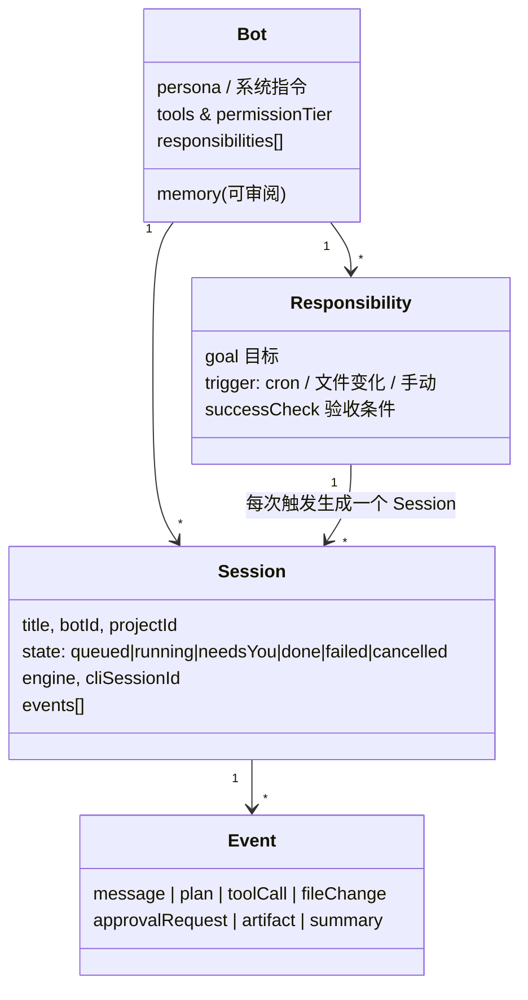
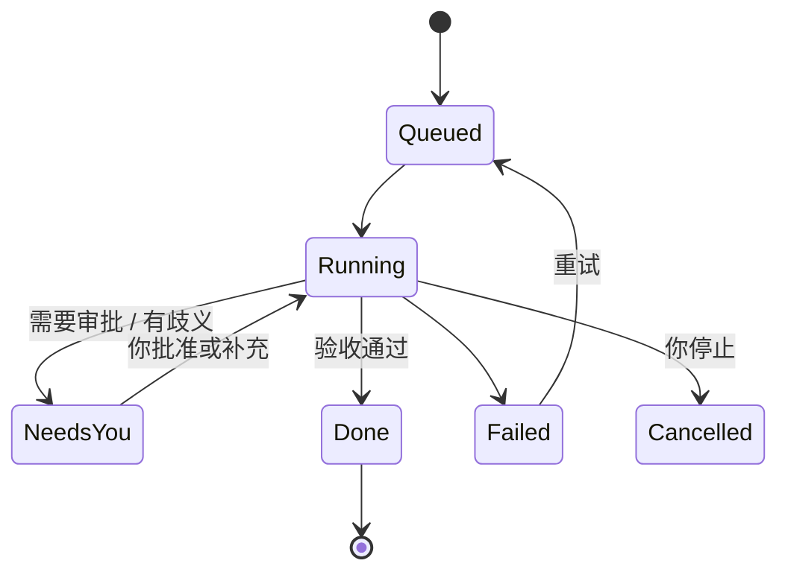

# PipiBot 产品与 UI/UX 审阅报告

> 审阅范围：`apps/apple`（Mac 主应用 + iOS 原生端 + PipiBotKit），以当前工作区未提交的改动为准。
> 对标：Devin（Bots / Sessions / Needs You）与 Grok Bot（桌面常驻 Agent）。
> 设计依据：Apple *Designing Fluid Interfaces* 和 *Principles of Great Design*（apple-design skill）。
> 方法：只读了代码，**没有运行 App 截图**。文中的行号都指向当前源码。

---

## 0. 一句话结论

**PipiBot 现在本质上是“带多个人设的 ChatGPT 客户端”，对标产品却是“替你持续干活的 Bot”。** 两者的核心单位不一样：

| | 现在的 PipiBot | Devin / Grok Bot |
|---|---|---|
| 核心单位 | 对话 `PipiConversation`（消息数组） | **会话 / 任务（Session）**，带状态机：排队、运行、等你、完成、失败 |
| 用户的角色 | 一问一答、盯着屏幕等回复 | 下达目标后离开；**只在需要决策时被叫回来** |
| Agent 的过程 | 只能看到一串流式文字 | 能看到计划、步骤和工具调用、文件 Diff、证据和产物 |
| 并发 | 全局只能有一个生成任务，发新消息会打断上一个 | 多个会话并行，后台运行 |
| 主动性 | Routine 只能整点触发，App 要开着且空闲才会跑 | 定时或事件触发 + 自检，结果推送到收件箱 |
| 被需要时 | “需要你”只在开启 Daemon 同步后才有数据，Mac 端实际是空的 | 统一的 Needs You 收件箱，审批直接写在时间线里 |

你觉得“用起来比较初级”，主要原因不是视觉细节，**而是信息架构还停留在“聊天”这一层**。视觉打磨（玻璃材质、弹簧动效、头像）已经做得不少了，但它们包住的是一个能力偏弱的业务内核。

---

## 1. P0：商用前必须修（关系到信任和数据安全）

### 1.1 状态文件解码失败会静默丢掉全部数据
[PipiNativeMacRuntime.swift#L484-L498](file:///Users/jimizhou/Desktop/Projects/pipibot/apps/apple/Sources/PipiBotKit/Runtime/PipiNativeMacRuntime.swift#L484-L498)
- `loadResidentState` 用 `try?` 解码，任何字段变化或损坏都会返回 `nil`。App 于是当作新用户启动，**下一次 `saveResidentState` 就会用空状态覆盖原文件**，所有对话、Bot、密钥全部丢失。
- 修复方向：解码失败时先把原文件备份为 `.corrupt-<ts>.json` 并提示用户；每个字段用 `decodeIfPresent` 容错；按版本做迁移；对话按会话分文件存储，或改用 SQLite / SwiftData。

### 1.2 API Key 明文存在 JSON 里
[PersonalBotModels.swift#L82](file:///Users/jimizhou/Desktop/Projects/pipibot/apps/apple/Sources/PipiBotKit/Models/PersonalBotModels.swift#L82) 中的 `apiKey: String` 随 `Codable` 一起写进 `resident-state.json`。全仓库没有任何 `SecItem` / Keychain 调用。你自己的竞品分析里也写了 Grok Bot 用的是系统 Keychain 托管凭证。
- 修复方向：`apiKey` 不参与 Codable，改为 `keychainRef`；读写都通过 `SecItemAdd/CopyMatching`。

### 1.3 不可逆的破坏性操作没有确认，也没有撤销
- 设置页“清空所有对话”点一下就执行：[PipiSettingsView.swift#L697-L700](file:///Users/jimizhou/Desktop/Projects/pipibot/apps/apple/Sources/PipiBotMacApp/PipiSettingsView.swift#L697-L700)
- 删除 Bot 会**连带删除它的全部对话**，没有任何提示：[PipiAppStore.swift#L820-L829](file:///Users/jimizhou/Desktop/Projects/pipibot/apps/apple/Sources/PipiBotKit/State/PipiAppStore.swift#L820-L829)
- 右键删除对话和项目也是立即生效：[PipiWorkspaceView.swift#L698](file:///Users/jimizhou/Desktop/Projects/pipibot/apps/apple/Sources/PipiBotMacApp/PipiWorkspaceView.swift#L698)、[#L518](file:///Users/jimizhou/Desktop/Projects/pipibot/apps/apple/Sources/PipiBotMacApp/PipiWorkspaceView.swift#L518)
- 按 Apple 的 *Agency* 原则：可恢复的操作（删除单个对话）用**撤销**（`UndoManager`，或“已删除 · 撤销”提示条），真正不可逆的操作（清空全部、删 Bot 连带对话）才弹 `confirmationDialog`。

### 1.4 全局只有一个生成任务，会互相打断、抢占视图
- [PipiAppStore.swift#L863-L865](file:///Users/jimizhou/Desktop/Projects/pipibot/apps/apple/Sources/PipiBotKit/State/PipiAppStore.swift#L863-L865)：只要在任何对话里发新消息，就会 `stopGenerating()` **停掉另一个对话里正在跑的 Agent**。对 Codex 或 Claude Code 这类要跑几分钟的任务，这是致命问题。
- [PipiAppStore.swift#L511-L520](file:///Users/jimizhou/Desktop/Projects/pipibot/apps/apple/Sources/PipiBotKit/State/PipiAppStore.swift#L511-L520)：Routine 到点时会改掉 `activePersonaId`，新建对话并切过去。**用户正在打字的界面会被直接抢走。**
- [PipiAppStore.swift#L534](file:///Users/jimizhou/Desktop/Projects/pipibot/apps/apple/Sources/PipiBotKit/State/PipiAppStore.swift#L534)：只要有任何生成在进行，到点的 Routine 就直接跳过，而且不会补跑。
- 修复方向：`isGeneratingReply / streamingMessageId / generationTask` 从全局单例改成 `[sessionId: RunState]`，后台运行不改变当前视图。

### 1.5 本地 Agent 接入太浅（这块正是 Devin / Grok 的核心）
[PipiInferenceEngine.swift#L205-L215](file:///Users/jimizhou/Desktop/Projects/pipibot/apps/apple/Sources/PipiBotKit/Runtime/PipiInferenceEngine.swift#L205-L215)
- 现在用的是 `claude -p <prompt>`、`codex exec <prompt>`，拿到的只有纯文本：**看不到工具调用、改了哪些文件，也看不到审批请求**。应改为 `claude -p --output-format stream-json --verbose`、`codex exec --json`，把 JSONL 事件解析成结构化的时间线。
- 没有会话延续：每一轮都新开一个进程，把最近 8 条消息拼成一段文字塞进去（[#L828-L848](file:///Users/jimizhou/Desktop/Projects/pipibot/apps/apple/Sources/PipiBotKit/Runtime/PipiInferenceEngine.swift#L828-L848)）。应保存 CLI 返回的 session id，用 `--resume`（Claude）或 `exec resume`（Codex）续接。
- 没有权限档位：`claude -p` 默认不允许写文件，Codex 默认是只读沙箱，Agent 很可能“答应了但实际没改”。需要按项目设置权限档位：**只读 / 询问后执行 / 自动编辑**，分别映射到 `--permission-mode`、`--sandbox`。
- **中文乱码 Bug**：[#L895-L903](file:///Users/jimizhou/Desktop/Projects/pipibot/apps/apple/Sources/PipiBotKit/Runtime/PipiInferenceEngine.swift#L895-L903) 对每个 pipe 数据块单独做 `String(data:encoding:.utf8)`。一个多字节汉字被拆到两个块里时，解码返回 `nil`，**这一整块输出会被静默丢掉**。应先累积字节，只解码完整的 UTF-8 部分。

### 1.6 每次状态变化都在主线程写整个 JSON
[PipiAppStore.swift#L310-L342](file:///Users/jimizhou/Desktop/Projects/pipibot/apps/apple/Sources/PipiBotKit/State/PipiAppStore.swift#L310-L342)：切换对话、折叠项目都会把**全部对话**格式化编码后同步写盘。“个人记忆”输入框更是**每敲一个字就写一次**（[PipiSettingsView.swift#L621-L626](file:///Users/jimizhou/Desktop/Projects/pipibot/apps/apple/Sources/PipiBotMacApp/PipiSettingsView.swift#L621-L626)）。对话一多就会明显卡顿。
- 修复方向：防抖约 500ms 合并写入，在后台 actor 上编码，每个会话单独存文件。

---

## 2. P1：产品业务逻辑（和对标产品差距最大的部分）

### 2.1 把“对话”升级成“会话 / 任务”
建议的新领域模型：





现有的 `PipiConversation` 其实就是“只包含 message 事件的 Session”，可以平滑迁移。`OutcomeResponsibility` / `NeedsYouDecision` / `SubSession` 这些 Protocol 模型已经存在（ProtocolModels.swift），只是 Mac UI 把它们删了（`MacOutcomeStudioView` 在工作区里是删除状态）。**建议把它们合进同一个 Session 模型，不要再单独做一个“Outcome Studio”页面。**

### 2.2 让 Agent 的工作过程可见
现在用户只能看到一串文字和计时器。Devin 和 Grok 给人的“靠谱感”，来自能看见过程：
- **计划卡**：可勾选的步骤清单，随执行进度更新。
- **步骤行**（默认折叠）：“读取 3 个文件”“运行 `npm test` ✓ 12s”“编辑 `server.ts` +18 −4”。
- **Diff / 产物卡**：点开后在右侧检查器里查看。
- **结果总结 + 证据**：退出码、测试结果、改动文件列表。不能只有一句“我修好了”。

`PipiMarkdownView` 里已经有 diff / terminal / thinking 这些块，可以复用为事件渲染器。区别在于数据来源要换成**结构化事件**，而不是从文字里猜。

### 2.3 让“需要你”收件箱真正有数据
- 现在 `decisions` 只来自 Daemon SSE，而同步默认关闭（[PipiAppStore.swift#L252](file:///Users/jimizhou/Desktop/Projects/pipibot/apps/apple/Sources/PipiBotKit/State/PipiAppStore.swift#L252)），所以 Mac 端收件箱永远是空的。顶部横幅也只展示第一条（[PipiWorkspaceView.swift#L729](file:///Users/jimizhou/Desktop/Projects/pipibot/apps/apple/Sources/PipiBotMacApp/PipiWorkspaceView.swift#L729)）。
- 正确的数据来源：本地 Agent 的**权限请求**（要执行命令、要写文件）、Routine 运行失败、验收没通过、Agent 主动提问。这些都在本机产生，不依赖 Daemon。
- 交互上，审批卡片**原地显示在会话时间线里**，侧边栏“收件箱”汇总并显示数字角标。菜单栏图标也显示同一个数字（这一点现在已经做了）。

### 2.4 Routine → Responsibility（职责）
[PipiBotInspectorView.swift#L204-L216](file:///Users/jimizhou/Desktop/Projects/pipibot/apps/apple/Sources/PipiBotMacApp/PipiBotInspectorView.swift#L204-L216) 和 [PipiAppStore.swift#L533-L563](file:///Users/jimizhou/Desktop/Projects/pipibot/apps/apple/Sources/PipiBotKit/State/PipiAppStore.swift#L533-L563)：
- 只能选小时，`routineMinute` 永远是 0；“每周”被写死为周一（`weekday == 2`），没有星期选择。
- 只有 App 在前台且空闲时才会触发；错过了不补跑，跑完也没有通知；活动记录不能点进去看对应会话。
- 建议改为：**目标 + 触发器 + 验收条件**三段式，每次触发生成一个后台 Session；结果写入“今日简报”，失败时进入收件箱。可以支持用自然语言创建：“每个工作日 9:00 帮我汇总 GitHub 通知”。

### 2.5 记忆：从“手写备注”变成“学到的、可审阅的”
现在的“记忆”只是一个手动填写的文本框，拼进系统提示词里（[PipiAppStore.swift#L1171-L1176](file:///Users/jimizhou/Desktop/Projects/pipibot/apps/apple/Sources/PipiBotKit/State/PipiAppStore.swift#L1171-L1176)）。商用 Bot 的做法是：对话结束后抽取候选记忆，比如“用户偏好 pnpm”，然后**用一张卡片请你确认（采纳 / 忽略）**；每个 Bot 有一个记忆列表，可以搜索、编辑、删除；回答时标注“用到了 2 条记忆”。

### 2.6 快速唤起（⌥Space）和菜单栏
- ⌥Space 只是 `CommandMenu` 里的菜单快捷键（[PipiBotMacApp.swift#L102-L105](file:///Users/jimizhou/Desktop/Projects/pipibot/apps/apple/Sources/PipiBotMacApp/PipiBotMacApp.swift#L102-L105)），**只有 PipiBot 在前台时才有效**，算不上全局唤起。需要用 `RegisterEventHotKey` 或 KeyboardShortcuts 库注册全局热键。
- 快捷栏面板是 borderless 的 `NSPanel`（[PipiQuickBarPanel.swift#L25-L38](file:///Users/jimizhou/Desktop/Projects/pipibot/apps/apple/Sources/PipiBotMacApp/PipiQuickBarPanel.swift#L25-L38)）：没有子类化 `canBecomeKey`（borderless 窗口可能无法接收键盘输入，需要实测确认），没有 Esc 关闭，点击外部也不会消失。
- 从快捷栏或菜单栏发出的问题，会**被追加到当前正在进行的对话里**，并且强制把主窗口拉到前台，打断用户。正确做法是：**在面板内直接回答**（像 Spotlight 那样展开显示答案），需要时再“在主窗口继续”，并新建一个会话来承接。

### 2.7 历史记录的心智模型前后矛盾
- “最近对话”只显示**当前 Bot** 的对话，“项目”里显示**所有 Bot** 的对话，“归档”又是全局的（[PipiAppStore.swift#L131-L170](file:///Users/jimizhou/Desktop/Projects/pipibot/apps/apple/Sources/PipiBotKit/State/PipiAppStore.swift#L131-L170)）。结果是：用户想找昨天和 Writer 的对话，得先猜对 Bot 并点进去。
- 没有搜索，没有按时间分组（今天 / 昨天 / 前 7 天），也不能置顶。
- 建议：**会话列表做成全局的**，Bot 只是会话的一个属性和筛选条件，每一行显示 Bot 头像和状态点。⌘K 打开全局搜索和命令面板。

### 2.8 iOS 端是一个孤岛
[PipiIOSCompanionRootView.swift](file:///Users/jimizhou/Desktop/Projects/pipibot/apps/apple/Sources/PipiBotIOSUI/PipiIOSCompanionRootView.swift)
- 有独立的存储和独立的模型配置，**和 Mac 的对话不互通**。这和“Mac 大脑 + iPhone 随身伴侣”的定位相反。
- 看不到历史对话列表；消息是纯 `Text`，不渲染 Markdown；没有停止生成、复制、重新生成；没有“新对话”入口。
- 添加模型时校验失败会静默无反应（[#L82-L86](file:///Users/jimizhou/Desktop/Projects/pipibot/apps/apple/Sources/PipiBotIOSUI/PipiIOSCompanionRootView.swift#L82-L86)）；引导页填错 Key 也照样直接完成（[#L136-L139](file:///Users/jimizhou/Desktop/Projects/pipibot/apps/apple/Sources/PipiBotIOSUI/PipiIOSCompanionRootView.swift#L136-L139)）。
- 建议的定位：iOS 端 = **收件箱（审批）+ 会话状态 + 随手派活**，数据从 Mac 同步过来。对话主力仍在 Mac。

### 2.9 图片附件其实没有发给模型
`PipiChatAttachment.isImage` 能识别图片，但发送时只拼了一句 `[Attached file: x at path]`（[PipiAppStore.swift#L976-L984](file:///Users/jimizhou/Desktop/Projects/pipibot/apps/apple/Sources/PipiBotKit/State/PipiAppStore.swift#L976-L984)），模型看不到图片内容。界面接受图片但模型看不到，这是一个“看起来能用，实际不能用”的功能。

---

## 3. P2：UI/UX 与 Apple 设计工艺

### 3.1 外壳不是原生结构（对应 Familiarity / Flexibility 原则）
- 侧栏是固定 252pt 宽的 `HStack`（[PipiWorkspaceView.swift#L134-L166](file:///Users/jimizhou/Desktop/Projects/pipibot/apps/apple/Sources/PipiBotMacApp/PipiWorkspaceView.swift#L134-L166)）：不能折叠，不能拖动调宽，也不支持 ⌃⌘S。
- 检查器是**浮在聊天内容上面**的（ZStack 叠加，带阴影），窗口一窄就会盖住消息和输入框。
- 建议：改用 `NavigationSplitView` + `.inspector()` + 原生 `.toolbar`。系统会自动提供折叠、调宽、全屏行为和红绿灯按钮的避让。窗口拖动问题（`isMovableByWindowBackground = false` 加隐藏标题栏）也会一并解决。

### 3.2 缩放用的是 `scaleEffect`，不是字号缩放
[PipiBotMacApp.swift#L167-L188](file:///Users/jimizhou/Desktop/Projects/pipibot/apps/apple/Sources/PipiBotMacApp/PipiBotMacApp.swift#L167-L188) 对整个根视图做 `scaleEffect`，可能导致文字和阴影栅格化发虚、1px 描边变成小数像素、Menu 和 Sheet 不跟着缩放。字体 token 都是固定 pt 值（[DesignTokens.swift#L665-L673](file:///Users/jimizhou/Desktop/Projects/pipibot/apps/apple/Sources/PipiBotKit/DesignSystem/DesignTokens.swift#L665-L673)）。
- 建议：字号 token 乘一个 `textScale` 环境值（或在 iOS 上用 `.dynamicTypeSize`），让布局跟着文字一起重排，而不是整体放大一张图。

### 3.3 只有鼠标悬停才能看到的操作
复制和重新生成平时是 `opacity(0)`（[PipiWorkspaceView.swift#L1242](file:///Users/jimizhou/Desktop/Projects/pipibot/apps/apple/Sources/PipiBotMacApp/PipiWorkspaceView.swift#L1242)），归档按钮也只在悬停时出现。键盘用户和 VoiceOver 用户完全用不了这些功能。全部 Mac UI 里只有 2 处 `accessibilityLabel`。
- 建议：最后一条回复的操作栏常驻显示；所有只有图标的按钮都补上 `accessibilityLabel`；用 `accessibilityAction` 提供“复制 / 重新生成”。

### 3.4 层级和信息噪音（对应 Simplicity 原则：简单 ≠ 极简）
- Bot 名字在同一屏重复出现 3 次以上（顶栏、每条消息、空状态大标题），**每条回复还带一个模型标签**，但真正重要的状态（运行中 / 等你 / 完成）反而没有固定的位置。
- 侧栏同时有 Bot（每行 36pt）、项目、最近对话、归档和底部入口，**全部平铺，没有主次**。建议主次顺序为：收件箱 → 会话 → 项目，Bot 折叠成一排头像。
- 错误信息作为一条黄色聊天消息显示，文案却是“请点击左下角设置…”（[PipiAppStore.swift#L900-L904](file:///Users/jimizhou/Desktop/Projects/pipibot/apps/apple/Sources/PipiBotKit/State/PipiAppStore.swift#L900-L904)）。**应该直接提供按钮**：「打开 AI 引擎设置」「重试」「换一个引擎重试」。

### 3.5 性能直接影响“手感”（对应 Response 原则）
- `generatingElapsedSec` 每 100ms 更新一次，而 `PipiWorkspaceView.body` 读了这个值，**整个工作区每秒要重算 10 次**。应把计时器拆成独立的小视图，用 `TimelineView(.periodic)` 自己刷新。
- 每收到一个流式 chunk 都会修改整个 `conversations` 数组，并重新解析整条 Markdown（`parseBlocks` 在 body 里调用）。回复越长越卡，复杂度接近 O(n²)。建议把流式缓冲和已定稿的内容分开，只增量解析末尾的块。

### 3.6 动效与材质的小问题（整体方向是对的）
- 弹簧参数整体偏快：`drawer` 是 response 0.22 / damping 0.96。Apple 给抽屉的参考值是 0.3 / 0.8，而且只有带惯性的手势才需要回弹。对没有手势的检查器，建议 `response 0.3, damping 1.0`。
- 侧栏用的是 `.ultraThinMaterial` 叠 55% 实色，检查器是 `.regularMaterial` 叠 `liquidGlassSurface`，两层玻璃并排，层级感不清楚。按“重材质 = 结构层，轻材质 = 交互层”的原则，侧栏应比检查器更“重”。另外，代码里还没有适配 `prefers-reduced-transparency`（即 `accessibilityReduceTransparency`）。

---

## 4. 建议的新信息架构（Mac）

```text
┌───────────────┬──────────────────────────────────────────┬──────────────────┐
│ 🔍 搜索  ⌘K    │  ◉ 修复登录页 CLS 抖动                     │  计划 · 改动 · 上下文 │
│               │  Coder · pipibot · Claude Code · 运行中 3m │                  │
│ 📥 需要你  (2) │ ─────────────────────────────────────────│ ☑ 定位提交        │
│ ☀️ 今日简报     │  你：首页加载抖动，查一下原因并修复           │ ☑ 复现            │
│               │                                          │ ◻ 修复 + 测试      │
│ 会话           │  ▸ 计划（3 步）                            │                  │
│  ● 运行中       │  ▸ 读取 4 个文件                           │ server.ts +18 −4 │
│   修复登录页…  ◉│  ▸ 运行 npm test  ✓ 12s                   │ Hero.tsx  +6 −2  │
│  ● 等你         │  ┌ 需要你：允许执行 `git push`？ ────────┐  │                  │
│   周报草稿    ! │  │  [允许一次] [总是允许] [拒绝]          │  │                  │
│  今天           │  └──────────────────────────────────────┘  │                  │
│   旅行清单      │                                          │                  │
│  昨天 …         │  ┌ 输入框 ───────────────────────────────┐ │                  │
│               │  │ Coder ▾  Claude Code ▾  权限: 询问 ▾  ⬆ │ │                  │
│ 项目 ▸         │  └──────────────────────────────────────┘ │                  │
│ Bots ◯◯◯◯ +    │                                          │                  │
└───────────────┴──────────────────────────────────────────┴──────────────────┘
```

- **左栏**：搜索 → 需要你 → 今日简报 → 全局会话（按状态和时间分组）→ 项目 → Bot 头像排。
- **中间**：会话时间线。审批卡片原地显示；输入框里可以选 Bot、引擎和**权限档位**。
- **右栏**：原生 `.inspector`，推开中间内容而不是盖住它。按会话显示“计划 / 改动 / 上下文（用到的记忆和指令）”。
- **Bot 详情页**（点击头像进入）：人设、工具权限、职责列表、记忆，以及最近的运行记录。

---

## 5. 落地路线

| 阶段 | 周期 | 内容 | 用户能感知到的变化 |
|---|---|---|---|
| **S0 · 打地基** | ~1 周 | §1 全部 P0：Keychain、安全持久化（备份 + 防抖 + 后台写）、删除可撤销 / 需确认、UTF-8 流修复、按会话的运行状态（取消全局锁） | 不丢数据、不乱码、不会被打断 |
| **S1 · Session 内核** | ~2 周 | Session / Event 模型和迁移；Claude `stream-json`、Codex `--json` 事件解析；时间线渲染（计划、步骤、Diff）；权限档位；审批卡片 | **第一次有“Bot 在干活”的感觉** |
| **S2 · 原生外壳** | ~1.5 周 | `NavigationSplitView` + `.inspector` + toolbar；全局会话列表和搜索 ⌘K；收件箱；全局 ⌥Space 并在面板内回答；无障碍补全 | 像一个成熟的 Mac App |
| **S3 · 主动性** | ~2 周 | Responsibility（触发器 + 验收）替换 Routine；今日简报；系统通知；可审阅的记忆 | 从“我去问它”变成“它来找我” |
| **S4 · 跨端** | 视同步方案而定 | iOS 改为“收件箱 + 会话状态 + 派活”，数据与 Mac 同步 | 出门在外也能审批 |
