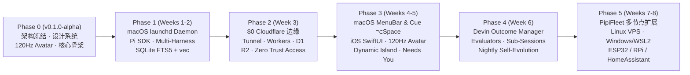

# PipiBot 全阶段工程开发计划 (Engineering Development Plan & WBS)

> **版本基线**: `v0.1.0-alpha` (Phase 0 开源基线已冻结，Phase 1–5 排期 8 周)
> **核心理念**: *From Tasks to Outcomes, From Chatbots to a Living Cross-Device AI Manager*
> **相关文档**: [产品愿景与竞品研究](../architecture/01-PRODUCT-VISION-AND-RESEARCH.md) · [系统架构与 Harness](../architecture/02-SYSTEM-ARCHITECTURE-AND-HARNESS.md) · [Cloudflare 与 PipiFleet](../architecture/03-CLOUDFLARE-AND-FLEET-INFRA.md) · [记忆与自我进化](../architecture/04-MEMORY-AND-SELF-EVOLUTION.md) · [UI/UX 设计系统](../design-system/01-UIUX-DESIGN-SYSTEM.md) · [实时进度看板与 ADR](./02-PROGRESS-TRACKER.md)

---

## 1. 工程总览与里程碑时间线 (Executive Overview & Milestone Timeline)

PipiBot 的工程实施遵循 **"先架构与交互灵魂验证 -> 后本地宿主内核 -> 再零成本边缘互联 -> 再双端沉浸式界面 -> 再自治结果循环 -> 最后异构节点扩张"** 的渐进式演进策略。整个工程拆分为 **Phase 0（开源基线发布）** 与 **Phase 1–5（8 周全栈交付周期）**：

### 阶段发布矩阵 (Release Train Summary)

| Phase | 目标版本 | 周期 | 核心交付物 (Key Deliverables) | 准出关键指标 (Exit Gate) |
| :--- | :--- | :--- | :--- | :--- |
| **Phase 0** | `v0.1.0-alpha` | Baseline | 4 份架构文档、UI/UX 规范、零依赖 120Hz Avatar 交互工作台、Protocol/Core/Edge 代码骨架 | `node --check` 通过、浏览器零构建运行工作台、文档与接口契约完整 |
| **Phase 1** | `v0.2.0-alpha` | Weeks 1–2 | `pipibot-daemon` (`launchd`)、Pi SDK 嵌入、Claude Code/Codex/OpenCode + Routed MCP Bridge、4 层 SQLite 记忆 | 4 大 Harness 端到端闭环调度、250ms 脉冲零丢帧、FTS5+vec 召回 < 20ms |
| **Phase 2** | `v0.3.0-beta` | Week 3 | `cloudflared` 隧道编排、Worker Relay、D1 注册表、R2 制品零出站费上传、Access Zero Trust | 全链路 $0/月 配额验证、Mac 休眠离线队列重放 100% 不丢消息 |
| **Phase 3** | `v0.4.0-beta` | Weeks 4–5 | macOS MenuBar & Manus Cue (`⌥Space`)、`pipibot-ios` SwiftUI、Dynamic Island、Needs You 滑动收件箱 | 120fps Avatar CPU < 1%、iOS 审批指令经 Tunnel 回传执行 < 1.5s |
| **Phase 4** | `v0.5.0-rc` | Week 6 | Devin 风格 Outcome Manager、Autonomous Evaluators、夜间做梦反思与 Pi Skill 自动合成 | 72 小时无人值守 Outcome 闭环运行、Evolution Diff 透明审计卡片 |
| **Phase 5** | `v1.0.0` | Weeks 7–8 | Linux VPS `systemd`、Windows Service/WSL2、Raspberry Pi / ESP32 MQTT / Home Assistant 节点 | 单节点代理空闲内存 < 15MB、跨生活/工作/开发/IoT 统一 Fleet 协同 |

---

## 2. 分阶段详细工作分解结构 (Detailed Phased Engineering Roadmap & WBS)

### Phase 0 (`v0.1.0-alpha`): 开源基线、架构研究与交互原型冻结 (Initial Open-Source Release)

**目标**：建立无歧义的系统蓝图、设计语言、通信协议与可交互的程序化头像验证台，避免后期返工。

| WBS ID | 工作包 (Work Package) | 核心任务与技术细节 | 对应仓库产出 |
| :--- | :--- | :--- | :--- |
| **WBS 0.1** | **深度竞品研究与产品愿景** | 拆解 Devin Bots（Outcome Ownership / Needs You）、GrokBot 0.18（Routed MCP / 250ms pulse）、GrokBot Animation Anatomy（192 射线 / Rodrigues 3D 眼球）、Pi Harness（4 工具内核）及 Manus Cue / Dots / Muse 范式。 | [`01-PRODUCT-VISION-AND-RESEARCH.md`](../architecture/01-PRODUCT-VISION-AND-RESEARCH.md) |
| **WBS 0.2** | **系统架构与多 Harness 路由设计** | 定义 `PipiCore`（基于 Pi）、`PipiRouter`（Native Pi / Claude Code / Codex / OpenCode / BYOK）、`RoutedMcpBridge` 及 `PipiOutcomeEngine` 状态机与 Schema。 | [`02-SYSTEM-ARCHITECTURE-AND-HARNESS.md`](../architecture/02-SYSTEM-ARCHITECTURE-AND-HARNESS.md) |
| **WBS 0.3** | **Cloudflare 免费层与 PipiFleet 设计** | 设计 `cloudflared` + Worker + D1 + R2 + KV + Access 的 $0/月拓扑及五类节点（Mac/iOS/VPS/Win/IoT）能力沙盒与安全边界。 | [`03-CLOUDFLARE-AND-FLEET-INFRA.md`](../architecture/03-CLOUDFLARE-AND-FLEET-INFRA.md) |
| **WBS 0.4** | **4 层记忆与夜间自我进化规范** | 设计 L0 工作内存 -> L1 SQLite FTS5/vec -> L2 `SOUL.md`/`USER.md`/`MEMORY.md` -> L3 自动合成 `skills/*.md`，含显著性评分与 Evolution Diff。 | [`04-MEMORY-AND-SELF-EVOLUTION.md`](../architecture/04-MEMORY-AND-SELF-EVOLUTION.md) |
| **WBS 0.5** | **UI/UX 设计系统与 120Hz 头像工作台** | 完成 Obsidian Dark / Warm Vellum Light 双主题 Token、53 状态矩阵与 9 种表情定义，并在浏览器实现零依赖 120Hz 程序化 SVG 引擎与 Mac/iOS 交互模拟器。 | [`01-UIUX-DESIGN-SYSTEM.md`](../design-system/01-UIUX-DESIGN-SYSTEM.md), [`design-system/`](../../design-system/index.html) |
| **WBS 0.6** | **协议、核心与边缘代码脚手架** | 建立 `@pipibot/protocol` 零依赖契约、`@pipibot/core` 路由器与记忆引擎骨架、`@pipibot/cloudflare-edge` Worker/D1/Wrangler 模板及 Monorepo 工程配置。 | [`packages/protocol/src/index.ts`](../../packages/protocol/src/index.ts), [`packages/core/`](../../packages/core/src/harness-router.ts), [`packages/cloudflare-edge/`](../../packages/cloudflare-edge/src/worker.ts) |

---

### Phase 1 (Weeks 1–2): macOS 常驻宿主、Pi SDK、多 Harness 适配器与 4 层记忆存储

**目标**：让 PipiBot 在 macOS 本机真正“活”起来，具备永不掉线的后台进程、统一的推理调度器及持久化记忆引擎。

#### WBS 1.1: macOS Always-On Resident Daemon (`pipibot-daemon`)
- **Launchd 托管与守护 (`com.pipibot.daemon.plist`)**：
  - 实现 `KeepAlive: true`、`RunAtLoad: true`、标准日志轮转与优雅信号处理（`SIGTERM`/`SIGINT` 时落盘 SQLite WAL checkpoint 与中断状态）。
  - 集成 `IOPMAssertionCreateWithName`（仅在长跑关键任务期间按需阻止空闲休眠，常规待机允许进入 Dark Wake / Power Nap）。
- **本地 IPC 与状态广播**：
  - 暴露 Unix Domain Socket (`~/.pipibot/run/daemon.sock`) 供 MenuBar、Manus Cue 与 CLI 秒级连接；同时提供本地 loopback WebSocket (`127.0.0.1:18420`) 供给实时流视图。
  - 实现 **250ms Activity Pulse** 心跳节拍器，将当前运行状态映射到 `AvatarState53` 并驱动前端弹簧动效。

#### WBS 1.2: Embedded Pi Harness SDK Integration (`PipiCore`)
- **嵌入 `@mariozechner/pi-coding-agent` 与 `pi-ai`**：
  - 将 Pi 的极简 4 工具内核（`read`、`write`、`edit`、`bash`）作为默认内生执行引擎，直接以 SDK/RPC 模式嵌入 Daemon，避免冷启动开销。
  - 通过 Pi Extension Hooks 挂载 PipiBot 专属安全护栏（破坏性命令二次确认、`.env`/Keychain 路径访问拦截、Output Artifact 自动截屏归档）。
- **BYOK 直连矩阵**：
  - 通过 `pi-ai` 统一层配置 OpenAI、Anthropic、Google Gemini、DeepSeek、xAI Grok、OpenRouter 及本地 Ollama/vLLM，密钥全部加密存入 macOS Keychain（严禁明文落盘）。

#### WBS 1.3: Local Multi-Harness Adapters & Routed MCP Bridge
- **本地 CLI 自动探测与会话复用**：
  - **`claude-code` Adapter**：检测本机 `claude` 二进制与已有登录态，通过 `--mcp-config <temp-mcp.json>` 与 `--output-format stream-json` 拉起子进程，零额外 API Key 即可复用用户既有订阅/认证。
  - **`codex` Adapter**：探测 `~/.codex` 配置与 `codex` CLI，支持 JSONL 事件流解析及工作区隔离参数透传。
  - **`opencode` Adapter**：支持 `opencode` CLI / 本地 HTTP Server / ACP (Agent Client Protocol) 双向会话控制。
- **Routed MCP Bridge (`packages/core/src/harness-router.ts`)**：
  - 启动按会话动态绑定的本地 MCP Server（stdio 或 SSE），向外部 CLI Harness 暴露 PipiBot 核心工具：`pipi_memory_recall`、`pipi_memory_store`、`pipi_needs_you_escalate`、`pipi_fleet_exec`、`pipi_artifact_upload`。
  - 实现 **Client-Side Tool Relay**：当云端模型或受限子进程需要读取 macOS 剪贴板、触发 AppleScript、获取前台 IDE 上下文时，经策略校验后安全转发回 macOS 宿主执行。

#### WBS 1.4: SQLite FTS5 + `sqlite-vec` 4-Tier Memory Store
- **存储引擎构建**：
  - 初始化 `~/.pipibot/memory/pipibot.sqlite`（启用 `PRAGMA journal_mode=WAL; synchronous=NORMAL; foreign_keys=ON;`）。
  - 集成 **SQLite FTS5**（中文/英文混合分词检索，支持 BM25 排序）与 **`sqlite-vec`**（本地轻量 Embedding 向量索引，支持离线模型或低成本 API Embedding）。
- **四层记忆落地 (`packages/core/src/memory-engine.ts`)**：
  - **L0**：内存环形缓冲区保存当前会话流、最近 5 分钟 Manus Cue 前台应用上下文与 Fleet 心跳快照。
  - **L1**：Append-only 情景账本（会话消息、工具执行摘要、Git Commit、生活备忘）。
  - **L2**：双向同步 `~/.pipibot/persona/` 下的 `SOUL.md`、`USER.md`、`MEMORY.md` 与时间线知识图谱表，支持 **Temporal Superseding（时间线事实覆盖）**（如用户偏好从 npm 切换为 pnpm 时自动废止旧事实并保留版本链）。
  - **L3**：自动扫描 `~/.pipibot/skills/*.md` 与 Pi 扩展脚本，建立语义触发索引。

---

### Phase 2 (Week 3): $0/月 Cloudflare 免费层基础设施与 Zero Trust 安全隧道

**目标**：在不打开任何家庭/办公室路由器端口、不购买任何云服务器的前提下，实现外网 iOS 与全球节点对 macOS 主宿主的加密直连与离线兜底。

#### WBS 2.1: `cloudflared` Auto-Tunnel Orchestrator
- 由 `pipibot-daemon` 托管 `cloudflared tunnel run` 子进程，配置文件自动生成并受权限保护（`0600`）。
- 实现 **Sleep/Wake 感知重启器**：监听 macOS `NSWorkspace.didWakeNotification` 与网络接口切换事件（Wi-Fi <-> 热点），在 2 秒内重建 QUIC/HTTP2 隧道连接并向 Cloudflare KV 刷新在线状态。

#### WBS 2.2: Cloudflare Worker Edge Relay (`packages/cloudflare-edge/src/worker.ts`)
- **双向实时中继**：利用 WebSocket / SSE 将 iOS Companion 与 Mac Tunnel 桥接；对高频 `250ms` 头像脉冲实施边缘节流与合并（如每 1s 聚合或在状态跃迁时即时下发），严格压低 Worker 请求计数。
- **Mac 离线兜底队列**：当 Mac 休眠且 Tunnel 断开时，来自 iOS 的快捷指令、GitHub Webhook 或定时触发器自动落入 D1 `offline_inbox` 队列，待 Mac 唤醒上线后按 FIFO + 幂等 ID 批量拉取重放。
- **APNs 推送触发器**：当 Mac 上报高优先级 `NeedsYouDecision`（如阻塞审批或服务器告警），Worker 经由 HTTP/2 JWT 直接触发 Apple Push Notification service (APNs) 唤醒 iOS 与灵动岛。

#### WBS 2.3: Cloudflare D1 Fleet Registry & KV Presence Cache
- **D1 (`schema.sql`)**：维护轻量级元数据镜像（`fleet_nodes`、`outcomes_snapshot`、`needs_you_queue`、`offline_inbox`、`audit_events`）。严禁存储源码与明文记忆库。
- **KV**：仅缓存毫秒级节点在线状态 (`presence:<node_id>`) 与短效 Tunnel 路由元信息，设置合理 TTL 避免无意义写入配额消耗。

#### WBS 2.4: Cloudflare R2 Zero-Egress Artifact Uploader
- 用于承载需要跨设备预览的富媒体证据：Devin 风格的 **PR 修复前后截图/MP4 录屏**、UI HTML 实时预览包、语音备忘录、以及客户端 **AES-GCM 加密的 SQLite 灾备快照**。
- **免费配额保护守卫**：实现上传前内容去重（SHA-256）与自动 Lifecycle 策略（临时截图 7 天自动清理，仅保留加密备份最近 3 份），确保总容量稳固在 **10 GB 免费上限** 之内，且利用 R2 **零出站流量费 (Zero Egress)** 特性供 iOS 自由预览。

#### WBS 2.5: Cloudflare Access Zero Trust
- 为 Tunnel 域名启用 **Cloudflare Access**（免费版支持最多 50 名用户）：配置 Apple ID / GitHub OIDC 作为人类用户登录校验，同时为 `iOS App` 和远程 `PipiFleet` 节点签发 **Service Token (`CF-Access-Client-Id` / `Secret`)**。
- Worker 入口强制校验 `Cf-Access-Jwt-Assertion` JWT 签名，并在应用层叠加 **E2EE 局部载荷加密**（敏感 Prompt、终端输出与记忆摘要仅在 Mac 与 iOS 持有的设备密钥间加解密，Cloudflare 仅路由密文）。

---

### Phase 3 (Weeks 4–5): macOS MenuBar & Manus Cue (`⌥Space`) + iOS 原生伴侣端

**目标**：将 `design-system/` 的交互灵魂转化为原生 SwiftUI / AppKit 双端产品，打造 “随手召唤、单手批阅、一眼知全局” 的人机协同体验。

#### WBS 3.1: macOS MenuBar & Outcome Studio Popover
- **MenuBar Living Avatar (22×22pt)**：使用 `CAShapeLayer` / Metal 实现与 Web 工作台同源的简化轮廓呼吸与状态色点，一眼感知当前正在运行的 Harness 与活跃子会话数。
- **Outcome Studio Popover (420×640pt)**：集成 Harness 快速切换器（`Pi` / `Claude Code` / `Codex` / `OpenCode` / `BYOK`）、当前活跃 Outcomes 进度条、Dots 节点活力矩阵以及快捷语音/文字下达界面。

#### WBS 3.2: Manus Cue Floating Ambient Overlay (`⌥Space`)
- **零打扰环境感知**：借助 macOS Accessibility API 与 `NSWorkspace`，感知当前活跃窗口（例如 VS Code / Cursor 正在编辑报错文件、Xcode 编译失败、Safari 打开 GitHub PR、Mail 正在草拟日程邮件）。
- **1-Click Whisper 建议条**：按下 `⌥Space` 弹出玻璃拟态悬浮胶囊，直接给出 1~3 个高上下文相关性的“下一步 Outcome 动作”（如 *"Spawn Claude Code to fix failing Swift test & open PR"* 或 *"Extract invoice PDF to Life Ledger"*），回车即派发给后台 Daemon 异步执行，不阻塞当前心流。

#### WBS 3.3: iOS Native Companion App (`pipibot-ios`, SwiftUI)
- **120Hz ProMotion 程序化头像引擎 (Swift/Metal)**：
  - 将 [`design-system/pipibot-avatar.js`](../../design-system/pipibot-avatar.js) 的数学内核移植至 Swift `CADisplayLink`（120Hz）：192 射线极坐标轮廓插值、6 轨道 cubic-Bézier 关键帧、半隐式 Euler 弹簧 (`amount`, `swap`, `spin`) 与 Rodrigues 3D 球面眼球投影，结合 **CoreHaptics** 实现点击眨眼与状态切换的细腻触觉反馈。
- **Dynamic Island & Lock Screen Live Activities (`ActivityKit`)**：
  - 当长跑 Outcome 在 Mac/VPS 执行时，灵动岛实时展示紧凑态脉动微标与进度环；长按展开显示子会话数、最新日志片段与剩余预估步数。
- **Devin-Style "Needs You" Swipe Decision Inbox**：
  - 针对移动场景重构的卡片式决策流：展示问题背景、AI 推荐选项、风险等级（Low/Medium/High）以及 R2 拉取的 **Before/After 截图或短视频证据**。
  - **右滑批准 (Approve & Continue)** / **左滑驳回或转人工微调** / **按住底部按钮语音追加指示**，单手 3 秒内解决阻塞。
- **Dots Fleet Matrix & Muse Spatial Canvas**：
  - Dots 视图以极简呼吸点阵显示 Mac、iOS、VPS、Windows、IoT 实时健康度；Muse 视图支持多模态生活/工作卡片与实时语音打断对话。

---

### Phase 4 (Week 6): Devin-Bot Outcome Manager 与夜间自我进化/技能合成引擎

**目标**：让 PipiBot 真正从 "被动等指令的工具" 跃迁为 "对结果负责的数字管家"，并且每一夜都会变得更懂用户。

#### WBS 4.1: `PipiOutcomeEngine` 责任闭环调度器
- **Responsibility Spec (YAML/JSON)**：每个长期目标均包含 `goal`、`constraints`、`success_metrics`、`budget_guardrails`（最大 Token/耗时/危险操作白名单）、`triggers`（Cron / Webhook / FileSystem Watch / Fleet Telemetry Threshold）与 `escalation_policy`。
- **Autonomous Evaluator & Child Sub-Session DAG**：
  - 触发器唤醒后，Engine 创建隔离的工作流会话，通过 `PipiRouter` 为不同子步骤分配最合适的 Harness（例如用 Pi 做快速文件检索与协调，用 Claude Code 做复杂架构重构，用 Codex 做单测生成）。
  - 执行完毕后强制经过独立 **Evaluator（自检评估器）**：必须收集可验证证据（单测通过日志、Playwright 截图、VPS 健康探针 200 OK）才算达成 Outcome；若遇到超出 Guardrail 的权限或语义歧义，立即打包证据推送到 `Needs You` 收件箱并挂起当前分支。

#### WBS 4.2: 内置生活/工作/研发/基建 Outcome 模板包
- **Dev**: `PR-Quality-Guard`（自动审查新提交、复现 UI 回归并附带录屏 PR）、`Dep-Health-Bot`（周度依赖升级与测试验证）。
- **Infra**: `VPS-Self-Healer`（监控内存/Nginx/证书到期，异常时先抓诊断现场再申请重启）。
- **Work & Life**: `Morning-Brief-Synthesizer`（聚合邮件/日历/GitHub 动态生成 60 秒晨报）、`Receipt-and-Bill-Archivist`（发票/账单识别归档与异常消费提醒）。

#### WBS 4.3: 夜间自我进化与技能合成引擎 (`PipiEvolve`)
- **Micro-Reflection (每轮对话后轻量提炼)**：异步抽取隐式偏好（语言习惯、架构厌恶点、作息规律、常去地点/习惯），不阻塞主对话响应。
- **混合检索与显著性公式**：严格实现 `Score = w1·Recency + w2·Importance + w3·Relevance + w4·Confidence`，防止过时噪声干扰决策。
- **Nightly Dreaming Cycle (夜间空闲期定时整合)**：
  - 每天凌晨（Mac 插电空闲时）批量回顾当天 L1 情景日志：
    1. **去重与冲突消解**：合并重复认知，对变化了的习惯执行 Temporal Superseding。
    2. **L2 画像更新**：增量更新 `USER.md` / `SOUL.md` 与知识图谱边权重。
    3. **L3 Pi Skill 自动合成**：识别近 7 天内人工重复操作 >= 3 次且均成功的工具链序列，自动抽象参数并生成标准 Pi Skill (`~/.pipibot/skills/<auto-skill>.md`)，附带测试用例。
- **Evolution Diff & Understanding Score Card**：早晨在 Mac Popover 与 iOS 呈现一张极简"昨晚我更了解你了"进化卡片，清晰列出新增记忆、废止记忆与新合成技能，用户可一键确认、编辑或撤销（**防幻觉与用户主权保障**）。

---

### Phase 5 (Weeks 7–8): Multi-Node `PipiFleet` 异构节点扩展

**目标**：将单一 Mac 宿主的能力边界无感延伸至云端服务器、Windows 工作机以及物理家居硬件，实现真正的全栖数字生活管辖。

#### WBS 5.1: Linux VPS 常驻节点 (`pipibot-node-linux`)
- 构建超轻量守护代理（独立静态编译二进制或裁剪版 Node 代理，目标空闲内存 **`< 15 MB`**），以 `systemd` 服务运行于 Ubuntu/Debian/Alpine VPS。
- 仅持有最小权限 **Capability Token**（例如只读 `journalctl`/`docker stats` + 白名单服务重启），通过加密 WebSocket 接入 Cloudflare Relay 或直连安全隧道。

#### WBS 5.2: Windows Service & WSL2 桥接节点 (`pipibot-node-win`)
- 双通道架构：Windows 原生服务负责采集前台窗口上下文、桌面文件与 PowerShell 环境；WSL2 代理负责运行 Linux 编译链、Docker 与本地 CLI Harness (`claude`, `codex`)。
- 通过本地命名管道 / Loopback 统一向上层 `PipiCore` 暴露统一的 `FleetNodeTelemetry` 与执行协议。

#### WBS 5.3: Embedded & IoT 边缘网关 (`pipibot-edge-iot`)
- **Raspberry Pi 节点**：运行 ARM64 轻量 Agent，承接局域网发现、本地摄像头/NAS 监控与传感器聚合。
- **ESP32 & Home Assistant 接入**：通过 MQTT Bridge 或 Home Assistant REST/WebSocket MCP 工具接入温度、光照、门磁、智能插座状态；允许生活类 Outcome（如 *"夜间书房无人且灯光未关超过 30 分钟时通过 Needs You 确认或自动关闭"*）与研发工作流联动。

---

## 3. 分阶段验证测试套件 (Verification Test Suites per Phase)

| Phase | 测试套件名称 | 验证方式与自动化用例 (Test Cases & Methods) | 通过标准 (Acceptance Criteria) |
| :--- | :--- | :--- | :--- |
| **Phase 0** | `Suite-V0: Contract & Workbench` | 1. `node --check design-system/pipibot-avatar.js` 2. 浏览器访问 `design-system/index.html` 验证 Dark/Light 切换、53 状态切换、鼠标眼动追踪、iOS Needs You 模拟。 3. 校验全部跨文档相对链接有效性。 | 零语法/控制台报错；Avatar 在浏览器 DevTools Performance 下稳定跑满显示器刷新率；所有链接可达。 |
| **Phase 1** | `Suite-V1: Daemon, Router & Memory` | 1. 强杀 Daemon 验证 `launchd` 3 秒内重启恢复 WAL 状态。 2. Mock + 真实 CLI 集成测试：`Pi`、`claude-code`、`codex`、`opencode` 通过 Routed MCP Bridge 调用 `pipi_memory_recall`。 3. 10,000 条中英文记忆下基准测试 FTS5 + `sqlite-vec` 混合召回。 | 4 个适配器全部走通工具回调；记忆 Top-10 召回 P95 < 20ms；250ms 心跳无明显漂移。 |
| **Phase 2** | `Suite-V2: Edge Relay & Chaos` | 1. `wrangler dev` + Miniflare 本地仿真 D1/R2/KV/Access JWT 验签。 2. **Chaos Fault Injection**：强行合盖休眠 Mac 10 分钟，期间发送 50 条 iOS 指令与 Webhook，开盖唤醒后校验重放顺序与幂等性。 3. 7 天模拟流量压测配额账本。 | 离线消息 100% 顺序重放无重复；唤醒重连 Tunnel < 5s；日均 Worker 请求 < 15k，R2/D1 处于免费额 20% 以下。 |
| **Phase 3** | `Suite-V3: Mac & iOS UX` | 1. Xcode Instruments Time Profiler & Metal/CoreAnimation 帧率采样。 2. XCUITest 覆盖 `Needs You` 左滑/右滑卡片、R2 图片加载、Dynamic Island 启停。 3. macOS `⌥Space` Manus Cue 热键端到端延迟测试。 | iOS 120Hz ProMotion 掉帧率 < 0.5%，Avatar CPU 占比 < 1%；Cue 浮窗呼出 < 80ms。 |
| **Phase 4** | `Suite-V4: Autonomy & Evolution` | 1. 构建沙盒 Git 仓库测试 Layout/PR Outcome 完整循环（发现报错 -> 子会话修复 -> 截图证据 -> Needs You -> 人工批准合并）。 2. 喂入 14 天仿真对话日志运行 Nightly Dreaming，校验 Temporal Superseding 准确率与 L3 Skill 生成有效性。 | 越权破坏性命令 100% 被 Guardrail 拦截进 Needs You；新合成 Pi Skill 可直接通过单元测试运行。 |
| **Phase 5** | `Suite-V5: Multi-Node Fleet` | 1. Ubuntu VPS Docker 压测 `pipibot-node-linux` 空闲与并发内存。 2. Windows + WSL2 跨路径工具执行测试。 3. 本地 Mosquitto MQTT Mock 仿真 ESP32 温湿度告警触发 Outcome。 | 边缘 Node Agent 空闲 RSS < 15 MB；Capability Token 越权路径访问 100% 拒绝。 |

---

## 4. 非功能性性能与成本目标 (Non-Functional Performance & Cost Targets)

| 指标维度 (Dimension) | 硬性目标 (Hard Target) | 测量边界与实现保障 (Measurement & Mechanism) |
| :--- | :--- | :--- |
| **边缘节点空闲内存 (Node Agent Idle RAM)** | **`< 15 MB` RSS** | 适用于 Linux VPS / Raspberry Pi 边缘代理；零重型框架依赖，按需唤醒执行容器/脚本。 |
| **macOS 主宿主内存 (Mac Daemon Idle RAM)** | **`< 80 MB` RSS** | 常驻 Node/Native 进程 + SQLite WAL 缓存，空闲期卸载非活跃向量分页。 |
| **程序化头像渲染性能 (Procedural Avatar)** | **`120 fps` @ `< 1%` CPU** | Web 端采用单 `<svg>` DOM 复用 + `requestAnimationFrame` 半隐式 Euler 积分（零重排）；iOS 端采用 SwiftUI `Canvas` / Metal + `CADisplayLink`。 |
| **Cloudflare 月度账单上限 (Cloud Cost Ceiling)** | **`$0.00 / month`** | 严格限定在 Free Tier 内：Workers < 100k req/day（通过客户端合并与本地直连优先实现日均 < 10k），D1 < 5GB，R2 < 10GB（7 天临时制品 TTL），KV < 100k reads/day，Access <= 50 seats。 |
| **端到端状态同步延迟 (Pulse & Sync Latency)** | **`250 ms` 本地 / `< 1.5 s` 跨网** | 本地通过 Unix Socket 直推；跨网经 QUIC `cloudflared` + Worker WebSocket 中继，APNs 唤醒控制在 1.5s 内。 |
| **冷启动与 Cue 响应 (Cue Activation)** | **`< 80 ms` 浮窗弹出** | 常驻后台预热窗口上下文缓存（L0），按 `⌥Space` 零模型等待立即渲染建议。 |
| **本地优先隐私安全 (Local-First Security)** | **0 明文源码/密钥上云** | 源代码、`.env`、SQLite 原始表永远留存本机；Tunnel 叠加 Access JWT + 设备级端到端加密。 |

---

## 5. 工程风险缓解矩阵 (Risk Mitigation Matrix)

| 风险 ID | 风险描述 (Risk Scenario) | 概率 / 影响 | 工程级缓解与熔断措施 (Mitigation & Circuit Breaker) |
| :--- | :--- | :--- | :--- |
| **R-01** | **Mac 笔记本合盖休眠导致跨网中断**，iOS 下达指令或外部 Webhook 超时丢失。 | 高 / 高 | Worker 侧维护基于 D1 的幂等 `offline_inbox` 暂存队列并向 iOS 明确显示节点状态为 `sleeping`（支持 Power Nap 周期唤醒同步或提示唤醒后自动执行）。 |
| **R-02** | **外部 CLI (`claude` / `codex` / `opencode`) 版本升级破坏 stdout/JSON 格式**。 | 中 / 高 | `PipiRouter` 采用容错降级解析器（NDJSON 逐行校验 + 未知字段透传），并将核心工具调用全部固化在标准的 **MCP (Model Context Protocol)** 协议层，减少对 CLI 私有输出格式的耦合。 |
| **R-03** | **高频 250ms 心跳或异常死循环打爆 Cloudflare Free Tier 每日 10 万次 Worker 请求上限**。 | 中 / 高 | 1. 250ms 动画物理插值完全在端侧计算，绝不走网络；网络仅在**状态跃迁**或**长连接心跳（30s）**时通信。 2. Worker 内置速率限制与 Circuit Breaker：单日达到 80% 阈值自动降级为纯本地/轮询模式并发出警告。 |
| **R-04** | **Autonomous Outcome 失控执行破坏性 Bash 命令或无限消耗 API 额度**。 | 中 / 极高 | 1. 每个 Outcome 强制配置 `max_cost_usd`、`max_iterations` 与沙盒目录边界。 2. Pi Extension Hook 在执行 `rm -rf`、`git push --force`、数据库 `DROP` 等高危正则匹配时强制阻断，转入 `Needs You` 人工确认。 |
| **R-05** | **夜间自我进化产生"记忆幻觉"，错误覆盖 `USER.md` 关键偏好**。 | 中 / 中 | 1. 要求 >= 2 次独立情景证据才可提升为高置信度长期事实（Confidence >= 0.75）。 2. 采用不可变版本号保留被覆盖旧记录，每日展示 **Evolution Diff** 供用户一键回滚。 |
| **R-06** | **120Hz SVG/Canvas 引擎在低电量 iPhone 或老旧 Mac 上掉帧发热**。 | 低 / 中 | 监听系统 Low Power Mode (`NSProcessInfo.isLowPowerModeEnabled`) 与电池阈值，自动无缝降频至 60Hz/30Hz 并暂停背景光晕滤镜。 |
| **R-07** | **本地 SQLite 记忆库或 Keychain 凭证被恶意第三方脚本窃取**。 | 低 / 极高 | API Key 仅存 macOS Keychain（不落地明文）；敏感记忆分区可选 SQLCipher 加密；MCP Bridge 严格校验调用方会话 Token 与工具白名单。 |
| **R-08** | **多端并发修改同一 Outcome 或记忆文件引发冲突**。 | 中 / 中 | macOS Resident 担任单写者主节点（Single Writer Authority）；iOS 与远程节点仅提交 Intent/Decision Event，由主节点串行裁决并广播版本号。 |
